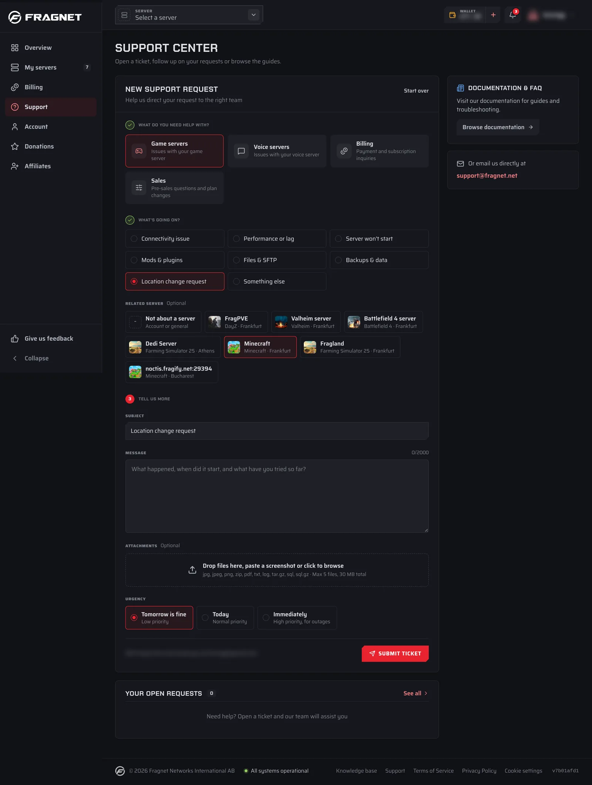

You can't change a server's location yourself in the [Fragnet dashboard](VAR::PANEL_URL). Our support team moves it for you.

## Request a location change

1. Open the [Fragnet dashboard](VAR::PANEL_URL) and select **Support** in the sidebar.
2. Under **What do you need help with?**, choose **Game servers**.
3. Under **What's going on?**, choose **Location change request**, then select the server under **Related server**.
4. In **Message**, tell us which location you'd like to move to and when suits you. Set the **Urgency** and select **Submit ticket**.

You can see your server's current location in the **Location** row of the **Server Details** card on the **Overview** tab. It updates once the move is done.

## What to expect when your server is moved

**IP address**: Your server's IP address changes when it moves to another location, because each of our machines has its own addresses. Players who join by IP need the new address, which you'll find under **Address** in the **Server Details** card. If your players join with a free [subdomain](../control-panel/subdomains.md) instead, they can keep using the same name. Mention it in your ticket so we can check that it points to the new address after the move.

**Files**: Your server's files are moved with it and stay as they are. We still recommend [creating a backup](../control-panel/backups/creating-a-backup.md) before the move.

**Downtime**: Your server is offline while it's being moved. How long that takes depends mostly on the size of your server's files: large servers take longer. Our team keeps you updated in the ticket.
