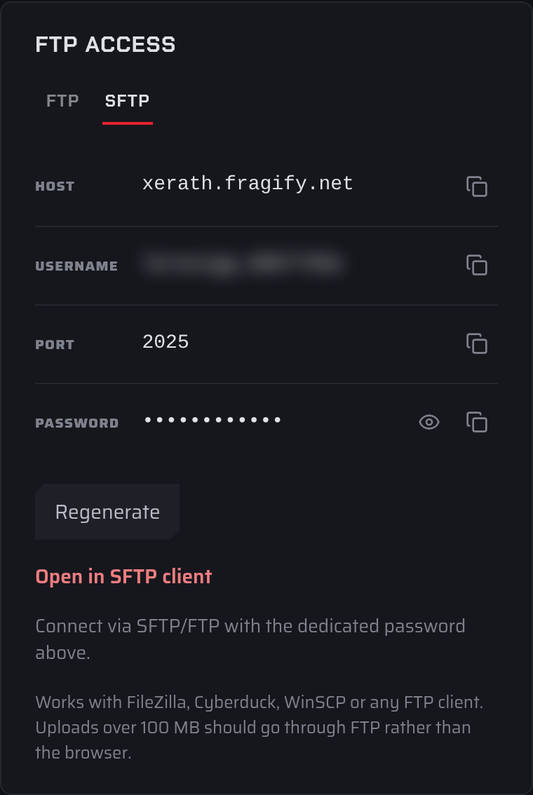
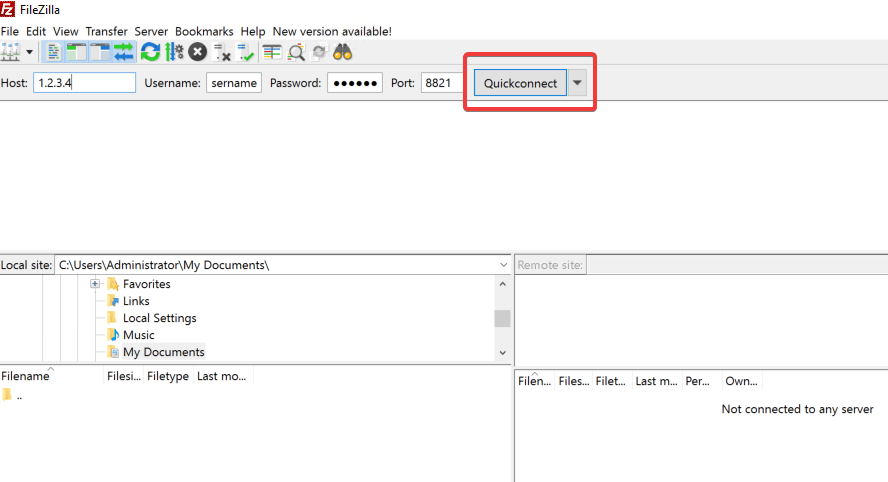

You can manage most of your server's files in the browser from the **Files** tab of the [Fragnet dashboard](VAR::PANEL_URL). See [Files](../control-panel/file-manager.md) for what you can do there.

An FTP or SFTP client is better for bigger jobs:

- uploading large files (uploads over 100 MB should go through FTP rather than the browser)
- uploading or downloading many files at once
- moving files and folders between folders, which the **Files** tab can't do

Some games limit which files you can access, at the request of their developers.

## Find your connection details

1. Open the [Fragnet dashboard](VAR::PANEL_URL), go to **My servers** and select your server.
2. Open the **Files** tab and find the **FTP access** card. The same details are under **Configuration** → **General** → **File access**. On Farming Simulator servers, they're in the **File access** card on the **Overview** tab.
3. Choose **FTP** or **SFTP** at the top of the card. The port changes with your choice.
4. Copy the **Host**, **Username**, **Port** and **Password** with the copy button next to each. To see the password, select the eye icon (**Reveal**).

:::info
The password is a dedicated SFTP/FTP password for this server. It is **not** your Fragnet account password. Only the account owner and team members with the **Admin** or **Service manager** role can see it.
:::

We recommend SFTP, which encrypts the connection, if your client supports it.

### Change the password

Select **Regenerate**, then **Regenerate password** to confirm. The new password replaces the old one for everyone with access to the server, and connections that use the old password stop working.

## Choose an FTP client

You can use any FTP or SFTP client you like. These are popular free options:

| Software | Windows | Mac | Linux |
|----------|---------|-----|-------|
| [FileZilla](https://filezilla-project.org/) | ✔️ | ✔️ | ✔️ |
| [Cyberduck](https://cyberduck.io/) | ✔️ | ✔️ | ❌ |
| [WinSCP](https://winscp.net/eng/download.php) | ✔️ | ❌ | ❌ |

If your computer has an FTP client set up to open links, you can also select **Open in FTP client** or **Open in SFTP client** in the card. It fills in the host, port and username for you; you enter the password.

## Connect with FileZilla

1. Download and install FileZilla Client from [filezilla-project.org](https://filezilla-project.org/download.php?type=client).
2. In the bar at the top of FileZilla, fill in:
   - **Host**: the host from the dashboard. For SFTP, type `sftp://` in front of the host. Don't add the port to the host.
   - **Username**: the username from the dashboard.
   - **Password**: the SFTP/FTP password from the dashboard.
   - **Port**: the port shown for the option you chose (FTP or SFTP).
3. Select **Quickconnect**.

When you're connected, your server's files appear on the right (**Remote site**) and your computer's files on the left (**Local site**).

## Upload and download files

- To upload, drag files or folders from the left side to a folder on the right.
- To download, drag them from the right side to the left.
- You can also right-click a file or folder and select **Upload** or **Download**.
- To move a file on the server, drag it into another folder on the right side.

:::tip
Most games only read their configuration files when they start. Restart your server after uploading or changing config files.
:::

If you can't connect, check that you copied the port for the option you chose, and that you're using the SFTP/FTP password from the dashboard. If it still doesn't work, [open a support ticket](VAR::SUPPORT_URL) and choose **Files & SFTP**.
