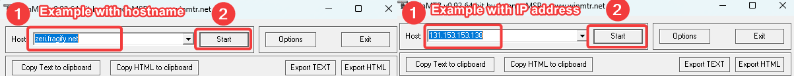
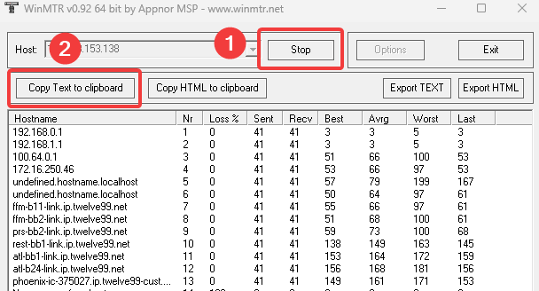

# How to perform a WinMTR
## Troubleshooting connection/latency issues

To troubleshoot connection problems with your server, our support team often needs to see how data travels from your computer to our network.
A traceroute shows part of this, but WinMTR results give us everything we need, plus some extra troubleshooting points. Here is how to get them:

**For an accurate diagnosis, please send us WinMTR results instead of traceroute results!**

### Performing a WinMTR

1. Download WinMTR from here: [https://sourceforge.net/projects/winmtr/files/WinMTR-v092.zip/download](https://sourceforge.net/projects/winmtr/files/WinMTR-v092.zip/download), unzip it and open WinMTR.
2. In the **Host** field, enter your server's IP address or hostname without the port at the end, then select **Start**. You'll find your server's address under **Address** in the **Server Details** card on the **Overview** tab of the [Fragnet dashboard](VAR::PANEL_URL).

3. Leave the scan running for a while (at least 10 minutes), then select **Stop**.
4. Select **Export TEXT** and save the results as a `.txt` file. You can also select **Copy Text to clipboard** and paste the results straight into your ticket message.

5. Find your own IP address on [https://ipinfo.io/](https://ipinfo.io/) and copy it.

### Sending the results to our support team

Attach the WinMTR file to your support ticket and include your IP address in the message:

- **New ticket**: [open a support ticket](VAR::SUPPORT_URL), choose **Game servers** and **Connectivity issue**, and select your server under **Related server**. Under **Attachments**, select **Attach files** (or drag the file onto the box), then select **Submit ticket**.
- **Existing ticket**: open the ticket from **Support** in the dashboard and attach the file to your reply.

You can attach up to 5 files per message, 30 MB in total. Allowed file types are jpg, jpeg, png, zip, pdf, txt, log, tar.gz, sql and sql.gz, so save the results with **Export TEXT** rather than **Export HTML**.

<!-- screenshot: support-ticket-winmtr-attachment.png | Support center, New support request step 3 "Tell us more": Game servers / Connectivity issue selected, Subject and Message filled in, and a WinMTR .txt file shown under Attachments with the "1 of 5" file count, above the Submit ticket button -->

### Performing a traceroute if you are unable to perform a WinMTR

1. On Windows, open the Start menu, search for Command Prompt (or cmd) and open it.
2. Type `tracert` followed by your server's IP address without the port at the end, for example `tracert 192.0.2.10`, and press Enter.
3. Wait until the trace is finished.
4. Select the output with your mouse and copy it with Ctrl+C, then paste it into your support ticket reply. To save it to a file instead, run `tracert 192.0.2.10 > tracert.txt` and attach `tracert.txt` to your ticket.
5. Include your computer's IP address, which you can check on [https://ipinfo.io/](https://ipinfo.io/).
