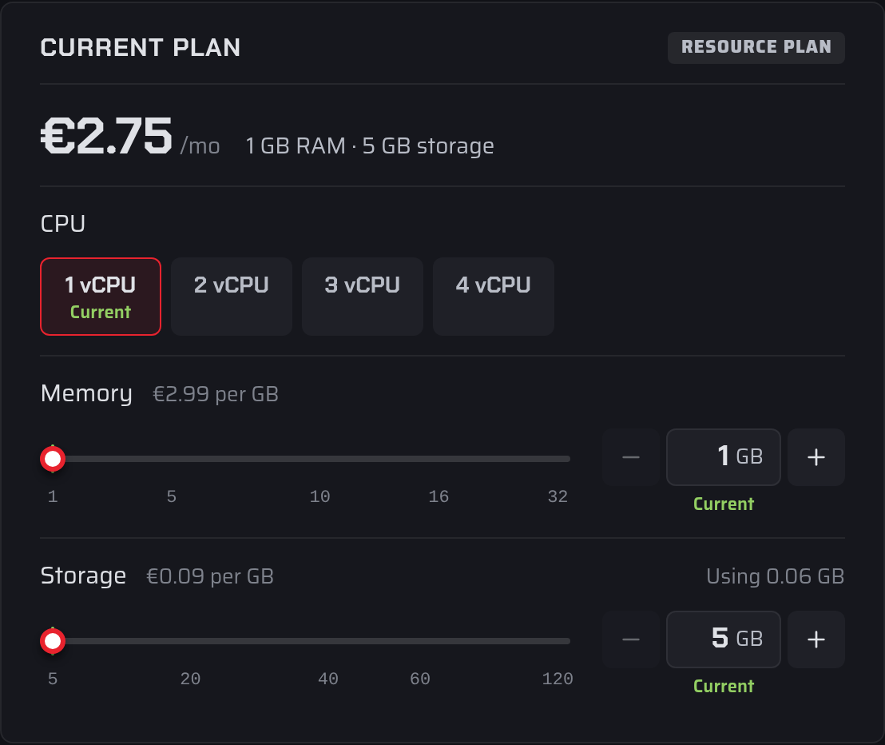

# How do I Upgrade/Downgrade my server

You can change your server's plan, for example its memory, storage, CPU or player slots, from the [Fragnet dashboard](VAR::PANEL_URL).

- **Upgrades** apply straight away. You pay the difference for the rest of the current billing period.
- **Downgrades** are scheduled for the end of your current billing period. Nothing is charged, and you keep your current plan until then.

## Change your plan

1. Open the [Fragnet dashboard](VAR::PANEL_URL), go to **My servers** and select your server.
2. Open the **Billing** tab. You can also select **Change plan** next to **Plan** in the **Server Details** card on the **Overview** tab.
3. In the **Current plan** card, adjust the options you want to change, such as **Memory**, **Storage**, **CPU** or **Player slots**. Each option shows the price difference per month, and your current choice is marked.
4. Check the summary under the options. It shows the new price, when the change **Takes effect** and what you pay today.
5. Confirm the change:
   - For an upgrade, select the **Upgrade** button that shows today's amount, then pay the upgrade invoice with your wallet or a payment method.
   - For a downgrade, select **Schedule downgrade**.
   - For a change that costs the same, select **Schedule change**.

Select **Reset** to go back to your current plan without changing anything.

### After an upgrade

When the upgrade invoice is paid, the card shows **Plan upgraded** and the new resources apply within a few minutes. If the server is running, it restarts to apply the new plan. From your next renewal, the server renews at the new price.

If you leave the upgrade invoice unpaid, the card offers **Pay invoice** or **Cancel upgrade**. You can't make another change until you pay or cancel it.

### After a downgrade

The card shows the date of the change and the new plan. You keep your current plan until then, and the server restarts briefly on that date to apply the new one. To undo it, select **Keep current plan**.

If the renewal invoice for the next period was already created, it is cancelled and issued again at the new price.

:::warning
Before you downgrade, check that your server still fits the smaller plan. For example, the dashboard warns you if more players are online than the new number of slots.
:::

## When you can't change your plan

The **Billing** tab tells you why a change isn't possible. Common reasons:

- **A cancellation is pending.** Withdraw the cancellation request first.
- **The renewal invoice is overdue.** Pay the open invoice first.
- **A downgrade or billing cycle change is already scheduled.** Upgrades apply straight away, so they can't wait behind a scheduled change. Keep your current plan and billing cycle first, then upgrade.
- **The server renews through an old PayPal subscription.** Plan and billing cycle changes for these servers are made by our support team.
- **The server is managed by our support team.** Some servers, including those not yet moved to our new platform, can only be changed by our team. You can also ask us to move the server to the new platform; this changes its IP address.

In these cases, [open a support ticket](VAR::SUPPORT_URL) in the **Sales** category and choose **Plan upgrade or downgrade**.

Only the account owner and team members with the **Admin** or **Billing** role can change a server's plan.

To change how often you pay instead, see [For how long do I have to sign up?](../billing/subscription-period.md).
