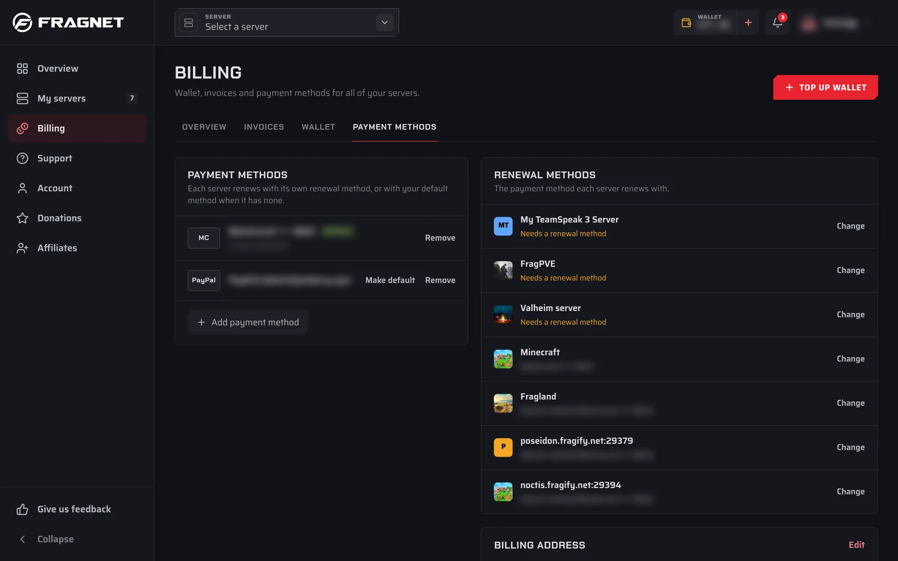

# What forms of payment does Fragnet accept?

All online payments in the [Fragnet dashboard](VAR::PANEL_URL) are processed by Stripe. You don't need a Stripe or PayPal account to pay by card.

## Payment methods

The payment form shows the methods available for your country and the currency your account is billed in. These include:

- **Credit and debit cards**
- **PayPal**
- Other local methods where available, such as Klarna, Revolut Pay, iDEAL, Bancontact, Google Pay and Amazon Pay
- **Pix**, for accounts billed in Brazilian reais (BRL)

You can also pay with your **wallet balance**. Add money to your wallet with **Top up wallet** on the **Billing** page, or **Add funds** from the wallet button in the top bar. Your wallet can pay new orders and invoices, either in full or together with another method. Renewals use your wallet balance first: if it covers a renewal invoice, the renewal is paid from your wallet. For new orders and other invoices, you choose it when you pay.

Very small amounts can be below the minimum for a card payment. In that case the dashboard asks you to pay from your wallet and offers to top it up first.

:::info
Bank transfers and other manual payment methods aren't offered in the dashboard. If you can't pay online, [open a support ticket](VAR::SUPPORT_URL) in the **Billing** category before you send any money.
:::

## Methods you can save for automatic renewals

A saved payment method renews your servers automatically (see [How do I renew my services?](./renew-service.md)). You can save:

- credit and debit cards
- PayPal
- Klarna, Revolut Pay and SEPA Direct Debit, where they are offered

For accounts billed in BRL, you can save a card. A server can also renew with **Pix Automático**, which you set up for each server from its **Billing** tab with **Renew automatically with Pix**.

When you order a server with a method that can be saved, it is saved for that server's renewals. Paying an invoice online does not save the method.

## Save a payment method

1. Open the [Fragnet dashboard](VAR::PANEL_URL), go to **Billing** and open the **Payment methods** tab. You can also select **Payment methods** in the user menu at the top right.
2. Select **Add payment method**.
3. Choose a method and enter its details. Some methods, such as PayPal, ask you to approve the payment method on their own page.
4. Select **Save payment method**.

Adding a payment method does not charge you. The first method you save becomes your default.

## Manage your saved methods

On the **Payment methods** tab:

- **Make default** sets the method used by servers that don't have their own renewal method.
- **Remove** deletes a method after you confirm **Remove this payment method?**. Servers that renewed with it fall back to your default method.
- The **Renewal methods** card lists each server and the method it renews with. Select **Change** next to a server, pick a method and select **Use this method**, or select **Add a new payment method**.

:::tip
Only the account owner and team members with the **Admin** or **Billing** role can see and change payment methods.
:::
