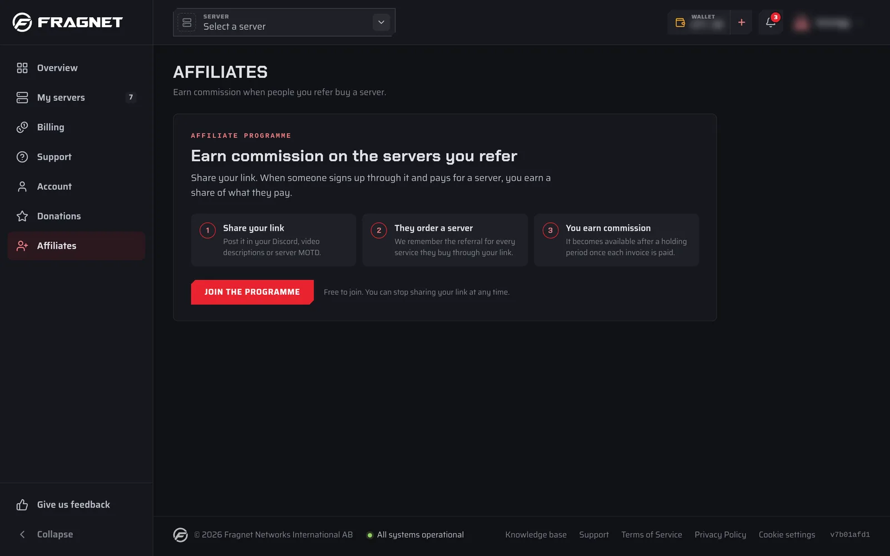

# Affiliates: Earn money by advertising us!

With the Fragnet affiliate programme you share a personal referral link. When someone signs up through your link and pays for a server, you earn a commission on what they pay. The programme is free to join.

## Join the programme

1. Open the [Fragnet dashboard](VAR::PANEL_URL) and select **Affiliates** in the sidebar. If you don't have an account yet, create one first.
2. Select **Join the programme**.

Only the account owner and team members with the **Admin** or **Billing** role can open the **Affiliates** page.

## Share your referral link

After you join, the **Affiliates** page shows **Your referral link**, for example `https://fragnet.net/ref/yourname`. Select **Copy** and share it on your website, Discord, video descriptions or in your server's message of the day.

To send people to a specific page instead of the home page, see [Affiliates: Linking to a specific page](./affiliate-custom-url.md).

Under your link you see the terms that apply to your account: the commission rate, whether you earn on every renewal or only on the first invoice, how long commissions are held, and the minimum payout.

:::info
A visit only counts for you if the visitor allows **Marketing** cookies in the cookie banner. The referral is then remembered for 90 days. Your own orders never earn commission.
:::

## How commissions work

- When a referred customer pays an invoice, a commission for that payment appears under **Commissions** with the status **Pending**.
- A commission becomes **Available** once the holding period has passed, as long as the payment was not refunded or disputed and the server stayed active the whole time (no suspension, cancellation request or termination). Otherwise it is **Reversed**.
- With recurring commission, every renewal invoice earns its own commission with its own holding period.
- **Unpaid orders** lists referred orders whose first invoice hasn't been paid yet. They earn nothing until they're paid.

The page also shows your **Pending** and **Withdrawn** totals, the number of **Visitors** to your link and your **Referrals**, plus an **Activity** chart of visits, orders and earnings.

## Withdraw your earnings

Your affiliate balance is separate from your wallet. Once your **Available balance** reaches the minimum payout:

1. Select **Withdraw**.
2. Under **Send it to**, choose:
   - **Fragnet wallet credit** (the default): the amount is added to your wallet once our team approves it. You can use it for renewals and upgrades.
   - **Payout**: only if you have agreed a cash payout with our team. Add your **Payout details** (for example your PayPal email, or IBAN and account holder name). We open a **Billing** support ticket to arrange it.
3. Select the **Withdraw** button that shows the amount to send the request.

A withdrawal always takes your whole available balance, and you can only have one request waiting at a time. Your requests are listed under **Withdrawals**.

:::warning
Cash payouts are only made to a registered company that can invoice Fragnet, and the payout method must be agreed with our team first. [Open a support ticket](VAR::SUPPORT_URL) in the **Billing** category if you'd like to arrange one.
:::
