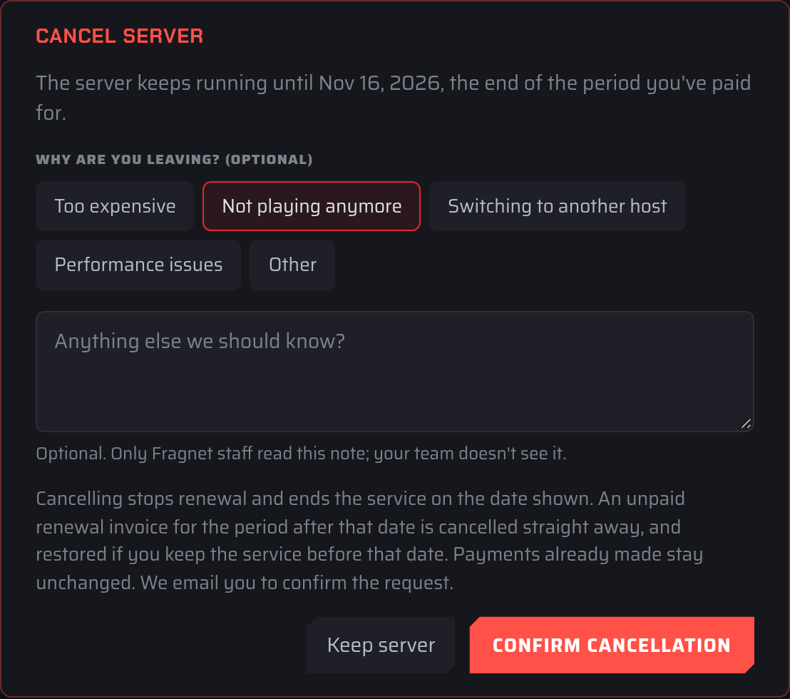

# How do I cancel my service?

:::tip
If something isn't working with your server, [contact our support team](VAR::SUPPORT_URL) before you cancel. We're happy to help.
:::

## Request a cancellation

1. Open the [Fragnet dashboard](VAR::PANEL_URL), go to **My servers** and select your server.
2. Open the **Billing** tab. You can also select **Cancel server** in the **More actions** menu (⋯) at the top of the server page.
3. In the **Cancel server** card, select **Request cancellation**. The card shows the date your server keeps running until.
4. Optionally, pick a reason under **Why are you leaving? (optional)** and write a note in **Anything else we should know?**. Only Fragnet staff read the note.
5. Select **Confirm cancellation**. Select **Keep server** if you changed your mind.

We email you to confirm the request. The card then shows **Cancellation requested. The server stops on** followed by the date.

Only the account owner and team members with the **Admin** or **Billing** role can cancel a server.

## What happens after you cancel

- Your server keeps running until the end of the period you've already paid for. It is removed on that date.
- Automatic renewal is off while the cancellation is pending, so your saved payment method isn't charged for another period.
- An unpaid renewal invoice for the period after that date is cancelled straight away.
- Payments you've already made stay as they are.
- While the cancellation is pending, you can't change the server's plan or billing cycle.

If the server's paid period has already ended (for example, its renewal invoice is overdue), it is removed within a day of cancelling and its unpaid invoice is cancelled.

:::warning
When the server is removed, its files and backups are deleted. Download anything you want to keep before the date shown.
:::

## Change your mind

Until the server stops, you can keep it: open the **Billing** tab and select **Withdraw request** in the **Cancel server** card. Any renewal invoice that was cancelled is restored, and the **Auto-renew** switch in the **Renewal** card goes back to how it was before you cancelled.

<!-- screenshot: billing-tab-cancellation-pending.png | Server page, Billing tab: the Cancel server card after a cancellation was requested, showing "Cancellation requested. The server stops on [date]." and the "Withdraw request" button; the Renewal card shows "Ends" with the same date -->

## If you pay with an old PayPal subscription

Some servers are still paid by a PayPal subscription set up in our old billing system. If yours is, the **Renewal** card on the **Billing** tab says so. PayPal keeps taking these payments until you cancel the subscription in your PayPal account, so cancel it there as well. See [You charged me even after I cancelled?](./you-charged-me-even-after-I-cancelled.md).

## Refunds

Cancelling a server does not refund you automatically. If you're not satisfied within the first 3 days after your purchase, you can request a full refund. [Open a support ticket](VAR::SUPPORT_URL) in the **Billing** category and choose **Refund request**.

If the **Cancel server** card says the server has a partly paid invoice, it can't be cancelled from the dashboard. Open a **Billing** support ticket and we'll cancel it for you.
