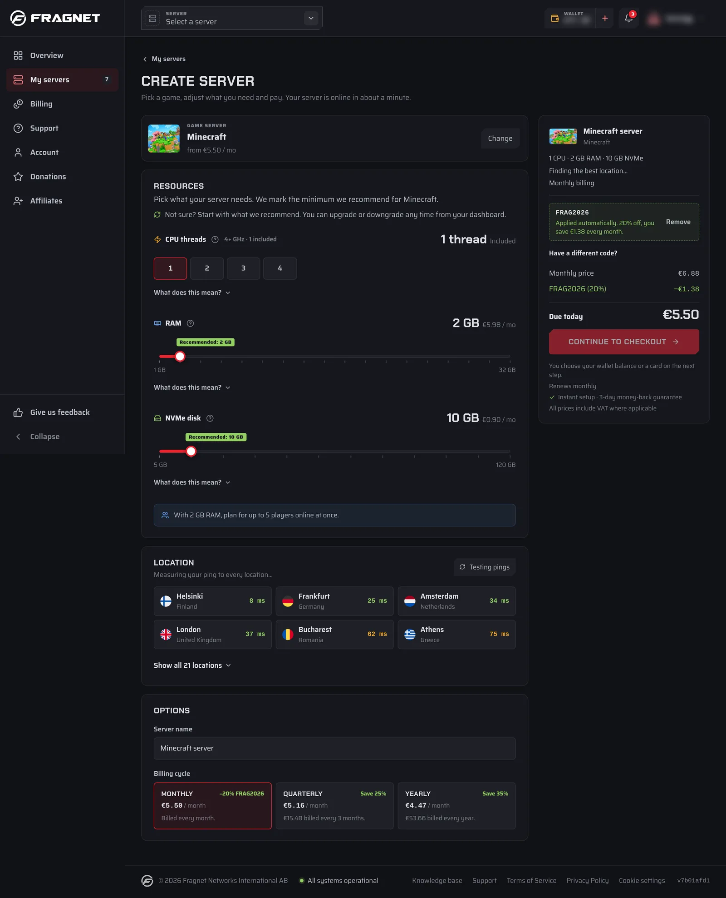

# How do I order additional services?

You can order another game or voice server at any time from the [Fragnet dashboard](VAR::PANEL_URL). Every server you order while signed in is added to the same account, next to your other servers.

## Order a server from the dashboard

1. Open the [Fragnet dashboard](VAR::PANEL_URL), go to **My servers** and select **Create server**.
2. Under **Server type**, choose **Game server** or **Voice server**, then pick the game or voice server you want.
3. Adjust what you need: the plan options, the location (the dashboard measures your ping to each one), the **Server name** and the **Billing cycle**. To use a promo code, select **Add a promo code**.
4. Select **Continue to checkout**.
5. Choose how to pay: your wallet balance, a saved payment method, or a new payment method. See [What forms of payment does Fragnet accept?](./accepted-payment-methods.md).
6. Accept the Terms of Service and Privacy Policy, then select the **Pay** button.

Your server starts setting up right after the payment is confirmed. It usually takes a few minutes. When it's ready, it appears under **My servers** and in the server picker in the top bar.

You can also order from the game pages on the [Fragnet website](https://fragnet.net) while you're signed in. The checkout shows which account you're signed in as, and the server is added to that account.

:::info
If you're a member of someone else's team, the server is added to the account you're currently using. Select **Switch account** in the user menu to change it. Only the account owner and team members with the **Admin** or **Billing** role can order servers.
:::

## Renewals for the new server

New servers renew automatically with the payment method you used, if it can be saved for renewals. Each server has its own renewal date, billing cycle and **Auto-renew** switch on its **Billing** tab. See [How do I renew my services?](./renew-service.md).

## Can't find what you need?

If a game isn't listed, or the page says it can't be ordered online right now, [open a support ticket](VAR::SUPPORT_URL) in the **Sales** category. We may be able to set it up for you.
