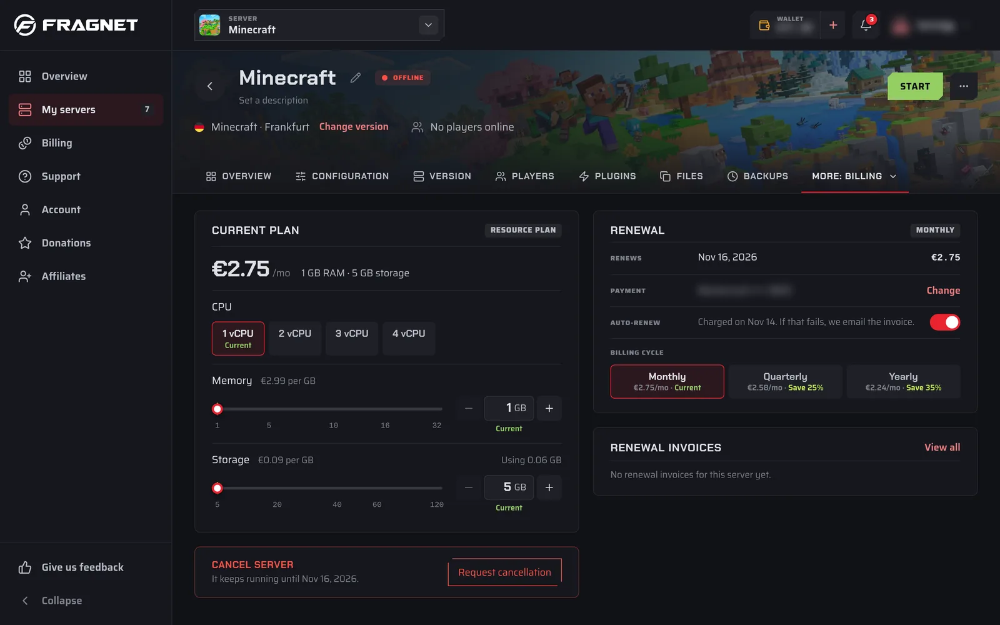

# How do I renew my services?

Servers are paid in advance, one billing period at a time. Each period is renewed with a renewal invoice. By default your server renews automatically, so you don't need to do anything. If your wallet balance covers a renewal, it's paid from your wallet. Otherwise we charge your saved payment method.

## Check a server's renewal

1. Open the [Fragnet dashboard](VAR::PANEL_URL), go to **My servers** and select your server.
2. Open the **Billing** tab. You can also select **Manage billing** in the **More actions** menu (⋯).

The **Renewal** card shows:

- **Renews**: the next renewal date and the amount.
- **Payment**: the payment method this server renews with. Select **Change** to pick another one.
- **Auto-renew**: the automatic renewal switch, with the date we'll charge you or email you the invoice.
- **Billing cycle**: how often the server renews. See [For how long do I have to sign up?](./subscription-period.md).

The **Renewal invoices** card lists the server's latest renewal invoices. Select **View all** to see all your invoices.

For an overview of all your servers, open **Billing** in the sidebar. The **Overview** tab lists your servers under **Subscriptions** with their next renewal, and **Manage plan** takes you to a server's **Billing** tab.

## How a renewal works

1. About 7 days before the due date, we create the renewal invoice and email it to you.
2. If your wallet balance covers the invoice, we use it to pay the renewal.
3. Otherwise, with **Auto-renew** on, we charge your saved payment method from 3 days before the due date (a little earlier for SEPA Direct Debit and Pix). If the payment fails, we email you and try again on the following days.
4. With **Auto-renew** off, or if you have no saved payment method, you pay the invoice yourself before the due date.
5. Once the invoice is paid, the server's next due date moves forward by one billing period.

The exact dates for your server are shown next to **Auto-renew** on the **Billing** tab.

## If a renewal isn't paid

- We send reminders 2 days before the due date and 1, 2 and 7 days after it.
- If the invoice is still unpaid the day after the due date, the server is suspended. Your files are kept.
- From 14 days after the due date, a suspended server can be terminated. Its files and backups are then deleted and can't be recovered.

To get a suspended server back, pay its renewal invoice. The server is renewed and reactivated automatically.

If you don't want to keep a server, cancel it instead of leaving the invoice unpaid. See [How do I cancel my service?](./cancel-service.md).

## Turn automatic renewal on or off

Use the **Auto-renew** switch in the **Renewal** card on the server's **Billing** tab. New servers have it switched on.

Turning automatic renewal off does **not** cancel your server. We email you each renewal invoice and you pay it yourself. If you don't pay, the server is suspended as described above.

To turn automatic renewal on, you need a saved payment method that can renew servers. If you don't have one, the card shows **Add a card to be charged automatically**. See [What forms of payment does Fragnet accept?](./accepted-payment-methods.md).

Only the account owner and team members with the **Admin** or **Billing** role can change renewal settings.

## Pay a renewal invoice yourself

1. Open the invoice from **Renewal invoices** on the server's **Billing** tab, or from **Billing** → **Invoices**. Unpaid invoices show **Upcoming** or **Overdue**.
2. In the **Pay now** section, pay with one or both of:
   - **Pay with Wallet**: enter the **Amount of credit to apply** and select the button that pays it from your wallet (for example **Pay €10.00 from wallet**).
   - **Pay online**: choose a saved payment method or enter a new one, then select the **Pay** button. Paying this way does not save the method or change your automatic renewals.

<!-- screenshot: invoice-pay-now.png | Invoice page for an unpaid renewal invoice: the invoice on the left and the "Pay now" section on the right with the "Pay with Wallet" box (available balance, Amount of credit to apply, Pay … from wallet button) and the "Pay online" section with a saved card selected -->

### Using your wallet

Renewals use your wallet balance first. If it covers a renewal invoice, the invoice is paid from your wallet without you doing anything. If it only covers part, you can still apply it yourself when you pay the invoice, as described above. To add money, select **Top up wallet** on the **Billing** page or **Add funds** from the wallet button in the top bar. [Donations](../control-panel/donations/index.md) and affiliate earnings you withdraw as wallet credit also go to your wallet.

## Old PayPal subscriptions

Some servers are still paid by a PayPal subscription from our old billing system. For these, the **Auto-renew** row says the server is paid by your PayPal subscription, and we don't charge a card for it. To pay by card instead, cancel the subscription in your PayPal account first, then turn **Auto-renew** on. New PayPal subscriptions can't be set up. To renew with PayPal, save PayPal as a payment method instead.

If you need help with a renewal, [open a support ticket](VAR::SUPPORT_URL) in the **Billing** category.
