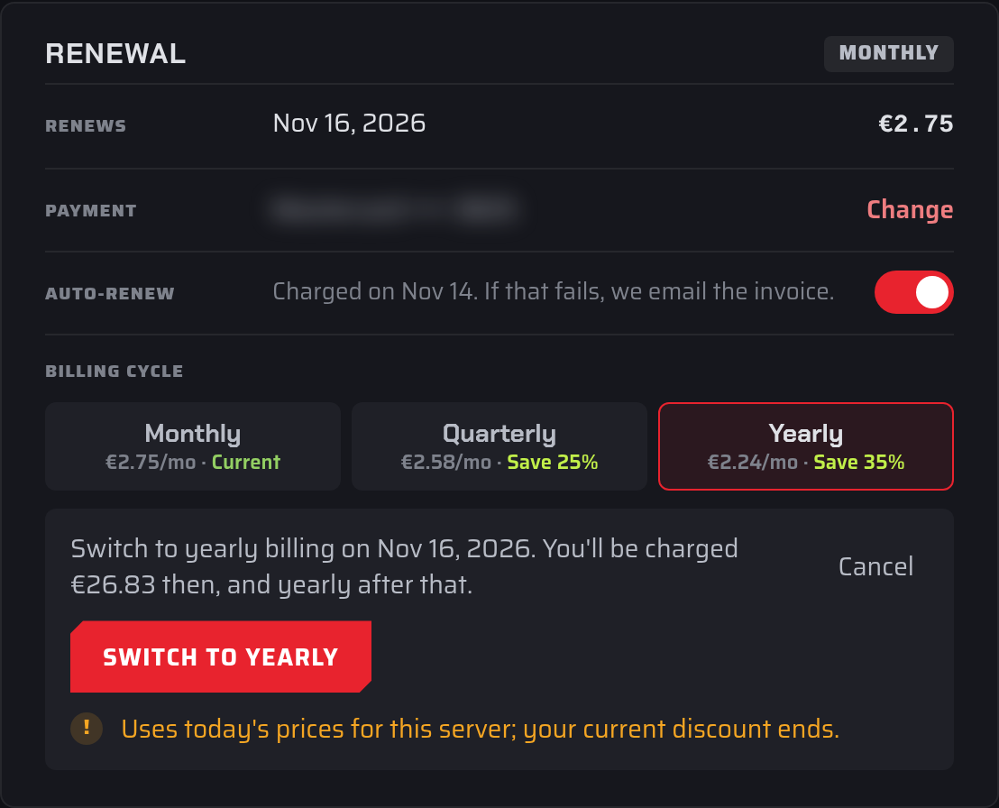

# For how long do I have to sign up?

The shortest billing cycle is one month. You can also pay for several months at a time, which costs less per month.

## Billing cycles

When you order a server, choose a **Billing cycle**: **Monthly**, **Quarterly** (every 3 months) or **Yearly**. Longer cycles show their discount as **Save** followed by a percentage. The order summary shows what you pay today and what each renewal costs.

Some servers can also switch to a **Semi-annual** cycle (every 6 months) later. The cycles you can choose, and their prices, are shown on the server's **Billing** tab.

:::info
Some promo codes only work with monthly billing. If you choose a longer cycle, the order page tells you that the code isn't combined with the cycle discount.
:::

Your server renews automatically at the end of each billing period. See [How do I renew my services?](./renew-service.md).

## Change your billing cycle

1. Open the [Fragnet dashboard](VAR::PANEL_URL), go to **My servers** and select your server.
2. Open the **Billing** tab. In the **Renewal** card, find **Billing cycle**. Each option shows its price per month, and **Current** marks the cycle you're on now.
3. Select the cycle you want. A summary shows the date of the switch and what you'll be charged then.
4. Select the **Switch to** button to confirm, or **Cancel**.

The new cycle starts at your next renewal: **Saved. The new terms start at the next renewal.** Until then, the card shows the scheduled switch. To undo it, select the **Keep** button for your current cycle.

Good to know:

- If you currently have a discount on the server, switching cycles uses today's prices and your current discount ends. The summary warns you before you confirm.
- If the renewal invoice for the next period was already created, it is cancelled and issued again at the new price.
- You can't change the billing cycle while a cancellation is pending or while the server's renewal invoice is overdue.
- Servers still paid by an old PayPal subscription can't change their billing cycle in the dashboard. [Open a support ticket](VAR::SUPPORT_URL) in the **Billing** category instead.
