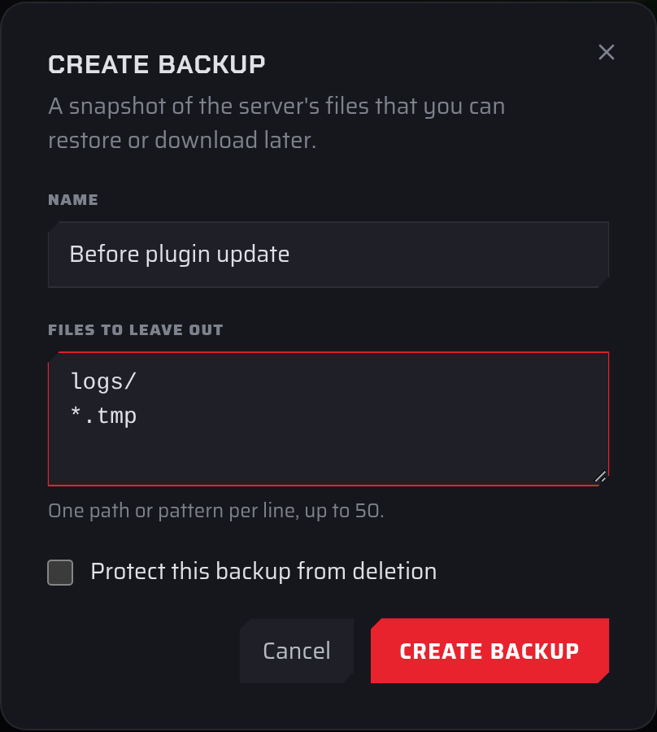

## Manual backup

1. Open the [Fragnet dashboard](VAR::PANEL_URL), go to **My servers** and select your server.
2. Open the **Backups** tab and select **Create backup**.
3. Fill in the dialog. Every field is optional:
   - **Name**: up to 191 characters, for example "Before plugin update". If you leave it empty, a name is chosen for you.
   - **Files to leave out**: files and folders to skip, one path or pattern per line, up to 50 lines. For example, `logs/` skips the logs folder and `*.tmp` skips every file ending in `.tmp`. Paths can't contain `..`.
   - **Protect this backup from deletion**: tick this to [protect](./locking-a-backup.md) the backup straight away.
4. Select **Create backup**.

The backup appears at the top of the list with the **In progress** tag. When it's finished, the tag goes away and the row shows the backup's size. The server can keep running while the backup is made.

:::tip
Some games keep recent changes in memory and save them every few minutes. To make sure the backup has the latest world, save the world first (on Minecraft, for example, run `save-all` in the console) or stop the server before you back up.
:::

If **Create backup** is greyed out, you've reached your plan's backup limit. Delete a backup you no longer need first. See [Backup limits](./index.md#backup-limits).

## Scheduled backup

To back up on a timer, either:

- turn on **Scheduled backups** on the **Backups** tab for a daily backup (see [Scheduled backups](./index.md#scheduled-backups)), or
- add a **Backup** task to a schedule for any other timing (see [Creating a schedule](../schedules/creating-a-schedule.md#daily-backup)).

Scheduled backups show the **Automatic** tag. When you're at your plan's limit, a scheduled backup replaces the oldest backup that isn't protected.
