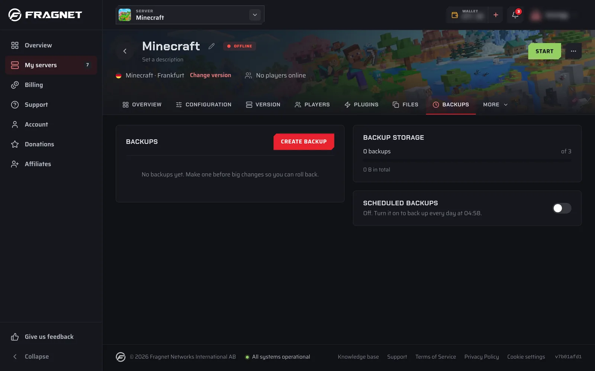

A backup is a snapshot of your server's files that you can restore or download later. Make one before big changes, such as installing mods, changing versions or wiping, so you can roll back if something goes wrong.

## Where to find backups

1. Open the [Fragnet dashboard](VAR::PANEL_URL), go to **My servers** and select your server.
2. Open the **Backups** tab. If you don't see it in the row of tabs, look under **More**.

:::info
You need the Owner, Admin or Service manager role on the account to use backups. TeamSpeak servers have a **Snapshots** tab instead, which works differently.
:::

## What a backup includes

A backup contains your server's files: worlds and saves, configuration files, mods and plugins. Nothing is left out unless you list it under **Files to leave out** when you [create the backup](./creating-a-backup.md).

Backups contain files only. Settings you change in the dashboard rather than in a file, such as the startup settings under **Configuration** → **General**, aren't part of a backup and don't change when you restore one.

## The Backups tab

The **Backups** card lists your backups, newest first. Each row shows the backup's name (or **Unnamed backup**), its size and when it was made, and any of these tags:

| Tag | Meaning |
| --- | ------- |
| **In progress** | The backup is still being made. |
| **Failed** | The backup didn't finish. You can delete it. |
| **Protected** | The backup can't be deleted or replaced until you remove the protection. |
| **Automatic** | A schedule made this backup. |

Open a backup's ⋯ menu for **Restore**, **Download**, **Protect from deletion** or **Remove protection**, and **Delete**. Some servers also offer **Rename**. **Restore** and **Download** only appear once a backup has finished.

Next to the list, the **Backup storage** card shows how many backups you have out of your plan's limit, for example "3 backups of 5", and their total size.

## Backup limits

Your plan sets how many backups you can keep. Backups made by schedules, and by tools that offer to make a backup first (such as a Rust wipe or a Minecraft version change), count toward the same limit.

When you reach it, **Create backup** is greyed out and the tab shows "You've used all 5 backups in your plan. Delete one to make another." (with your plan's number). If your plan has no backups, the tab shows "Your plan doesn't include backups."

There's no daily limit on backups. If you start several within a short time, though, the dashboard may answer "Too many requests. Wait a moment and try again." Wait a few minutes, then try again. A scheduled backup that hits this shows "Too many backups in a short time" under **Last run**.

If you need room for more backups, [open a support ticket](VAR::SUPPORT_URL).

## Scheduled backups

The **Scheduled backups** card backs your server up every day without you having to set up a schedule.

1. On the **Backups** tab, find the **Scheduled backups** card. While it's off, it tells you when it would run, for example "Off. Turn it on to back up every day at 03:42."
2. Turn on the switch.

This creates a schedule named **Daily backup**, which you'll find with your other [schedules](../schedules/index.md). The backup time is between 03:00 and 04:59 in your time zone and differs from server to server, so not every server backs up at once. You can change it by [editing the schedule](../schedules/editing-a-schedule.md).

Once your backups reach your plan's limit, each new automatic backup replaces the oldest backup that isn't protected, including backups you made yourself. [Protect](./locking-a-backup.md) any backup you want to keep.

Turning the switch off pauses the **Daily backup** schedule. Turning it on again resumes it.

If more than one of your schedules makes backups, the card shows how many there are instead of a switch, with a **Schedules** button to manage them.

The card only appears when your plan includes backups and your server has schedules.

## Backups in schedules

For more control, add a **Backup** task to any schedule. For example, back up every 6 hours, or back up before a weekly restart. See [Creating a schedule](../schedules/creating-a-schedule.md#daily-backup) and [Schedule tasks](../schedules/creating-a-task.md#backup).

:::tip Farming Simulator
Farming Simulator servers also have backups of individual savegames on the **Savegames** tab. Those are separate from the backups on this page.
:::

## In this section

- [Creating a backup](./creating-a-backup.md)
- [Downloading a backup](./downloading-a-backup.md)
- [Protecting a backup](./locking-a-backup.md)
- [Restoring a backup](./restoring-a-backup.md)
- [Deleting a backup](./deleting-a-backup.md)
