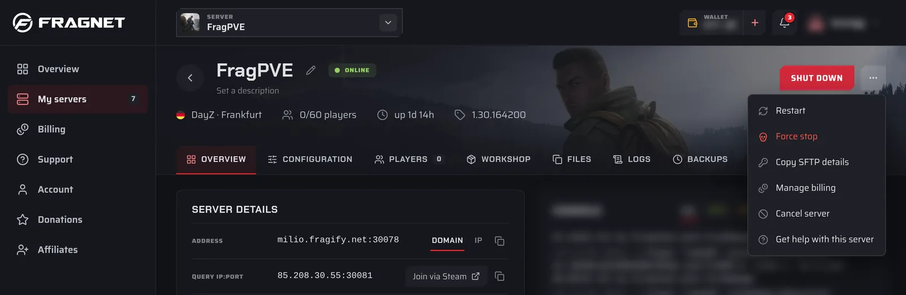
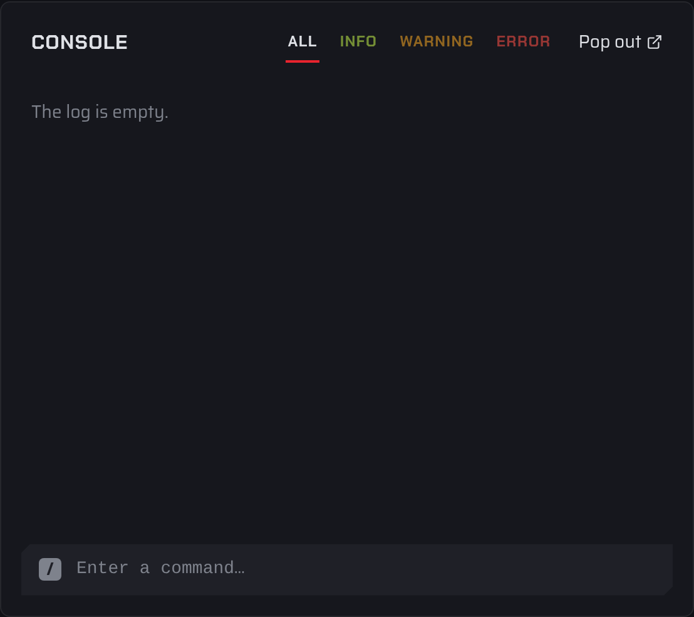

# Basic Controls

This page covers the everyday controls on a server's page: power, the console, the **Server Details** card, usage and renaming. To get there, open the [Fragnet dashboard](VAR::PANEL_URL), go to **My servers** and select your server.

:::info
Power, the console and renaming are only available to the Owner, Admin and Service manager roles. Other roles can view the server but not change it. See [Team access](./team-access.md).
:::

## Power controls

The power button sits at the top right of the server page. It changes with the server's state:

| Server state | Button |
| --- | --- |
| Offline | Green **Start** |
| Running | Red **Shut down** |
| Starting or stopping | **Starting…** or **Stopping…** (greyed out until the server gets there) |

Next to it, the ⋯ **More actions** menu has the other power actions:

- **Restart**: shuts the server down and starts it again. Shown while the server is running.
- **Force stop**: ends the server process immediately, without letting the game save.
- **Shut down**: only appears in this menu when the dashboard can't read the server's state.

### Force stop

Use **Force stop** only when a normal shutdown doesn't work, for example when the server is stuck on **Starting…** or **Stopping…**.

1. Open ⋯ **More actions** and select **Force stop**.
2. A warning appears under the header: "Force stop ends the server process immediately. Unsaved progress may be lost."
3. Select **Confirm force stop**, or **Keep running** to cancel.

The ⋯ **More actions** menu also has **Copy SFTP details**, **Manage billing**, **Cancel server** and **Get help with this server**, depending on your role.

:::note Farming Simulator
On Farming Simulator servers the buttons in the header control the game itself. See the Farming Simulator guides for details.
:::

## Console

The **Console** card on the **Overview** tab shows your server's live log and lets you send commands.

- **Filter the log**: select **All**, **Info**, **Warning** or **Error**. The **Error** filter shows how many errors there are.
- **Full view**: select the **Console** title to open the console on its own page, titled **Server log**. It has **Clear** (empties the view) and **Download** (saves the lines as a `.log` file). Select **Overview** at the top to go back.
- **Pop out**: opens the console in a separate browser window, so you can keep it open while you use other tabs.
- **Scrolling**: when you scroll up, new lines no longer push the view down. Select **Jump to latest** (or the "new lines" button) to go back to the bottom.

The console keeps the most recent 1,000 lines.

### Send a command

1. Click in the **Enter a command…** field at the bottom of the console.
2. Type the command and press **Enter**. A command is one line of up to 1,000 characters.
3. Use the **↑** and **↓** arrow keys to go through the last 30 commands you sent in that console.

If the server isn't running, you see "The server is offline. Start it to run commands." Start the server first.

### Games without a full console

- **Farming Simulator 22 and 25**: there is no console in the dashboard.
- **Valheim** and **Path of Titans**: the console shows the log, but the game doesn't read commands typed there. Admins use commands in game.
- **Battlefield 3**: the console shows server events only. Run commands from **PRoCon**.

## Server Details

The **Server Details** card on the **Overview** tab shows:

- **Address**: the address players connect to. Select the copy button next to it to copy it. When the server has both a domain and an IP address, use the **Domain** / **IP** switch (**Address type**) to choose which one you see and copy.
- **Subdomain**: your free Fragnet subdomain, if the server supports one. See [Subdomains](./subdomains.md).
- **Java version** (Minecraft): the Java runtime the server starts with. Select **Change** to pick another one. It applies the next time the server starts.
- **Location**: the city your server runs in.
- **Plan**: the price and resources of your plan. **Change plan** opens the **Billing** tab.

DayZ servers also show a **Query IP\:Port** row.

## Current usage and metrics

The **Current usage** card on the **Overview** tab shows live **CPU**, **RAM** and **Storage** use, each compared with your plan's limit, with a small graph of the last 60 seconds.

Select **View details** to open **Usage history**:

- Pick a time range from the last hour up to the last 30 days.
- Switch the charts between **Fit data** and **Plan limits**.
- See charts for **CPU**, **Memory**, **Storage**, **Network** and **Players**.
- Select **Export CSV** to download the data.

Usage is only recorded while the server is running.

## Rename the server

The dashboard name is how the server appears in your lists. Only you and your team see it. Players see the server name from your game settings, which you change on the [Configuration](./configuration.md) tab.

1. Select the pencil (**Rename server**) next to the server's name.
2. Type the new name. Use 1 to 60 characters on one line.
3. Select **Save**, or **Cancel** to keep the old name.

You can also change it under **Configuration** > **General** > **Dashboard name**.

## Add a description

A description is a short note shown under the server's name, for example "Main survival server".

1. Under the server's name, select **Set a description**. If the server already has one, select the pencil next to it (**Edit description**).
2. Type up to 120 characters.
3. Select **Save**.
