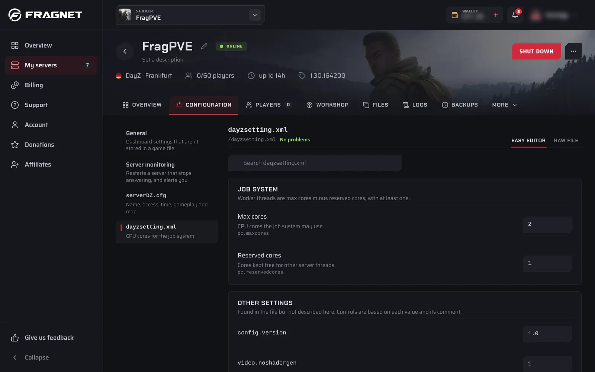

# Configuration

The **Configuration** tab holds your server's settings: the game's own config files, the startup settings, the dashboard name, the subdomain, the Java version, SFTP/FTP access and the option to wipe the server.

:::info
The **Configuration** tab is only available to the Owner, Admin and Service manager roles. See [Team access](./team-access.md).
:::

## Open the Configuration tab

1. Open the [Fragnet dashboard](VAR::PANEL_URL), go to **My servers** and select your server.
2. Select the **Configuration** tab. If you don't see it in the tab row, look under **More**.

On the left is a list:

- **General** comes first: "Dashboard settings that aren't stored in a game file." This is where the startup settings, dashboard name, subdomain, file access and Danger zone are.
- Below it is each config file of your game, with its file name and a short description. Plugin and mod configs are grouped under headings such as **Oxide configs** or **BepInEx configs**. Files you opened from the **Files** tab appear under **Opened files**.
- A file the game hasn't created yet shows "Not on your server".

On games without editable config files, the tab opens straight to the settings groups described under [General settings](#general-settings).

## Change a setting

Game guides on this site link here when they ask you to change a setting. First check where the setting lives: in one of the game's config files (listed on the left by file name), or under **General**. The guide usually names the file or group.

### In a game config file

1. Open the **Configuration** tab.
2. In the list on the left, select the config file, for example `server.properties`.
3. Find the setting. Type its name in the search box at the top (**Search** followed by the file name), or scroll through the groups.
4. Change the value. Where a setting has a default, it's shown under the setting, and **Reset** sets it back to that default.
5. A bar appears at the bottom with the number of unsaved changes and the file name. Select **Review changes** if you want to check every change first.
6. Save:
   - **Save and restart** writes the file and restarts the server, so the change applies right away. Players are disconnected while it restarts.
   - **Save** writes the file without restarting. Changes that need a restart apply the next time the server starts.
7. To throw away your changes instead, select **Discard**.

Some files can only be written while the server is stopped. Then the bar says "Stop the server to save" the file, "or use Save and restart". **Save and restart** stops the server, writes the file and starts it again.

### Under General

1. Open the **Configuration** tab and select **General** in the list.
2. Select the group the setting is in, for example **General** or **Startup**.
3. Change the value. A dot marks each changed setting.
4. A bar appears at the bottom with the number of unsaved changes. Select **Save**, or **Discard** to undo.
5. Most of these settings apply the next time the server starts. Restart the server to apply them now.

### Easy editor and raw file

Config files open in the **Easy editor**, which shows each setting as a labelled field. Switch to **Raw file** to edit the file as text. In the raw file, mistakes are listed under **Problems** with their line number, and the file can't be saved until errors are fixed.

Other options in a config file:

- **Reset file to defaults** sets every described setting back to its default, then **Reset values** to confirm. Nothing is written until you save.
- If the file doesn't exist yet, **Create with defaults** creates it.
- **Applied at start** next to a setting means its value comes from your startup settings and is written into the file every time the server starts. Change it under **General** > **Startup** instead, or your change is overwritten.
- **Set by your plan** means the value is part of what you pay for, such as the number of player slots. See [Paid options](#paid-options).

## General settings

Select **General** in the list on the left to see these groups.

### General

- **Dashboard name**: the server's name in your dashboard lists. Only you and your team see it. Players see the server name from your game settings, usually in the game's config file. Use 1 to 60 characters.
- **Subdomain**: a free address on a Fragnet domain that players can join with. See [Subdomains](./subdomains.md).
- **Java version** (Minecraft): the Java runtime the server starts with. Select **Change**, pick a version and confirm with **Switch to Java** and the version number. It applies the next time the server starts. If you see "Set by support", open a support ticket to change it.

### Startup

"The settings your server reads when it starts." Each row is one startup setting with a short description.

- Settings tagged **Set by your plan** are paid options and can't be changed here.
- Settings tagged **Fixed** can't be changed.
- Everything else you can change. After you save, it applies the next time the server starts.

On some games, such as CS2, DayZ, Rust and Path of Titans, the startup settings are arranged in the game's own groups instead of one **Startup** list.

#### Paid options

Settings that are part of your plan, such as player slots, memory or tick rate, are changed on the **Billing** tab, in the **Current plan** card. Pick the new values there. If the server is running, it restarts to apply the new plan. See [Upgrade or downgrade your server](../FAQ/upgrade-downgrade-server.md).

### Game-specific groups

Many games add their own groups here, for example the game settings on Farming Simulator or the world settings on Valheim. What you see depends on the game. The game guides explain them.

DayZ servers on Windows also have a **Server monitoring** entry in the list on the left. See [Crash alerts and activity](./crash-alerts.md#dayz-server-monitoring-alerts).

### File access

Your SFTP/FTP login details and password. See [Files and SFTP](./file-manager.md#sftp-and-ftp-access). On Farming Simulator servers this is on the **Overview** tab instead.

## Danger zone: wipe the server

The red **Danger zone** card is below the settings.

**Wipe server** deletes every file on the server, including worlds, configs and mods, then installs the game fresh. The server stops while it runs.

1. Make a [backup](./backups/index.md) first. A wipe can't be undone without one.
2. Select **Wipe server**.
3. Type the server's name exactly as shown to confirm.
4. Select **Wipe server now**.

The server is back when the fresh install finishes.

On DayZ servers the Danger zone also has **Reset the world**, which wipes the current map's saved world or only the characters, without reinstalling the server.
