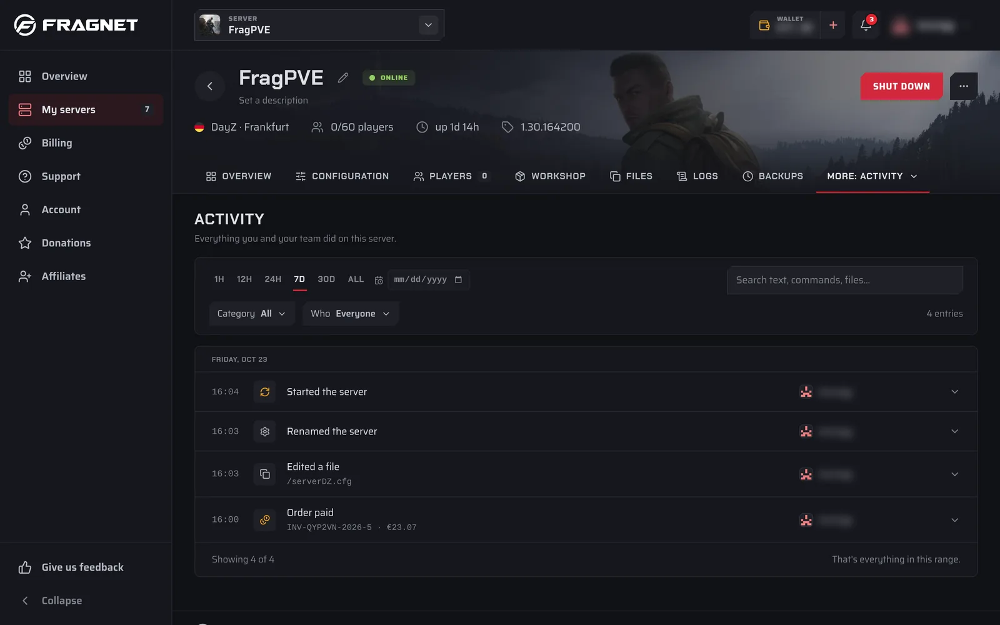
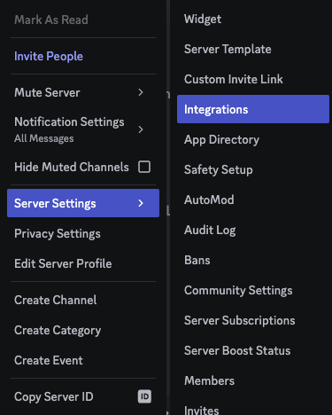
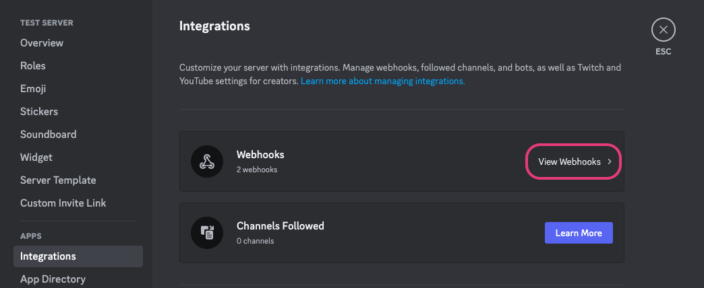
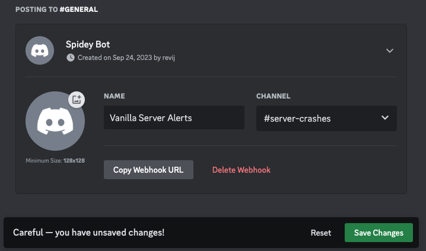

# Crash alerts and activity

The dashboard records what happens on your server, including crashes, on the **Activity** tab. You can also get alerts by email or Discord when a schedule fails and, on DayZ servers, from Server monitoring.

:::info
There's no general crash alert by email or Discord for every game. To spot crashes, check the **Activity** tab. Alerts are only available where described below.
:::

## The Activity tab

1. Open the [Fragnet dashboard](VAR::PANEL_URL), go to **My servers** and select your server.
2. Select the **Activity** tab. If you don't see it in the tab row, look under **More**.

The tab lists "Everything you and your team did on this server", newest first and grouped by day. Each entry shows what happened, who did it (a team member, **Fragnet staff** or **System**) and when. Select an entry to see its details, such as the command, file or setting involved, and where the action came from.

Every role on the account can see the **Activity** tab.

### What it logs

- **Crashes**: shown as **The server crashed**.
- **Power**: the server was started, stopped or restarted, or its process was killed.
- **Console**: console commands that were run.
- **Files**: files opened, edited, uploaded, downloaded, renamed, copied, compressed, extracted or deleted, and folders created, including changes made over SFTP and FTP and changes to the SFTP/FTP password.
- **Backups**: backups started, finished, failed, restored, downloaded, renamed, protected or deleted.
- **Schedules**: schedules created, updated, deleted or run manually, and their tasks changed.
- **Settings**: the server renamed or its description changed, startup and game settings changed, subdomains added or removed, the server wiped or reinstalled, versions, modpacks and Workshop mods installed or changed.
- **Billing** (only if your role has billing access): payments, renewal invoices, plan changes, automatic renewal and cancellation requests.

### Filter the list

- **Time range**: pick 1H, 12H, 24H, 7D, 30D or **All**. The list starts with the last 7 days. The date field next to it shows everything since a date you pick.
- **Search**: type in **Search text, commands, files…**.
- **Category**: show only **Power**, **Console**, **Files**, **Backups**, **Schedules**, **Settings** or **Billing**.
- **Who**: **Everyone** or **Account users**.

Each filter you set shows as a chip you can remove. **Clear all** removes them all. Select **Load 50 older** at the bottom to see older entries.

### Find out why your server crashed

1. On the **Activity** tab, look for **The server crashed** and note the time.
2. Select the entry to see the details that were recorded.
3. Check the console on the **Overview** tab and your game's log files on the **Files** tab around that time. Many crashes are caused by a mod or plugin, or by running out of memory.
4. If you can't find the cause, [open a support ticket](VAR::SUPPORT_URL) and mention the time of the crash.

## Alerts when a schedule fails

On servers where it's offered, a schedule can alert you when a run fails. You turn this on in the **Options** step of the schedule editor:

- **Email me when a run fails** sends an email to your account email address.
- **Post failures to Discord** posts a message to a Discord channel. Paste the channel's webhook into **Discord webhook URL**. See [Create a Discord webhook](#create-a-discord-webhook).

Once saved, the webhook shows as **Connected**. If Discord stops accepting it, you see "Not working — replace the webhook". Use **Replace** to paste a new one or **Remove** to stop the posts.

See [Schedules](./schedules/index.md) for how to create and edit a schedule.

## DayZ: Server monitoring alerts

DayZ servers on Windows have **Server monitoring**: the server is checked regularly, and restarted or stopped when it stops answering. Its alerts tell you by email and Discord when monitoring restarts, stops or gives up, and when the server crashes.

1. Open the **Configuration** tab and select **Server monitoring** in the list on the left.
2. Select **Alerts**.
3. Enter up to three email addresses in **Email 1**, **Email 2** and **Email 3**.
4. To post alerts to Discord, paste a webhook into **Discord webhook**. See [Create a Discord webhook](#create-a-discord-webhook).
5. Select **Save alerts**.
6. Select **Send test alert** to check that the alerts arrive.

The **General** section of **Server monitoring** holds the monitoring settings themselves (for example **Monitoring on**, **Action** and **Max restarts per hour**), and **Query log** shows what monitoring saw and did. Each alert email has a link to stop alerts to that address.

## Create a Discord webhook

A webhook lets the dashboard post messages to a channel on your Discord server. You need permission to manage webhooks on that Discord server.

1. In Discord, right-click your server and select **Server Settings** > **Integrations**.

2. If you already have other webhooks, select **View Webhooks**. Otherwise, select **Create Webhook**.

3. Select **Create Webhook** again. Enter a name for the webhook and pick the text channel the alerts should go to. You can name it anything you want.

4. Select **Save Changes** and then **Copy Webhook URL**.

5. Paste the URL into the dashboard: into **Discord webhook URL** in a schedule's options, or into **Discord webhook** under DayZ **Server monitoring** > **Alerts**. Then save.

The URL starts with `https://discord.com/api/webhooks/`. Keep it private: anyone with the URL can post to your channel.
