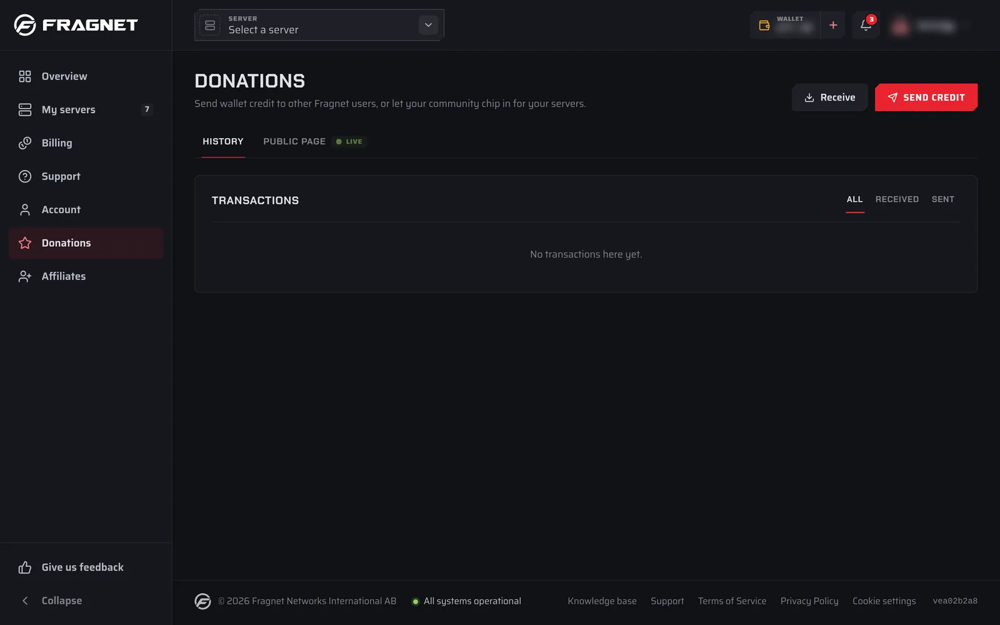

Donations let other people add credit to your wallet so they can help pay for your servers. There are two ways to receive them:

- **Other Fragnet users** can send credit to your username or email. See [Send and receive credit](./send-and-receive.md).
- **Anyone**, even without a Fragnet account, can donate through your public donation page. See [Public donation page](./public-page.md).

Every donation goes to your wallet, and renewals use your wallet balance first. When your balance covers a renewal invoice, the renewal is paid from your wallet.

Donations replace the old Group Pay system.

## Open Donations

Open the [Fragnet dashboard](VAR::PANEL_URL) and select **Donations** in the sidebar. On a phone, tap **Account** in the bottom bar, then **Donations** under **Earn**.

The page always works on the account you're using. If you're a member of several accounts, use **Switch account** in the user menu first.

## Who can use Donations

Only the account owner and team members with the **Admin** or **Billing** role can use Donations. Other team members see "Donations are managed by the account owner, admins and billing members." See [Team access](../team-access.md) for the roles.

## The Donations page

At the top of the page you'll find two buttons:

- **Receive** shows what other people need to donate to you: your username and email, and your public page link. See [Receive credit](./send-and-receive.md#receive-credit).
- **Send credit** sends credit to another Fragnet user. You pay from your wallet or by card. See [Send credit](./send-and-receive.md#send-credit).

Below them are two tabs:

- **History** lists the donations you've received and sent.
- **Public page** is where you set up your public donation page. The tab shows **LIVE** while your page is on and **DRAFT** while it's off.

## History

The **History** tab opens by default.

- If your public page is live and has a goal, a bar at the top shows how much of your servers' renewal is covered by donations this period. Select **Edit public page** to change the page.
- If your public page is off, a **Let your players chip in** box links to **Set up public page**.

The **Transactions** list shows every completed donation, newest first. Use **All**, **Received** and **Sent** to filter it, and **Previous** and **Next** to page through it. Each row shows:

- **Received from** or **Sent to**, followed by a name. Donors who chose to stay anonymous show as **Anonymous**.
- The date and where the donation came from: **Public page** or **Fragnet user**.
- The donor's message, if they left one.
- The amount: received donations in green with a plus sign, sent donations with a minus sign.

There are no status labels. A donation only appears once its payment has gone through, so a card payment that's still processing isn't listed yet.

### Old group pay credits

If your servers received credit through the old Group Pay system, it's listed in a separate **Old group pay credits** box below the transactions. These are entries from your wallet history. Each one shows its description, the date and the amount added to your wallet.

## Where donated credit goes

All donations are added to the wallet of the account that receives them:

- A donation through your public page adds the full amount the donor paid. Donors pay in your account's currency.
- Credit sent by another Fragnet user is converted to your account's currency if theirs is different.

You can see your balance on the wallet button in the top bar, and the wallet history on the **Wallet** tab of the **Billing** page.

## Use donations to pay for your server

Renewals use your wallet balance first. If the donations in your wallet cover a renewal invoice, the renewal is paid from your wallet and you don't need to do anything.

If your wallet only covers part of the invoice, you can use it yourself:

1. Open the invoice from **Billing** → **Invoices**, or from **Renewal invoices** on your server's **Billing** tab.
2. Under **Pay with Wallet**, check the **Amount of credit to apply** and select the button that pays it from your wallet, for example **Pay €10.00 from wallet**.
3. Pay the rest under **Pay online**.

See [How do I renew my services?](../../billing/renew-service.md) for more about renewals.

## Limits and fees

Through your public page:

- Public pages are available for accounts billed in EUR, USD, GBP, SEK or BRL.
- Donors can give between €5 and €500 ($5 to $500, £5 to £500, 50 to 5,000 kr, or R$25 to R$2,500).
- The full amount the donor pays is added to your wallet.

From another Fragnet user:

- The recipient must receive at least 3 in their account currency, for example €3.
- The amount the sender chooses includes VAT. The recipient gets that full amount as credit, converted to their currency if needed.
- Both the sender and the recipient need a verified email address.

Donations can't be cancelled or reversed in the dashboard. If something went wrong with a donation, [open a support ticket](VAR::SUPPORT_URL) in the **Billing** category.
