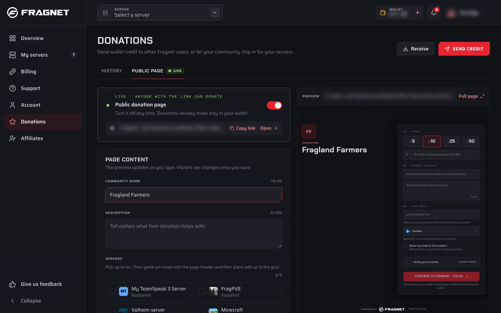
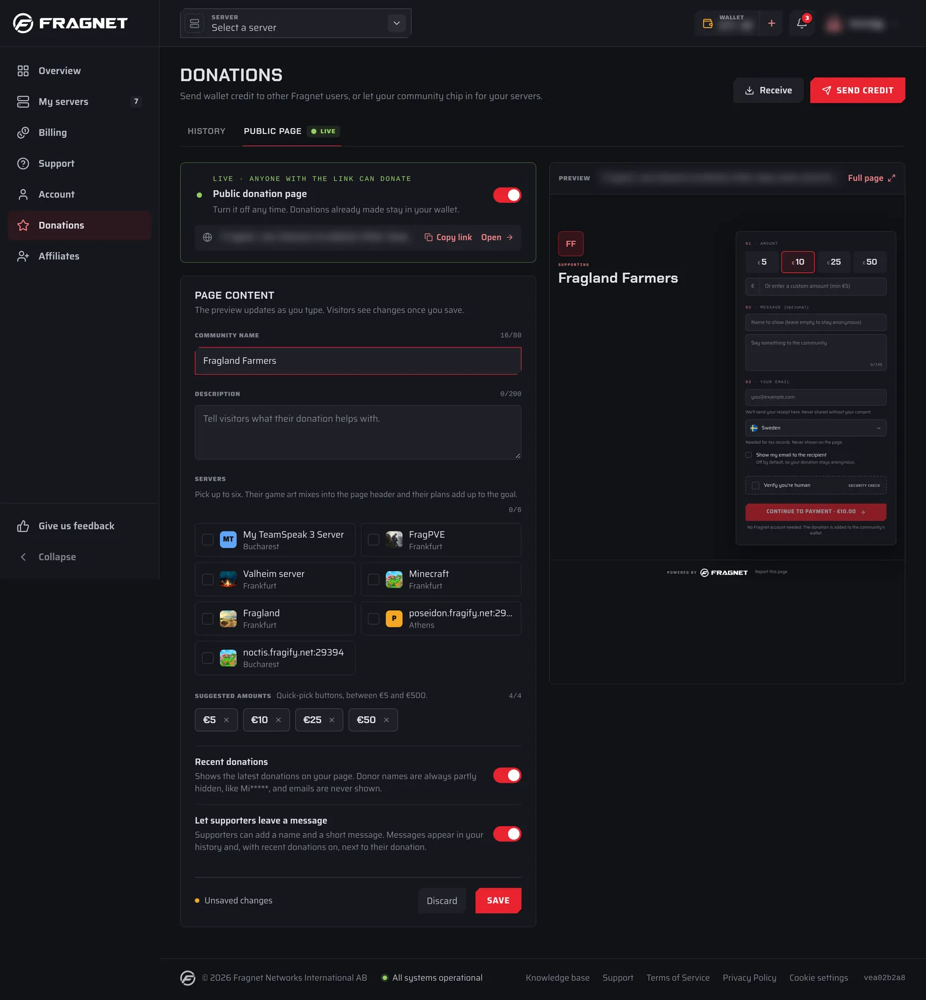
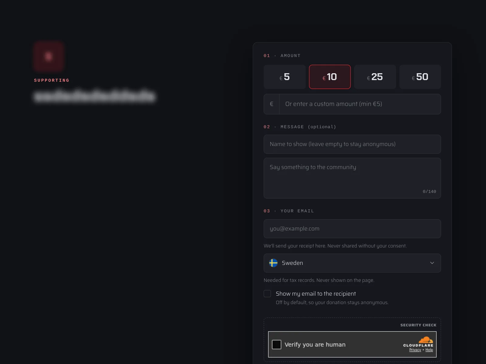

Your public donation page is a web page where anyone can donate to your community, even without a Fragnet account. It can show the servers you're raising money for and how much of their renewal is already covered. Every donation goes to your wallet.

You set up the page on the **Public page** tab of **Donations** in the [Fragnet dashboard](VAR::PANEL_URL). Only the account owner and team members with the **Admin** or **Billing** role can change it.

:::info Supported currencies
Public donation pages are available for accounts billed in EUR, USD, GBP, SEK or BRL. For other currencies, the **Public page** tab says "Public donation pages aren't available for accounts billed in … yet."
:::

## Set up your page

1. Open the [Fragnet dashboard](VAR::PANEL_URL), select **Donations** in the sidebar and open the **Public page** tab.
2. Under **Page content**, fill in the fields described below.
3. Check the **Preview** on the right. It updates as you type.
4. Select **Save**. Visitors only see your changes once you save. Select **Discard** to undo changes you haven't saved yet.
5. Turn on the switch in the **Public donation page** box at the top.
6. Select **Copy link** and share the link with your community.

Next to the **Save** button, the page shows **Unsaved changes** or **All changes saved**.

### Page content

- **Community name**: the page heading, for example "Mike's Minecraft Server". Up to 80 characters. If you leave it empty, the page shows the account owner's username.
- **Description**: what donations help with. Up to 200 characters.
- **Servers**: pick up to six of your servers. They appear on the page as name and city, their game art fills the page header, and their plans add up to the goal (see [The goal](#the-goal)). The number on each picked server is its position on the page. Cancelled servers can't be picked, and a server is removed from the page once it's cancelled.
- **Suggested amounts**: up to four quick-pick buttons that donors see. Type an amount and select **+ Add**. Select the **×** next to an amount to remove it. Amounts must be between the minimum and the maximum for your currency, for example €5 and €500.
- **Recent donations**: shows the latest donations on your page. Donor names are always partly hidden, like `Mi*****`, and emails are never shown.
- **Let supporters leave a message**: donors can add a name and a short message. Messages appear in your **History** and, with **Recent donations** on, next to their donation on the page.

### The goal

When you link servers, the page shows a goal:

- The goal is the total renewal price of the linked servers for their current billing period. Servers that renew in another currency or don't have a price are left out. If none of them count, the page says there's no goal to show.
- The progress counts donations made through your public page since the current billing period started. Credit sent by other Fragnet users doesn't count.
- Monthly plans show **This month's server costs**. Longer billing cycles show **This period's server costs**. The page also shows the next renewal date.
- When the goal is reached, donors see "Fully covered. Extra donations go toward the next renewal."

While the page is live, the same progress appears at the top of the **History** tab.

:::info How donations pay the renewal
Donations go to your wallet, and renewals use your wallet balance first. If your balance covers the renewal invoice, the renewal is paid from your wallet. See [Use donations to pay for your server](./index.md#use-donations-to-pay-for-your-server).
:::

## Turn the page on or off

Use the switch in the **Public donation page** box at the top of the tab (screen readers announce it as **Public page live**). It takes effect straight away, for the version you last saved.

- **On**: the box shows "Live · anyone with the link can donate" and your page link appears.
- **Off**: the box shows "Draft · not publicly accessible". Anyone who opens your link sees "Donation page unavailable". Donations already made stay in your wallet.

Your link stays the same when you turn the page off and on again.

If the box says "Your account can't receive public donations right now, so the page can't go live", check that the account owner has verified their email address. If the message stays, [open a support ticket](VAR::SUPPORT_URL).

## Your page link

While the page is live, its link is shown under the switch:

- **Copy link** copies the link.
- **Open** opens your page in a new tab.

**Full page** at the top of the **Preview** also opens the page. It shows the saved version, so save first to see your latest changes. You can also copy the link from the **Receive** button at the top of the **Donations** page.

The link looks like `https://fragnet.net/donate/` followed by a long code. Search engines don't list donation pages, so people can only find yours through the link you share.

## What donors see

Your page shows your community name, description and servers, the goal, and the five most recent donations if you turned them on. Donors don't need a Fragnet account. To donate, they:

1. Pick one of your suggested amounts, or type their own amount in the custom amount field.
2. Optionally enter a **Name to show** and a message, if you allow messages. Without a name, they show as **Anonymous**.
3. Enter their email, which is used for the payment receipt, and choose their country.
4. Optionally tick **Show my email to the recipient**. It's off by default.
5. Complete the security check and select **Continue to payment**. The button shows the amount, for example **Continue to payment · €10.00**.
6. Pay by card or another payment method available in their country, such as PayPal, and select **Donate** with the amount, for example **Donate €10.00**.

They then see a thank-you message, and Stripe emails them a receipt.

Each donation then appears on your **History** tab as **Received from** followed by the name the donor gave, with **Public page** as the source and their message, if any. If the donor ticked **Show my email to the recipient**, you also see a partly hidden version of their email.

## Share your page

- **Discord**: post the link in your announcements or info channel and pin it.
- **In game**: add the link to your server's message of the day, welcome message or server description. To remind players regularly, you can post it in chat with a [schedule](../schedules/creating-a-schedule.md) that runs your game's broadcast or say command.
- **Elsewhere**: put it on your community website, Steam group or social media.

Tell players what the money is for, such as keeping the server online for another month. Turn on **Recent donations** so supporters can see others chipping in.
