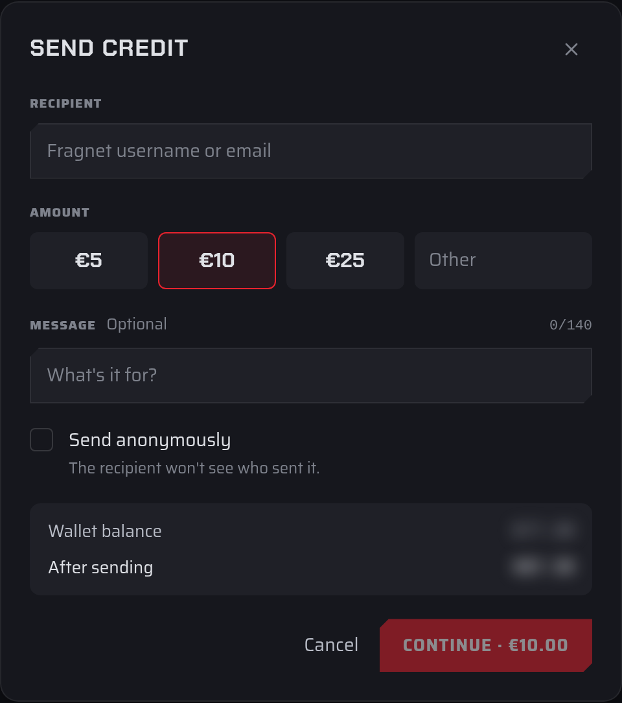
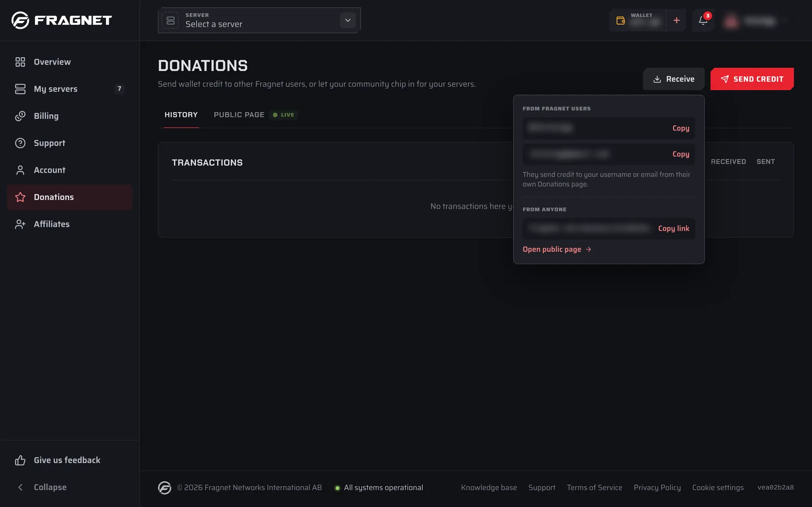

Fragnet users can send wallet credit to each other, for example to chip in for a friend's server. The credit lands in the recipient's wallet, and they can use it to pay their renewal invoices.

Only the account owner and team members with the **Admin** or **Billing** role can send credit or see the **Receive** details. Both the sender and the recipient need a verified email address.

## Send credit

1. Open the [Fragnet dashboard](VAR::PANEL_URL), select **Donations** in the sidebar and select **Send credit** at the top right.
2. Under **Recipient**, enter the recipient's Fragnet username or email. When the dashboard finds them, their name appears below the field marked **Fragnet user**.
3. Under **Amount**, pick one of the amounts or type your own under **Other**.
4. Optionally add a **Message** of up to 140 characters. The recipient sees it in their donation history.
5. Optionally tick **Send anonymously**. The recipient then won't see who sent the credit.
6. Check **Wallet balance** and **After sending** at the bottom of the dialog, then select **Continue**. The button shows the amount, for example **Continue · €10.00**.
7. Check the summary:
   - **Amount excl. VAT**, **VAT** and **Total**: what you pay. VAT is included in the amount you chose, not added on top.
   - **They receive**: what's added to the recipient's wallet, in their account currency.
8. Under **Pay with**, choose:
   - **Wallet credit**, if your balance covers the whole total. It shows your balance now and after sending. Then select the **Send** button, for example **Send €10.00**.
   - **Card or another payment method**. Select **Continue to payment**, choose one of your saved payment methods or enter a new one, then select the **Pay** button.
9. When the dialog says the credit was sent, select **Done**.

<!-- screenshot: send-credit-review.png | Send credit dialog, review step: recipient name, the Amount excl. VAT / VAT / Total / They receive lines, and Pay with showing "Wallet credit" (selected, with balance now and after sending) and "Card or another payment method", with the Back and "Send €10.00" buttons -->

The credit is sent from the wallet of the account you're using. Each transfer also gets an invoice on your account, which you can find under **Billing** → **Invoices**.

### Who you can send to

- The recipient must have their own Fragnet account. The credit always goes to the account they own, not to accounts they're a team member of. To give credit to a team's account, use the account owner's username or email.
- You can't send credit to yourself or to the account you're using.
- The recipient must receive at least 3 in their account currency, for example €3.
- If the recipient's account uses another currency, the amount is converted. **They receive** shows the converted amount.

If the dashboard says "No Fragnet user with that name or email.", check the spelling. You'll also see this message if the user hasn't verified their email address yet, or doesn't own a Fragnet account.

### If the payment doesn't finish

If you close the dialog or leave the page before a card payment is done, select **Send credit** again in the same browser tab. The dialog picks up the same transfer instead of starting a new one. From there you can select **Resume payment**, **Pay with wallet credit** if your wallet covers it, or **Check status**. If the dialog says "We couldn't confirm this donation yet", select **Check status** before you try again.

### Can I undo a transfer?

No. Once the credit is sent, it's in the recipient's wallet, and the dashboard has no way to cancel or reverse it. Check the recipient's name on the summary before you pay. If you sent credit to the wrong person, [open a support ticket](VAR::SUPPORT_URL) in the **Billing** category.

## Receive credit

To get credit from other Fragnet users, give them your username or email:

1. Open the [Fragnet dashboard](VAR::PANEL_URL), select **Donations** in the sidebar and select **Receive** at the top right.
2. Under **From Fragnet users**, select **Copy** next to your username or your email.
3. Send it to the person who wants to donate. They follow the steps under [Send credit](#send-credit) from their own **Donations** page.

The same panel has a **From anyone** section for people without a Fragnet account:

- If your public page is live, it shows your page link with **Copy link** and **Open public page**.
- If it's off, it says "Your public page is off." Select **Set up public page** to go to the **Public page** tab. See [Public donation page](./public-page.md).

:::info Credit goes to the account you own
The username and email shown under **Receive** are yours. Credit sent to them goes to the account you own, even if you're currently working in another account as a team member. To receive credit for a team's account, share the account owner's username or email.
:::

Credit you receive is listed on the **History** tab and added to your wallet. To use it for your servers, see [Use donations to pay for your server](./index.md#use-donations-to-pay-for-your-server).
