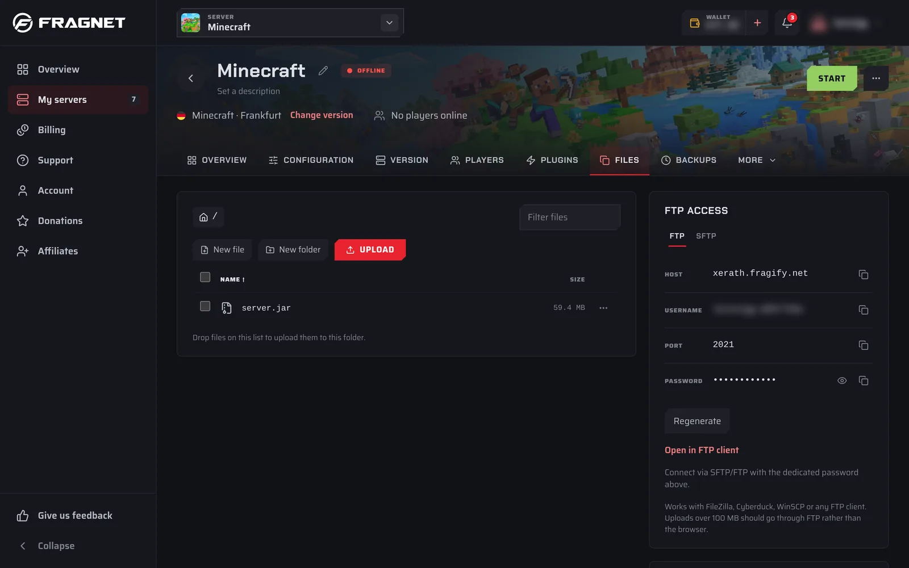
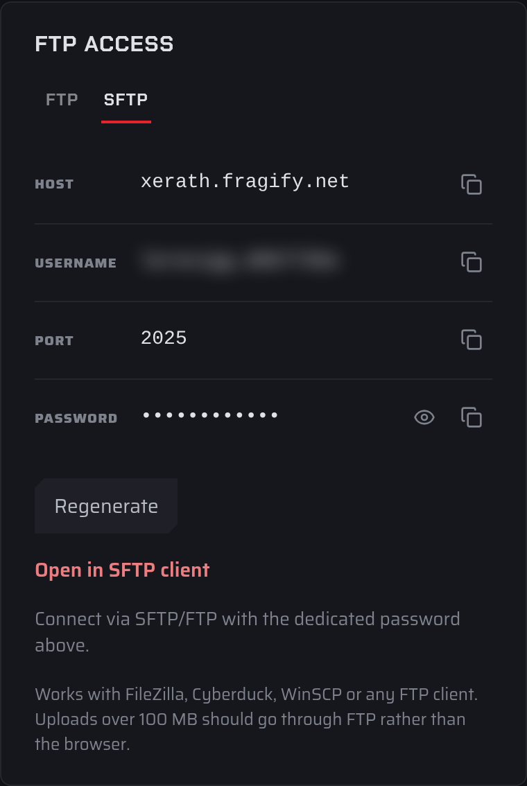

# Files and SFTP

You can manage your server's files in two ways:

- The **Files** tab in the [Fragnet dashboard](VAR::PANEL_URL), for quick jobs: uploading a few files, editing a config, renaming or deleting.
- An SFTP or FTP client on your computer, for large uploads, many files at once and moving files between folders.

:::info
The **Files** tab and the SFTP/FTP password are only available to the Owner, Admin and Service manager roles. See [Team access](./team-access.md).
:::

## The Files tab

Open the [Fragnet dashboard](VAR::PANEL_URL), go to **My servers** and select your server. Then select the **Files** tab.

- The path at the top shows the folder you're in. Select a folder in the path to go back to it, or the first button to go to the root folder.
- Select a folder to open it. Select a file to open it in the editor.
- Type in **Filter files** to show only matching names in the current folder.
- Select the **Name**, **Size** or **Modified** column header to sort.
- The toolbar has **New file**, **New folder** and **Upload**.
- Next to the list, the **FTP access** card shows your SFTP/FTP login and the **Disk usage** card shows how much storage you use.

### Upload files

1. Open the folder you want to upload to.
2. Select **Upload** and choose one or more files. You can also drag files from your computer onto the list. "Drop to upload here" shows where they will go.
3. Progress shows in the **Uploads** list above the files. You can cancel an upload while it runs.

You can't upload a folder. Compress it into a `.zip` file on your computer, upload the `.zip`, then use **Extract** on it.

:::tip Large files
Uploads over 100 MB should go through SFTP or FTP rather than the browser. If an upload fails with "Use FTP instead", use an SFTP client as described below.
:::

### Create a file or folder

1. Open the folder where you want the new item.
2. Select **New file** or **New folder**.
3. Enter a **Name**. Names can't contain slashes and can be up to 255 characters.
4. Select **Create**. A new file opens in the editor straight away.

### Edit a file

1. Select the file's name, or open its ⋯ menu and select **Edit**.
2. The editor opens next to the file list (below it on smaller screens).
3. Make your changes. A dot next to the file name shows there are unsaved changes.
4. Select **Save file**, or press **Ctrl+S** (**Cmd+S** on a Mac).
5. You see "Saved at" and the time. Restart the server to apply config changes.

**Revert** throws away the changes you haven't saved, and **Download** saves the file to your computer. If you try to leave with unsaved changes, the dashboard asks whether to save them or **Discard changes**.

You can edit text files up to 1 MB. Binary files, such as `.jar` or `.dll` files, can't be opened in the editor. Download them, or use an SFTP client.

For game config files, the ⋯ menu also has **Open in config editor**. It opens the file on the **Configuration** tab, where you can change settings with labelled fields instead of raw text. See [Configuration](./configuration.md).

### File and folder actions

Open the ⋯ menu at the end of a row for these actions:

| Action | What it does |
| --- | --- |
| **Edit** | Opens a text file in the editor. |
| **Open in config editor** | Opens a game config file on the **Configuration** tab. |
| **Download** | Downloads the file. To download a folder, **Compress** it first and download the archive. |
| **Rename** | Gives the file or folder a new name in the same folder. |
| **Make a copy** | Makes a copy of the file in the same folder. |
| **Compress** | Packs the file or folder into an archive in the same folder. |
| **Extract** | Unpacks an archive (`.zip`, `.tar`, `.tgz`, `.gz`, `.bz2`, `.xz`, `.rar` or `.7z`) into the folder it's in. |
| **Delete** | Deletes the file or folder, including everything inside a folder. You're asked to confirm. This can't be undone. |

:::warning
Deleted files are gone for good unless you have a backup. Make a [backup](./backups/index.md) before you delete or replace important files such as worlds.
:::

### Select several items

1. Tick the box at the start of each row, or the box in the header to select everything in the folder.
2. A bar shows how many items are selected, with **Compress**, **Delete** and **Clear**.
3. **Compress** packs the selected items into one archive (up to 100 items at a time). **Delete** deletes them all after you confirm. **Clear** unselects them.

### Moving files between folders

You can't move files or folders to another folder in the dashboard. **Rename** only changes the name within the same folder.

To move files, either:

- **Download and upload again**: download the file, open the folder you want it in, upload it there, then delete the original. For a folder or many files, **Compress** them first, download the archive, upload it to the new folder, **Extract** it there, then delete the originals.
- **Use an SFTP client**: connect as described below and drag the files to the new folder. This is the easiest way for large or many files.

## SFTP and FTP access

SFTP and FTP let you work with your server's files from a program on your computer. SFTP is encrypted, so we recommend it. Use FTP only if your client doesn't support SFTP.

### Find your login details

The SFTP/FTP login is in these places:

- **Files** tab, in the **FTP access** card.
- **Configuration** tab > **General** > **File access**.
- On Farming Simulator servers, the **File access** card on the **Overview** tab.

The ⋯ **More actions** menu at the top of the server page also has **Copy SFTP details**, which copies the host, port and username (not the password).

In the login panel:

1. Choose **FTP** or **SFTP** at the top. **FTP** is selected when the panel opens. The port changes with your choice.
2. Copy the **Host**, **Username** and **Port** with the copy button next to each.
3. Next to **Password**, select **Reveal** (the eye) to show it, or **Copy password** to copy it.
4. **Open in SFTP client** (or **Open in FTP client**) opens the connection in the SFTP or FTP program installed on your computer, if it supports these links.

:::info Your SFTP/FTP password
Each server has its own SFTP/FTP password. It isn't the password you use to sign in to the dashboard. Everyone on your team who can see the password uses the same one.
:::

### Change the SFTP/FTP password

1. In the login panel, select **Regenerate**.
2. Read the warning **Regenerate SFTP/FTP password?** The new password replaces the old one for everyone with access to this server, and existing connections using the old password stop working.
3. Select **Regenerate password**.
4. Update the saved password in your SFTP or FTP client.

### Choose a client

| Software | Windows | Mac | Linux |
|----------|---------|-----|-------|
| [Cyberduck](https://cyberduck.io/) | ✔️ | ✔️ | ✔️ |
| [WinSCP](https://winscp.net/eng/download.php) | ✔️ | ❌ | ❌ |
| [FileZilla](https://filezilla-project.org/) | ✔️ | ✔️ | ✔️ |

### Connect with FileZilla using SFTP

1. In the dashboard, open the login panel and select **SFTP**.
2. Open FileZilla and go to **File** > **Site Manager**, then select **New site**.
3. Set **Protocol** to **SFTP - SSH File Transfer Protocol**.
4. In **Host**, paste the **Host** from the dashboard. In **Port**, enter the **Port** shown under **SFTP**.
5. Set **Logon Type** to **Normal**.
6. In **User**, paste the **Username**. In **Password**, paste the password (use **Copy password** in the dashboard).
7. Select **Connect**. The first time, FileZilla asks whether to trust the server's host key. Select **OK**.

Your server's files appear on the right. Drag files between your computer (left) and the server (right), or between folders on the server to move them.
