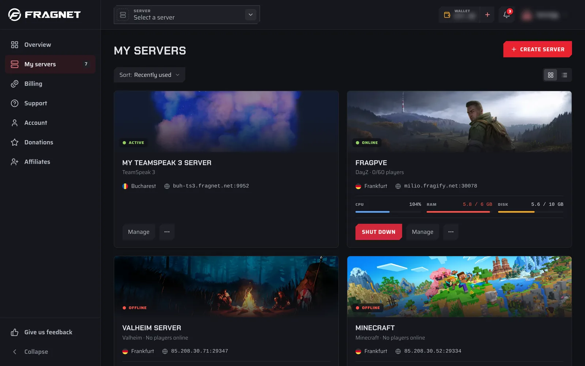
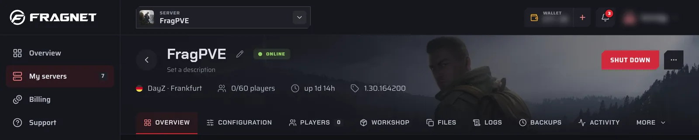

# Getting Started

The [Fragnet dashboard](VAR::PANEL_URL) is where you manage your servers, billing, support tickets and account. It replaces both the old game control panel and the separate billing area.

## Sign in

1. Go to [fragnet.net/auth/login](https://fragnet.net/auth/login).
2. Sign in in one of these ways:
   - Enter your **Email or username** and **Password**, then select **Log in**.
   - Select **Steam**, **Discord** or **Google** at the top to sign in with that account. You only see the providers that are available.
   - Enter your email and select **Email me a login link instead**. The link works once and expires after 15 minutes.
3. On your own device, you can tick **Keep me logged in on this device for 90 days** before you log in.
4. If you've turned on two-factor authentication, enter the 6-digit code from your authenticator app and select **Verify**. See [Two-factor authentication](./2fa.md).

:::tip Were you a Fragnet customer before the dashboard?
Your account has moved to the dashboard. Select **Forgot password?** on the login page, enter the same email address and select **Send reset link**. Open the link in the email to choose a new password. The link expires after 30 minutes.
:::

If you've been invited to other people's accounts, you see **Choose an account** after you sign in. Pick the account you want to use now. You can switch later, see [Team access](./team-access.md).

## Find your server

There are three ways to get to a server:

- **My servers** in the sidebar (**Servers** in the bottom bar on phones) lists all your servers. Use **Sort:** to order them by **Recently used**, **Name**, **Status** or **Next renewal**, and the buttons next to it to switch between grid and list view. Select a server to open it.
- The server picker in the top bar (**Select a server**) jumps straight to any server. **View all servers** at the bottom opens **My servers**.
- The **Overview** page, the first page after you sign in, shows **Your servers** as cards. Select **Manage** or **Console** on a card to open the server. Its **Overview** tab includes the console.

## The server page

At the top of a server's page you see its name, status, the power button and the ⋯ **More actions** menu. Below that is a row of tabs. Tabs that don't fit on your screen are under **More**.

Which tabs you see depends on the game and on your role on the account. Only the Owner, Admin and Service manager roles get the tabs that change the server, such as **Configuration**, **Files** and **Backups**.

| Tab | What it's for |
| --- | --- |
| **Overview** | The server's address, location and plan, the live console, current usage and schedules. |
| **Configuration** | Game config files, startup settings, the dashboard name, subdomain, Java version, SFTP/FTP access and wiping the server. |
| **Files** | Browse, upload, edit, download and delete the server's files. |
| **Backups** | Create, restore, download and protect backups. |
| **Activity** | A log of everything that happened on the server, including crashes. |
| **Billing** | The plan, renewal, invoices and cancellation. |
| **Version** | The version the server runs. On Minecraft you can install other server software or versions here. |
| **Players** | Who is online and, on some games, player lists such as operators, whitelist and bans. On Path of Titans this tab is called **Access**. |
| **Plugins**, **Mods**, **Workshop**, **Modpacks** | Install and manage add-ons, on games that support them. |
| Game-specific tabs | For example **Worlds**, **Wipes** (Rust), **Maps** (CS2 and Battlefield), **Demos** (CS2), **PRoCon** (Battlefield), **Steam** (DayZ), **Logs**, **Savegames** and **Map** (Farming Simulator). |

## In this section

- [Basic Controls](./basics.md): power, console, server details and renaming
- [Configuration](./configuration.md): change game and server settings
- [Files and SFTP](./file-manager.md): the Files tab and SFTP/FTP clients
- [Backups](./backups/index.md)
- [Schedules](./schedules/index.md)
- [Team access](./team-access.md): invite people and choose their role
- [Subdomains](./subdomains.md): a free address for your server
- [Crash alerts and activity](./crash-alerts.md)
- [Two-factor authentication](./2fa.md)
