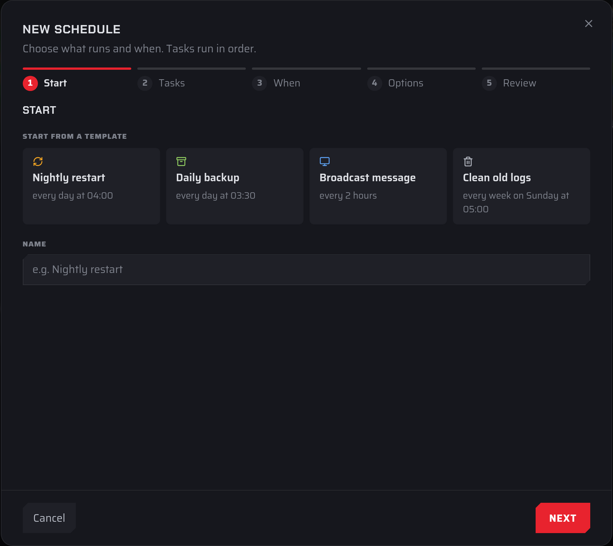
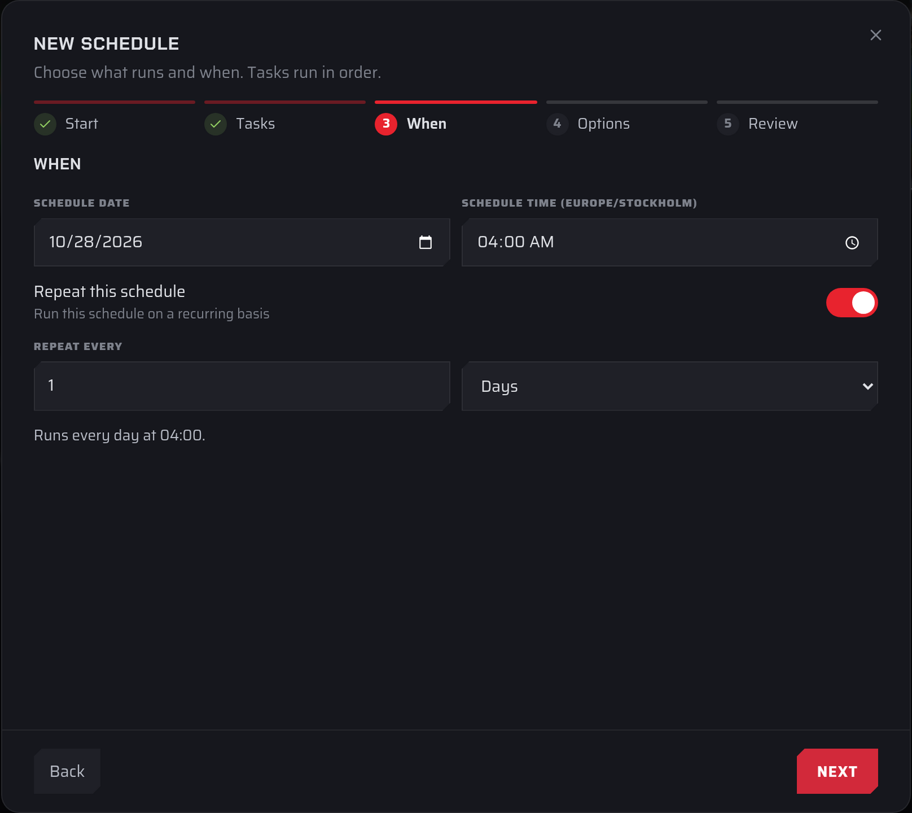
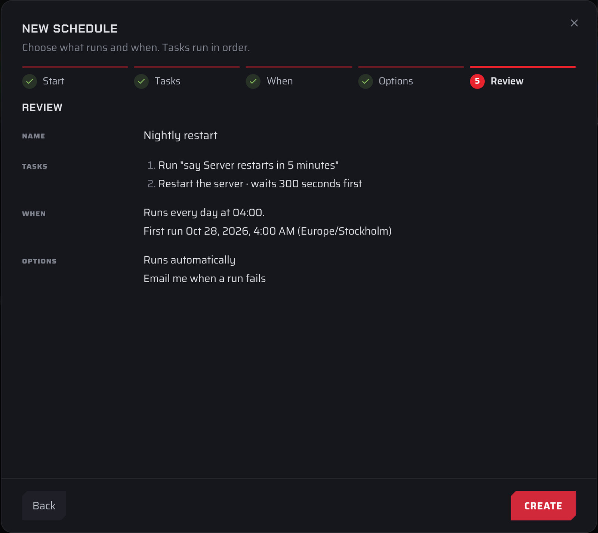

New schedules are made in the **New schedule** wizard. It has five steps: **Start**, **Tasks**, **When**, **Options** and **Review**. Use **Next** and **Back** to move between them. **Next** checks the current step and highlights anything that needs fixing before it moves on.

## Open the wizard

1. Open the [Fragnet dashboard](VAR::PANEL_URL), go to **My servers** and select your server.
2. On the **Overview** tab, in the **Schedules** card, select **New schedule**.

You can also select **New schedule** at the top of the full list (**Schedules** card → **View all**).

## Step 1: Start

Choose a template or start from scratch, and give the schedule a name.

**Start from a template** offers four ready-made schedules. Picking one fills in the name, tasks and timing, then takes you to the **Tasks** step. You can change anything afterwards.

| Template | Tasks | When it runs |
| -------- | ----- | ------------ |
| **Nightly restart** | **Power** → **Restart** | Every day at 04:00 |
| **Daily backup** | **Backup** | Every day at 03:30 |
| **Broadcast message** | **Command**, which you fill in with your game's message command | Every 2 hours, from the next full hour |
| **Clean old logs** | **Clean up**: `*.log.gz` files older than 14 days | Every week, on Sunday at 05:00 |

Times are in your browser's time zone. On Farming Simulator servers, **Broadcast message** uses a **Message** task (an in-game chat message) instead of a command.

**Name** is required, up to 191 characters.

If you don't pick a template, the schedule starts with one empty **Command** task and runs every day from the next 04:00.

## Step 2: Tasks

Each task is a numbered card. Pick the task type at the top of the card, then fill in its fields:

- **Command**: a console command.
- **Message**: an in-game chat message (Farming Simulator only).
- **Power**: **Start**, **Restart**, **Stop** or **Kill**.
- **Backup**: makes a backup.
- **Clean up**: deletes old files that match a pattern.
- **Workshop**: installs Workshop mod updates (only on servers with Workshop mods).

Every task also has a **Wait** … **seconds after the previous task** field and a **Continue if this task fails** checkbox.

Select **Add task** to add another card. The counter next to it shows how many you have, for example "2/10 tasks". Remove a task with the **×** on its card.

Tasks run from top to bottom and can't be moved, so add them in the order you want them to run.

For every task type and option in detail, see [Schedule tasks](./creating-a-task.md).

## Step 3: When

Set the first run and how often the schedule repeats.

- **Schedule date** and **Schedule time**: when the schedule runs first. The time label shows your browser's time zone, for example **Schedule time (Europe/London)**.
- **Repeat this schedule**: turn this off to run the schedule once, at the date and time above.
- **Repeat every**: a whole number from 1 to 1,000 and a unit: **Minutes**, **Hours**, **Days** or **Weeks**. The shortest repeat is 5 minutes.

A line below the fields confirms your choice, for example "Runs every day at 04:00."

Some common timings:

| You want | Schedule date and time | Repeat every |
| -------- | ---------------------- | ------------ |
| Every 15 minutes | Any time soon | 15 **Minutes** |
| Every 6 hours, at 00:00, 06:00, 12:00 and 18:00 | The next day, 00:00 | 6 **Hours** |
| Every day at 04:00 | Any day, 04:00 | 1 **Days** |
| Every Monday at 18:00 | A Monday, 18:00 | 1 **Weeks** |
| Once only | The date and time you want | **Repeat this schedule** off |

A weekly schedule runs on the weekday of its start date. To run on several weekdays, for example Monday, Wednesday and Friday, make one weekly schedule for each day.

## Step 4: Options

- **Enabled**: on by default. Paused schedules keep their settings but don't run automatically. You can still run them with **Run now**.
- **Only run while the server is online**: skips runs while the server is stopped. Don't turn this on for a schedule with a **Power** → **Start** task, because that task would never run.

On some servers you'll also see:

- **Only if no players are online**: skips the run when anyone is connected. If the player count can't be read, the run is skipped too.
- **Email me when a run fails**: sends an email to your account email address when a run fails. This is on by default for new schedules.
- **Post failures to Discord**: posts a message to a Discord channel when a run fails. Paste the channel's webhook URL (it starts with `https://discord.com/api/webhooks/`) into the field that appears. In Discord, you can create one under the channel's **Edit Channel** → **Integrations** → **Webhooks**.

After you've saved a webhook, the option shows **Connected**, or "Not working — replace the webhook" if Discord stops accepting it. Use **Replace** to paste a new URL or **Remove** to stop posting.

## Step 5: Review

Check the summary of the name, tasks, timing and options. For repeating schedules it also shows the date and time of the first run, with your time zone.

Select **Create** to save the schedule. It appears in the schedules list with its next run.

## Examples

### Nightly restart with a warning

This warns players in the chat, waits 5 minutes, then restarts the server at 04:00.

1. Select **New schedule**, then the **Nightly restart** template.
2. In the **Tasks** step, change task 1 from **Power** to **Command** and enter your game's message command, for example `say Server restarts in 5 minutes`.
3. Select **Add task**. On task 2, choose **Power**, then **Restart**.
4. On task 2, set **Wait** to `300` **seconds after the previous task**.
5. Select **Next**. In the **When** step, set **Schedule time** to 03:55, so the restart happens at 04:00. Leave **Repeat every** at 1 **Days**.
6. Select **Next**. In **Options**, turn on **Only run while the server is online** if you don't want the schedule to start a stopped server.
7. Select **Next**, check the summary and select **Create**.

:::tip
The command syntax depends on your game. `say` works on many games, including Minecraft and Rust. On Farming Simulator, use a **Message** task instead of a command. The first task's command can't contain `;`, `&`, `|`, `` ` ``, `$`, backslashes or brackets.
:::

### Daily backup

1. Select **New schedule**, then the **Daily backup** template. It has one **Backup** task.
2. Select **Next**. In the **When** step, change **Schedule time** if 03:30 doesn't suit you.
3. Select **Next** twice, check the summary and select **Create**.

Each backup counts toward your plan's backup limit. When you're at the limit, a scheduled backup replaces the oldest backup that isn't protected. To keep a backup for good, [protect it](../backups/locking-a-backup.md).

:::tip
The **Scheduled backups** switch on the **Backups** tab sets up the same kind of schedule in one click. See [Scheduled backups](../backups/index.md#scheduled-backups).
:::

### Weekly log cleanup

1. Select **New schedule**, then the **Clean old logs** template. It deletes `*.log.gz` files older than 14 days, every Sunday at 05:00.
2. To clean other files too, add patterns to **File patterns**, separated by commas, for example `*.log.gz, *.tmp`.
3. Select **Next** through the remaining steps and select **Create**.
