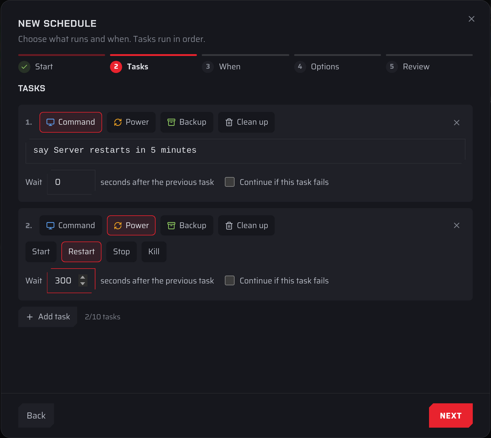

Tasks are what a schedule does. You add and change them in the **Tasks** step of the **New schedule** wizard (see [Creating a schedule](./creating-a-schedule.md)) or of the **Edit schedule** dialog (see [Editing a schedule](./editing-a-schedule.md)).

:::info
A schedule can have up to 10 tasks.
:::

## Adding and removing tasks

- Each task is a numbered card. Choose its type with the buttons at the top of the card.
- Select **Add task** to add a card at the end. The counter next to it shows how many tasks you have, for example "3/10 tasks".
- Select the **×** at the top right of a card to remove it. The last remaining task can't be removed.
- Tasks run in order from top to bottom. They can't be moved, so to change the order, change the type and fields of the existing cards.

## Task types

| Type | What it does | Available on |
| ---- | ------------ | ------------ |
| **Command** | Sends a console command to the server. | All servers except Farming Simulator |
| **Message** | Posts a message in the in-game chat. | Farming Simulator 22 and 25 |
| **Power** | Starts, restarts, stops or kills the server. | All servers |
| **Backup** | Makes a backup. | All servers |
| **Clean up** | Deletes old files whose names match a pattern. | All servers |
| **Workshop** | Installs Workshop mod updates. | Servers with Workshop mods, such as DayZ |

### Command

Enter one console command on a single line, up to 1,000 characters, for example `say Server restarts in 5 minutes`. Which commands exist depends on your game.

The first task in a schedule has an extra rule: its command can't contain `;`, `&`, `|`, `` ` ``, `$`, backslashes or brackets. If you need one of those, put another task first.

### Message

On Farming Simulator servers, **Message** takes the place of **Command**, because the game doesn't accept console commands. Enter one line of up to 200 characters, for example "Server restarts in 5 minutes, please save".

Messages reach the game through the Fragnet Livemap mod. If it isn't installed, the dashboard shows a warning with a link to **Install it on the Map tab**. Until it's installed, messages aren't sent, but the rest of the schedule still runs.

New **Message** tasks have **Continue if this task fails** turned on, so a restart that a message announces still happens if the message can't be sent. If an older schedule on a Farming Simulator server has a command task, it opens as a **Message** task and is saved as one.

### Power

Choose one of:

- **Start**: starts the server if it's stopped.
- **Restart**: stops the server and starts it again.
- **Stop**: shuts the server down normally.
- **Kill**: ends the server process immediately without saving. Unsaved world changes are lost, so use **Stop** unless the server won't shut down.

A **Start** task never runs if the schedule has **Only run while the server is online** turned on.

### Backup

Makes a backup of the server's files. It has no fields.

Each backup counts toward your plan's backup limit. When you're at the limit, a scheduled backup replaces the oldest backup that isn't protected. [Protect](../backups/locking-a-backup.md) any backup you want to keep. If the backup can't be made, the run shows "Backup limit reached" or "Too many backups in a short time".

### Clean up

Deletes files that match a name pattern and are older than a number of days. It's useful for log files and temporary files that build up.

- **Delete files older than** … **days**: 1 to 365 days.
- **File patterns**: 1 to 20 file name patterns, separated by commas, for example `*.log, *.tmp`. Use `*` for any characters and `?` for a single character. Patterns match file names only, so they can't contain slashes or spaces, and a pattern can't be wildcards only (`*` on its own isn't allowed).

After a run, the **Last run** column shows how many files were deleted and how much space was freed.

:::warning
Deleted files are gone. Check your patterns carefully, and [make a backup](../backups/creating-a-backup.md) first if you're not sure what they match.
:::

### Workshop

Installs pending updates for Workshop mods that have auto-update turned on. Tick **Restart after installing updates** to restart the server once the updates are installed, so they take effect.

## Options on every task

- **Wait** … **seconds after the previous task**: a delay from 0 to 900 seconds (15 minutes). Use it to give players time after a warning, or to let one step finish before the next.
- **Continue if this task fails**: when this is off and the task fails, the run stops there and the remaining tasks don't run. The **Last run** column then shows which task failed, for example "Task 2 failed". Turn it on if the rest of the schedule should run anyway.

## Locked tasks

Older schedules can include a task type that the dashboard doesn't offer for your server. These tasks show with a lock icon. They keep running as before and are saved unchanged, but you can't edit or remove them in the dashboard. If you need to change one, [open a support ticket](VAR::SUPPORT_URL).
