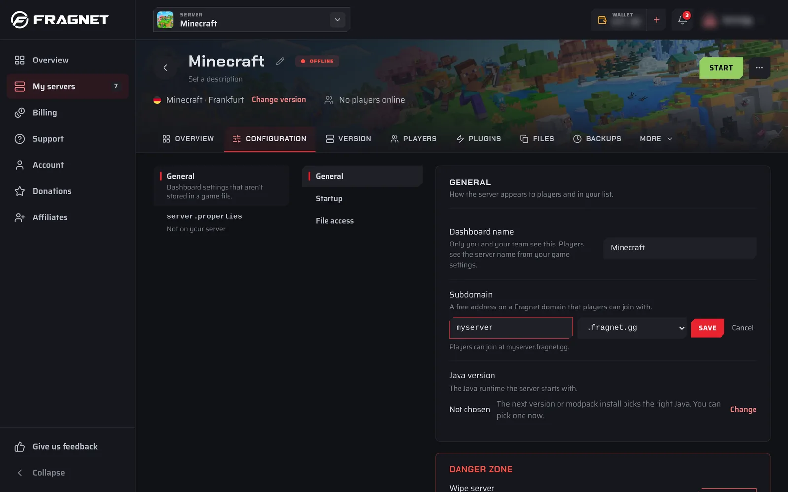

A subdomain gives your server a free, easy-to-remember address: a name you choose (for example `myserver`) in front of a Fragnet domain. Players can join with it instead of typing your server's IP address.

:::info
- You can only use the Fragnet domains offered in the dashboard. Custom domains (a domain you own) aren't supported.
- Each server can have one subdomain.
- Subdomains are only available on some games, and only to the Owner, Admin and Service manager roles.
:::

## Where to find it

Open the [Fragnet dashboard](VAR::PANEL_URL), go to **My servers** and select your server. The subdomain is in two places:

- **Overview** tab: the **Subdomain** row of the **Server Details** card.
- **Configuration** tab: **General** > **General** > **Subdomain**.

Both work the same way. If the row says **Not set**, the server has no subdomain yet.

## Set a subdomain

1. Select **Set subdomain**.
2. Type the name you want in the field (the example in the field is `myserver`). The rules:
   - 2 to 32 characters.
   - Lowercase letters, digits and hyphens only. Capital letters are turned into lowercase as you type.
   - It must start and end with a letter or a digit.
3. If more than one domain is offered, pick one from the list next to the field. If there's only one, it's shown after the field.
4. Check the line under the field, which shows the full address: "Players can join at" followed by your new address.
5. Select **Save**. You see "Subdomain saved."

If you see "That subdomain is taken. Try another one.", someone else already uses that name on that domain. Pick another name or another domain.

## Copy your subdomain

Select the copy button (**Copy subdomain**) next to the address to copy it, for example to share it with your players.

## Change or remove your subdomain

You can't edit a subdomain. To change it, remove it and set a new one.

1. Select the × button next to the address (**Remove subdomain**).
2. The dashboard asks you to confirm. Players who join with the old address can't connect until you set a new one and give them the new address.
3. Select **Remove subdomain**, or **Cancel** to keep it. You see "Subdomain removed."
4. To use a different name, follow [Set a subdomain](#set-a-subdomain) again.
