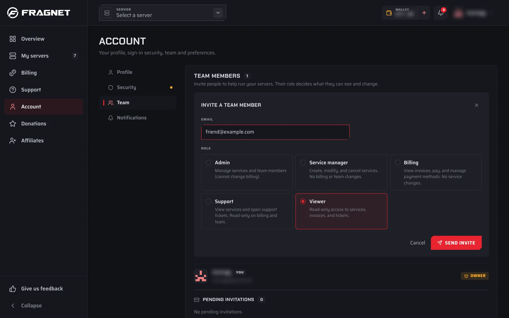

# Team access

You can let other people help run your servers without sharing your password. Invite them to your account as team members and give each one a role. The role decides what they can see and change.

Team members replace the old per-server subusers. If someone used to be a subuser on one of your servers, invite them as a team member.

:::warning Access covers the whole account
A team member's role applies to every server on your account. You can't give someone access to only one server, or choose permissions server by server.
:::

## Open your team

1. Open the [Fragnet dashboard](VAR::PANEL_URL).
2. Open the menu under your name at the top right and select **Team**. You can also select **Account** in the sidebar, then the **Team** tab.

The **Team members** card lists everyone on the account with their role. If you're the Owner or an Admin, it also shows **Pending invitations**.

## Invite a team member

Only the Owner and Admins can invite people.

1. In the **Team members** card, select **Invite member**.
2. In **Invite a team member**, enter the person's **Email**.
3. Under **Role**, pick a role. **Viewer** is selected to start with. Only the Owner can invite someone as an **Admin**.
4. Select **Send invite**.

The person gets an email with an invitation link. The invitation is valid for 24 hours. Until they accept, it's listed under **Pending invitations** with its role and expiry time.

### Accept an invitation

If someone invited you:

1. Open the link in the invitation email. You see who invited you and with which role.
2. If you aren't signed in, select **Log in** (or **Create account** if you don't have a Fragnet account yet) and use the email address the invitation was sent to.
3. Select **Accept invitation**. The dashboard takes you into the account.

If you're signed in with a different email address, select **Sign out** and sign in with the invited one. If the invitation has expired, ask the account owner to send a new one.

## Roles

The Owner is the person who owns the account. Every other member has one of the roles below. In the dashboard, each role comes with a short description, shown in the second column.

| Role | Dashboard description | Server tools | Billing tab | Manage the team |
| --- | --- | --- | --- | --- |
| **Owner** | Full control over the account, billing and team. | ✔️ | ✔️ | ✔️ |
| **Admin** | Manage services and team members (cannot change billing). | ✔️ | ✔️ | ✔️ |
| **Service manager** | Create, modify, and cancel services. No billing or team changes. | ✔️ | ❌ | ❌ |
| **Billing** | View invoices, pay, and manage payment methods. No service changes. | ❌ | ✔️ | ❌ |
| **Support** | View services and open support tickets. Read-only on billing and team. | ❌ | ❌ | ❌ |
| **Viewer** | Read-only access to services, invoices, and tickets. | ❌ | ❌ | ❌ |

**Server tools** means everything that changes a server: power buttons, the console, the **Configuration**, **Files** and **Backups** tabs, schedules, the SFTP/FTP password and game tabs such as plugins, mods or the Workshop.

Every role can see the account's servers in **My servers**, open each server's **Overview** tab (address, location, plan and usage) and its **Activity** tab.

**Manage the team** works like this:

- The Owner can invite people with any role, change roles and remove members.
- Admins can invite people with any role except Admin, and remove members. They can't change roles.
- Any member can leave the team.

## Change a member's role

Only the Owner can change roles.

1. Open the **Team members** card.
2. Select the role next to the member's name.
3. Pick the new role from the list. You see "Role updated."

## Remove a member or an invitation

- **Remove a member**: select **Remove** next to the member, or **Remove from team** in the role list (Owner). Confirm when the dashboard asks. Only the Owner and Admins can remove other members.
- **Leave a team**: if you're a member of someone else's account, select **Leave team** next to your own name.
- **Cancel an invitation**: under **Pending invitations**, select **Revoke** next to it.

## Work on someone else's account

When you're a member of other accounts, you switch between them:

- Open the menu under your name and select **Switch account**, then pick the account. This only shows if you have access to more than one account.
- When you sign in, you may see **Choose an account**. Pick the one to use now.

While you're working in someone else's account, a banner at the top of every page says **You're viewing @\{owner\}'s account as \{role\}.**, with the account's name and your role filled in. Select **Switch to my account** in the banner to go back to your own account.

Your password and two-factor authentication belong to you, not to the account you're viewing. Setting up [two-factor authentication](./2fa.md) protects your sign-in for every account you have access to.

<!-- screenshot: team-viewing-banner.png | Any dashboard page while working in another person's account: the gold banner "You're viewing @…'s account as Service manager." with the "Switch to my account" button. Blur the account name. -->
