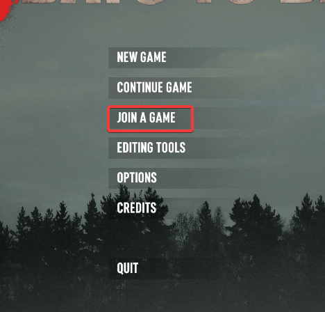
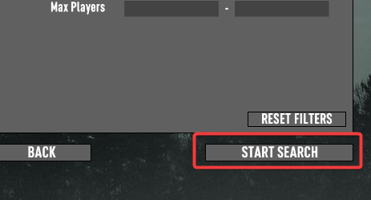
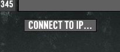
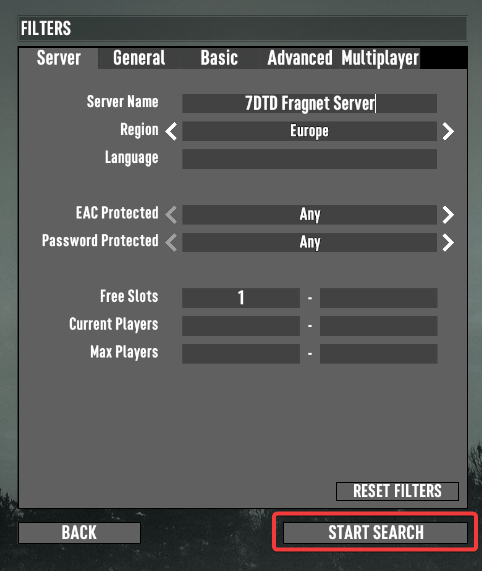
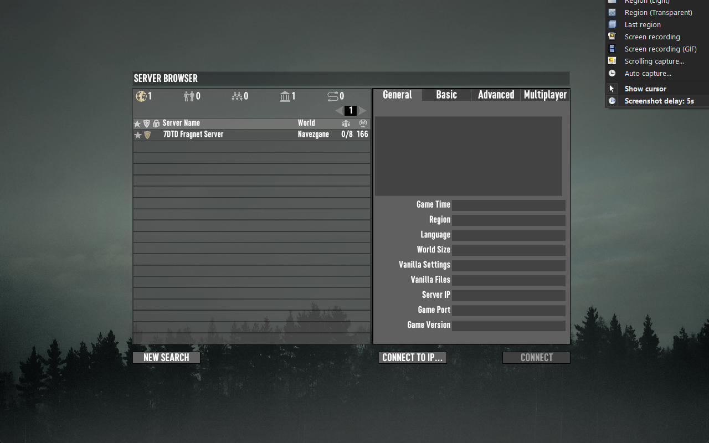

This guide shows two ways to connect to your 7 Days To Die server: by its address, or through the in-game server browser.

## Find your server's address

1. Open the [Fragnet dashboard](VAR::PANEL_URL), go to **My servers** and select your 7 Days To Die server.
2. On the **Overview** tab, the **Server Details** card shows the **Address**. Select the copy button next to it.

The address has two parts, the host and the port, separated by a colon (`host:port`). You need both. See [Server Details](../../control-panel/basics.md#server-details).

## Connect with the address

1. Launch the game and select **Join a Game** in the main menu.

   

2. Select **Start Search** in the bottom-right corner.

   

3. Select **Connect to IP...** and enter the host in **IP** and the port in **Port**.

   

4. Select **Connect**. If the address and port are right, you join your server.

## Find the server in the in-game browser

1. Launch the game and select **Join a Game** in the main menu.
2. In the **Server Name** filter, enter your server's name, then select **Start Search**. The name is the **Server Name** startup setting. See [Change your server's name](change-name.md).

   

3. Your server appears in the list. Double-click it to connect.

   

:::tip Can't find your server?
Check that the name you search for matches the **Server Name** startup setting, and reset other filters such as **Region**. You can always [connect with the address](#connect-with-the-address) instead.
:::
