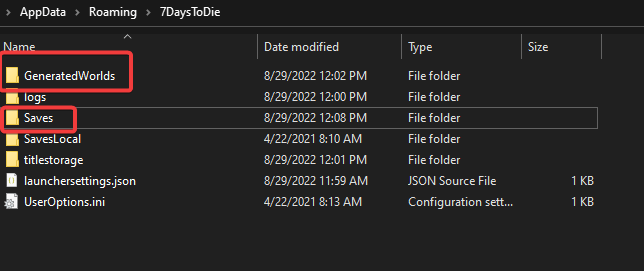
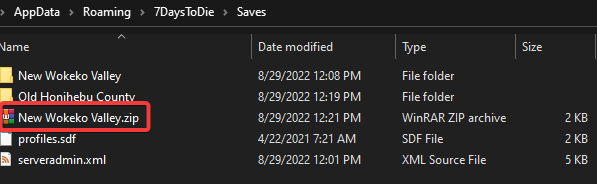
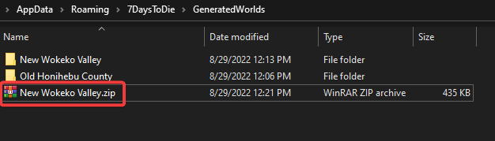

You can move a world you played on your computer to your 7 Days To Die server. You upload the save as a `.zip` file, extract it on the server and point the server to it.

## Prepare the world on your computer

1. Open your 7 Days To Die folder: `C:\Users\YourPCUsername\AppData\Roaming\7DaysToDie`. You can also type `%APPDATA%\7DaysToDie` in the Windows Explorer address bar.

   

2. Open the **Saves** folder. Each world has a folder here, and inside it each game you played on that world has a folder named after the game.
3. Make a `.zip` file of the world folder you want to upload. Zip the folder itself, not just its contents.

   

4. If the world is randomly generated (RWG), also make a `.zip` file of the world's folder in **GeneratedWorlds**.

   

## Upload the world to your server

1. Open the [Fragnet dashboard](VAR::PANEL_URL), go to **My servers** and select your 7 Days To Die server.
2. If the server has a world you want to keep, make a [backup](../../control-panel/backups/index.md) first.
3. Stop the server with **Shut down**.
4. Open the **Files** tab and go to the `.local/share/7DaysToDie/Saves` folder.
5. Upload the `.zip` file of the world folder with **Upload**, or drag it onto the file list. Uploads over 100 MB should go through [SFTP](../../control-panel/file-manager.md#sftp-and-ftp-access).
6. Open the ⋯ menu of the uploaded file and select **Extract**. Your world folder appears in `Saves`. You can then delete the `.zip` file.
7. For a randomly generated world, go to `.local/share/7DaysToDie/GeneratedWorlds`, upload the `.zip` file from **GeneratedWorlds**, and **Extract** it there too. If the `GeneratedWorlds` folder doesn't exist yet, create it in `.local/share/7DaysToDie` with **New folder**.
8. Open the **Configuration** tab and select **General**. In the **Startup** group, set:
   - **Game World** to the name of the world folder you uploaded.
   - **Game Name** to the name of the game folder inside it.
9. Select **Save** in the bar at the bottom of the page.
10. Start the server with **Start**. It loads your world.

See [Upload files](../../control-panel/file-manager.md#upload-files) and [File and folder actions](../../control-panel/file-manager.md#file-and-folder-actions) for more on uploading and extracting.
