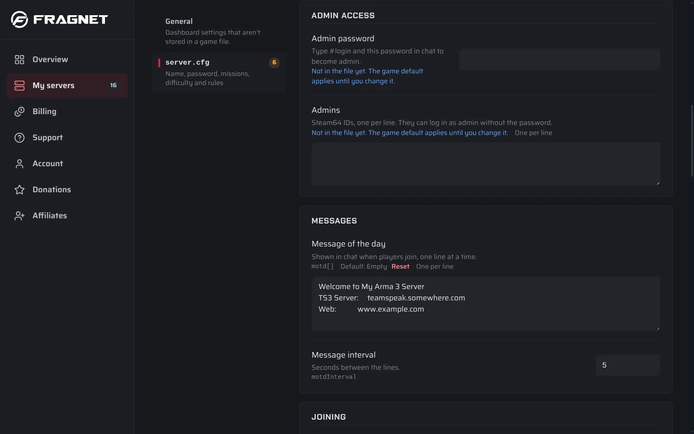

# Become admin on your Arma 3 server

As admin you can kick and ban players, change the mission and restart it, all from the chat in the game.

## Set the admin password

The admin password is `passwordAdmin` in your server's `server.cfg`.

1. Open the [Fragnet dashboard](VAR::PANEL_URL), go to **My servers** and select your server.
2. Open the **Configuration** tab, select **server.cfg**, and type the password in **Admin password** under **Admin access**.
3. Select **Save and restart**, or **Save** and restart the server later. The server reads `server.cfg` when it starts.



See [Change a setting](../../control-panel/configuration.md#in-a-game-config-file) for how saving works. Use a different password than the join password, and don't share it with players.

## Log in as admin

1. Join your server.
2. Open the chat (the default key is `/`).
3. Type `#login` followed by your admin password, for example `#login MyAdminPassword`, and press **Enter**.

To log out, type `#logout`.

### Log in without the password

Players whose Steam64 ID is in the `admins[]` list in `server.cfg` can log in with just `#login`, without the password:

```cpp
admins[] = {"76561198000000000", "76561198000000001"};
```

A Steam64 ID is the 17-digit number that starts with `7656`. You find yours in Steam under **Account details**.

## Admin commands

Type these in the chat after you log in. The full list is on the Bohemia wiki: [Multiplayer Server Commands](https://community.bistudio.com/wiki/Multiplayer_Server_Commands).

| Command | What it does |
| --- | --- |
| `#logout` | Logs you out as admin. |
| `#userlist` | Lists the players on the server, with their numbers. |
| `#kick` | Kicks a player. Add the player's name, ID or number, for example `#kick 3`. |
| `#exec ban` | Bans a player. Add the name, ID or number in quotes, for example `#exec ban "3"`. The player's ID is saved in `ban.txt`. |
| `#missions` | Ends the current mission and opens the list of missions, so you can pick one. |
| `#restart` | Restarts the current mission. |
| `#reassign` | Starts the mission over and lets players choose their roles again. |
| `#shutdown` | Shuts the server down right away. |

To lift a ban, type `#exec unban` followed by the player's ID in quotes, for example `#exec unban "76561198000000000"`.

`#restart` only restarts the mission. To restart the whole server, use **Restart** in the dashboard. See [Power controls](../../control-panel/basics.md#power-controls).
