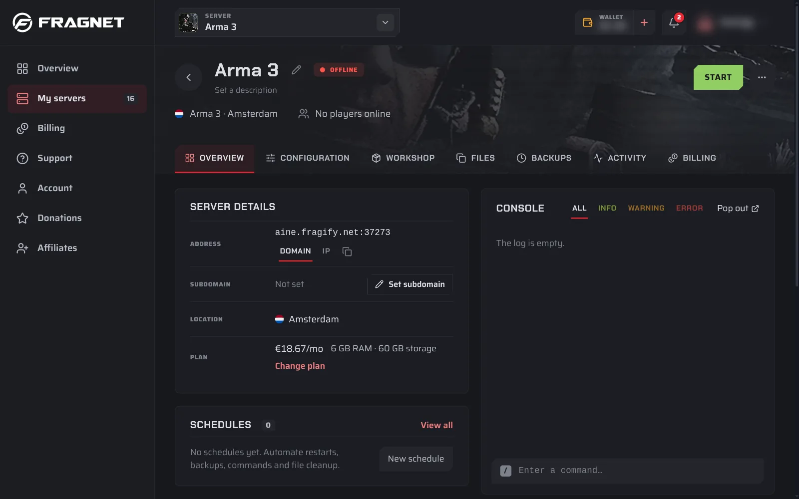

# Getting started with your Arma 3 server

This page shows where to find your server's address and how players join it.

## Find the address and port

1. Open the [Fragnet dashboard](VAR::PANEL_URL), go to **My servers** and select your server.
2. On the **Overview** tab, look at the **Server Details** card. **Address** shows the IP address and the port, for example `203.0.113.10:2302`. The number after the `:` is the port.
3. Select the copy button next to it to copy it.

If the address shows a name instead of numbers, switch **Address type** to **IP**.

## Join the server

### From the Arma 3 Launcher

1. Open the Arma 3 Launcher and select **Servers**.
2. Select **Direct Connect**.
3. Enter the IP address and the port from the dashboard, and join.

### From the game

1. Start Arma 3 and select **Multiplayer**, then **Server Browser**.
2. Search for your server's name and join.

You set the name players see on the **Configuration** tab. See [Change your server's settings](./configuration.md).

## Password

If your server has a join password, the game asks for it when a player joins. You set the password on the **Configuration** tab. Leave it empty for a public server.

## Mods

Players need the same mods as the server, or they can't join. Mods that only the server loads (**Server-side mods**) are the exception: players don't need those.

The easiest way to give players the right mods is a Launcher preset. Export one in the Arma 3 Launcher (**Mods**, **Preset**, **Export**) with the server's mods, and send the `.html` file to your players. They import it in their own Launcher.

To install mods on the server, see [Install Workshop mods](./workshop-mods.md).

## Next steps

- [Install Workshop mods](./workshop-mods.md)
- [Become admin on your server](./become-admin.md)
- [Add a custom mission](./custom-missions.md)
