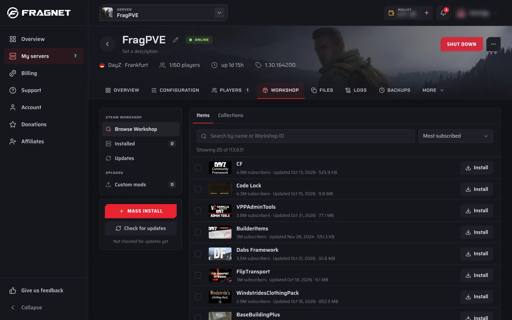
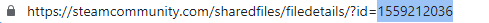

# Installing mods on your DayZ server

You install, update and remove Steam Workshop mods for DayZ on the **Workshop** tab of your server in the [Fragnet dashboard](VAR::PANEL_URL). The dashboard downloads the mods, adds them to the server's launch line and keeps track of their load order. You don't edit a command line yourself.

:::tip
Make a backup before you add or remove mods, so you can go back if the server doesn't start. See [Creating a backup for your DayZ server](./make-backup.md).
:::

## Open the Workshop tab

1. Open the [Fragnet dashboard](VAR::PANEL_URL), go to **My servers** and select your server.
2. Select the **Workshop** tab. If you don't see it in the row of tabs, look under **More**.

The list on the left has these views (on small screens they're in a drop-down at the top):

- **Browse Workshop**: search the Steam Workshop for DayZ mods and collections.
- **Installed**: the mods on your server and their **Load order**.
- **Updates**: installed mods with a newer version on Steam.
- **Custom mods** (under **Uploads**): mods you upload yourself as a `.zip` file.

Below the list, **Mass install** installs several mods at once by ID or link, and **Check for updates** compares your mods with Steam.

:::info
Some servers can only install and update mods while they're stopped. If yours is one of them and it's running, the dashboard shows "Stop the server first". Select **Stop server**, then try again. The server stays off until you start it.
:::

## Install mods from the Workshop

1. Select **Browse Workshop**.
2. Type the mod's name or Workshop ID in the search box. **Sort by** sorts the results by **Most subscribed**, **Recently updated**, **Trending** or **Newest**.
3. Select **Install** next to the mod. To install several, tick them and select the **Install** button at the bottom (for example **Install 3 mods**).

The download shows at the top of the tab, for example "Downloading 2 mods", with **Cancel** to stop it. Mods that the chosen mod lists as required items on Steam are installed with it.

### Install a list of mods or a collection

1. Select **Mass install**.
2. Choose how to install:
   - **IDs or links**: paste Workshop IDs or item links, one per line or separated by commas. You can install up to 50 at a time.
   - **Collection**: paste a Workshop collection link or ID. Mods you already have are skipped.
3. Check what was found. For IDs and links, each item shows whether it's **New**, already **Installed** or **Not available**. For a collection, you see how many items it has and how many you already have.
4. Select **Install** (for example **Install 12 mods**).

To find a mod's Workshop ID, open the mod's page on the Steam Workshop. The ID is the number at the end of the address:

To browse popular collections, select **Browse Workshop**, then **Collections**.

## Restart to load the mods

DayZ loads mods when it starts. After you install, enable, disable or reorder mods, a bar at the top of the **Workshop** tab tells you how many mod changes are waiting:

- If the server is running, select **Restart now**. Players are disconnected during the restart.
- If the server is stopped, select **Start server**.

Players download the client mods when they join.

## Load order and server-side mods

Select **Installed** to see the **Load order** card. It has two lists:

- **Client mods** (loaded with `-mod`): players download these when they join.
- **Server-side mods** (loaded with `-servermod`): only the server loads these.

Mods load top to bottom, so keep frameworks such as Community Framework (CF) above the mods that need them. Drag a mod to change its place or to move it to the other list. Changes save straight away and apply on the next restart.

See [Mod load order and launch parameters](./custom-commandline-dayz-server.md) for details.

## Manage installed mods

Select a mod in the **Installed** view to open its details:

| Option | What it does |
| --- | --- |
| **Enabled** | Turn off to stop loading the mod. Disabled mods stay installed and keep their place in the load order. |
| **Scheduled updates** | Installs new Workshop versions automatically during scheduled restarts. |
| **Server-side only** | Loads the mod with `-servermod`. Players don't download it when they join. |
| **Load position** | Shows where the mod loads. Use **Load earlier** and **Load later** to move it. |

The details also have **Install update** (or **Reinstall**), **Uninstall**, **Open on Steam** and **Copy Workshop ID**.

<!-- screenshot: dayz-workshop-mod-details.png | DayZ server, Workshop tab, Installed view with one mod's details panel open: Enabled, Scheduled updates and Server-side only switches, Load position with the earlier/later arrows, and the Install update/Reinstall and Uninstall buttons -->

To change several mods at once, tick them in the **Installed content** list and select **Enable**, **Disable** or **Uninstall**.

If other enabled mods need the mod you disable or uninstall, the dashboard warns you ("Other mods need this") and offers to change those mods too. Uninstalling a mod deletes its folder from the server.

## Update mods

1. Select **Check for updates**. The **Updates** view lists the mods that have a new version on Steam.
2. Select **Update** next to a mod, or **Update all**.
3. Restart the server so the new versions load.

To update mods without doing it by hand, turn on **Scheduled updates** for each mod and add a **Workshop** task to a restart schedule. See [Schedule tasks](../../control-panel/schedules/creating-a-task.md#workshop).

## Upload a custom mod

For a mod that isn't on the Steam Workshop:

1. On your computer, zip the mod folder, for example `@MyMod` with its `addons` and `keys` folders.
2. On the **Workshop** tab, select **Custom mods**.
3. Drop the `.zip` file on the upload area, or click it to choose the file.
4. The dashboard uploads and unpacks the zip and adds the new `@` folder as a custom mod. It appears in the load order with the **Custom** tag.

Mod folder names start with `@` and can only use letters, digits, dots, dashes and underscores.

## Mod keys

When **Verify mod signatures** is on in `serverDZ.cfg` (see [Changing basic settings](./adjust-basic-settings.md)), the server kicks players whose mods don't match its keys. Every mod's key, a `.bikey` file, must be in the server's `keys` folder. Mods carry their key in their own `keys` folder, for example `@MyMod/keys`.

If players are kicked with a signature error, check on the **Files** tab that the mod's `.bikey` file is in `keys`. If it's missing, download it from the mod's `keys` folder and upload it to the server's `keys` folder. See [Files and SFTP](../../control-panel/file-manager.md#moving-files-between-folders).

Uninstalling a mod leaves its key in the server's `keys` folder.

## Community maps

Map mods (for example a community terrain) also need their mission in the `mpmissions` folder.

1. Install the map mod and make sure it's enabled.
2. Stop the server.
3. On the **Overview** tab, select **Change map** on the **Map** card.
4. Missions that the dashboard finds in your mods are listed under "In your Workshop mods (copied into mpmissions when you save)". Select the mission.
5. Select **Switch map**, then start the server.

A community map only starts when its map mod is loaded on the server. Each map keeps its own world, so you can switch back to your old map later.
