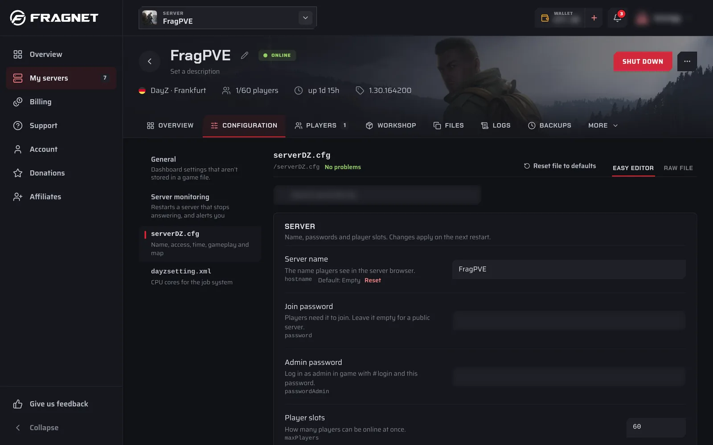

# Changing basic settings of your DayZ server

Your DayZ server's main settings, such as the server name, the passwords and the message of the day, are in `serverDZ.cfg`. You change them on the **Configuration** tab in the [Fragnet dashboard](VAR::PANEL_URL), where each setting has its own labelled field.

## Open serverDZ.cfg

1. Open the [Fragnet dashboard](VAR::PANEL_URL), go to **My servers** and select your server.
2. Select the **Configuration** tab.
3. In the list on the left, select `serverDZ.cfg` ("Name, access, time, gameplay and map").

A new server that still has the default name shows a notice on the **Overview** tab with **Name your server**. That button opens the same file.



## Change a setting

1. Find the setting in its group, or type its name in the search box at the top (**Search serverDZ.cfg**).
2. Change the value.
3. Select **Save and restart**. `serverDZ.cfg` can only be written while the server is stopped, so **Save and restart** stops the server, saves the file and starts the server again. If the server is already stopped, **Save** is enough.

For more about the save bar, **Review changes** and the **Raw file** view, see [Change a setting](../../control-panel/configuration.md#in-a-game-config-file).

## Settings in serverDZ.cfg

| Group | Settings |
| --- | --- |
| **Server** | **Server name**, **Join password**, **Admin password**, **Player slots** |
| **Gameplay** | **First person only**, **Hide crosshair**, **No personal light**, **Night lighting**, **Voice chat off**, **Voice quality**, **Respawn delay**, **Protect bases**, **Protect containers**, **Skip the respawn choice** |
| **Time** | **Start time**, **Day speed**, **Night speed**, **Keep the clock across restarts** |
| **Access** | **Whitelist only**, **Use the ban list**, **Use the priority list**, **Logins at once**, **Queue size** |
| **Advanced** | **Message of the day**, **Message interval**, **Verify mod signatures**, **Same game version only**, **Use cfggameplay.json**, and the admin log settings |
| **Mission** | **Map** |

Each field shows a short description and, where there is one, the default value.

### Server name and passwords

- **Server name** is the name players see in the server browser.
- **Join password**: players need it to join. Leave it empty for a public server.
- **Admin password**: to log in as admin, type `#login` followed by this password in the game chat, for example `#login MyAdminPassword`.
- **Player slots** is part of your plan when it shows **Set by your plan**. Change it on the **Billing** tab. See [Upgrade or downgrade your server](../../FAQ/upgrade-downgrade-server.md).

Settings tagged **Applied at start**, usually including the server name and passwords, are stored in your startup settings and written into `serverDZ.cfg` every time the server starts. Their labelled fields change the startup setting for you. If you edit those lines in the **Raw file** view instead, the dashboard warns "Replaced from your startup settings at every start", because your change would be overwritten.

### Message of the day

- **Message of the day**: shown in the chat after players join. Put one message per line.
- **Message interval**: the number of seconds between the messages.

For welcome messages, repeating messages and countdowns, you can also use **Server messages** on the **Overview** tab (see [Other DayZ settings](#other-dayz-settings)).

### Time

- **Start time**: `SystemTime` follows the real clock. Or enter a date and time as `YYYY/MM/DD/HH/MM`.
- **Day speed**: `1` is real time. `6` makes a full day last 4 hours.
- **Night speed**: speeds up nights on top of the day speed. `4` makes nights four times shorter.
- **Keep the clock across restarts**: the clock continues where it stopped instead of going back to the start time.

### Editing the file as text

Switch to **Raw file** to see `serverDZ.cfg` as text. Each setting is one line, for example:

```cpp
hostname = "My DayZ Server";   // Server name
password = "";                 // Join password, empty for a public server
motd[] = {"Welcome to the server", "Join our Discord"};
motdInterval = 30;             // Seconds between messages
```

Settings that the easy editor doesn't describe are listed under **Other settings**. The full list of `serverDZ.cfg` settings is on the [Bohemia Interactive wiki](https://community.bistudio.com/wiki/DayZ:Server_Configuration).

## Other DayZ settings

Some DayZ settings live elsewhere in the dashboard:

| Setting | Where |
| --- | --- |
| Map | **Overview** tab, **Map** card, **Change map** (stop the server first). Each map keeps its own world. |
| Automatic restarts with warnings | **Overview** tab, **Restarts and messages** card, **Set up restarts** |
| Welcome, repeating and countdown messages | **Overview** tab, **Restarts and messages** card, **Server messages** |
| Whitelist, ban list and priority queue | **Players** tab |
| Chat limits | **Configuration** tab, **General**, **Chat limits** |
| BattlEye RCon password | **Configuration** tab, the BattlEye config `BEServer_x64.cfg` ("BattlEye remote console access"), **RCon password**. BattlEye renames this file while the server runs, so stop the server to edit it. The **BattlEye RCon** card on the **Overview** tab shows the host, port and password for RCon tools. |
| CPU cores for the job system | **Configuration** tab, `dayzsetting.xml` |
| Game updates and the Experimental branch | **Steam** tab |
| Restarting a server that stops answering (Windows servers) | **Configuration** tab, **Server monitoring**. See [DayZ: Server monitoring alerts](../../control-panel/crash-alerts.md#dayz-server-monitoring-alerts). |
| Loot spawns | `types.xml`, see [Increase Item Spawns](./increase-item-spawns.md) |
