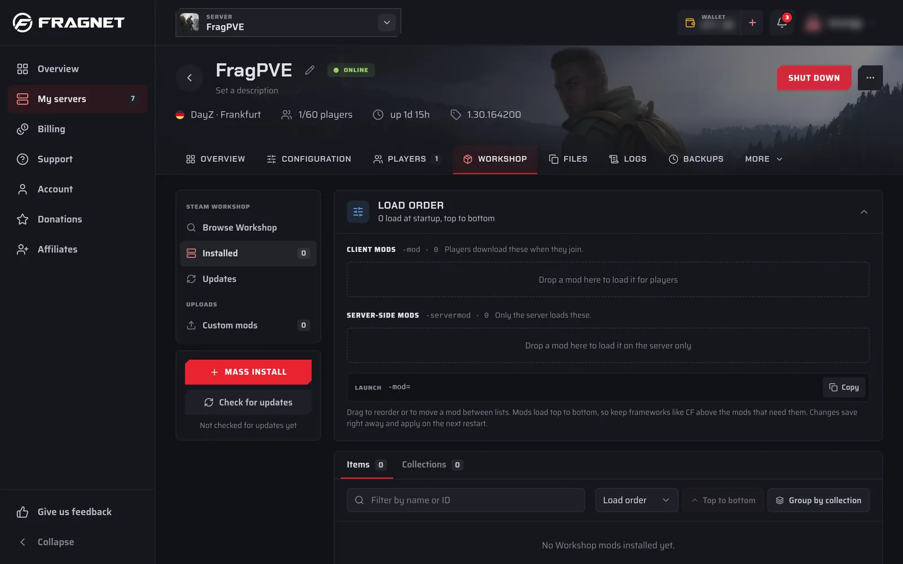
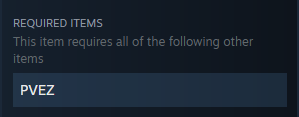

# Mod load order and launch parameters on your DayZ server

The [Fragnet dashboard](VAR::PANEL_URL) builds your DayZ server's launch line for you. There's no custom command line to write:

- The `-mod` and `-servermod` parameters come from the mods on the **Workshop** tab, in their **Load order**.
- Other startup options are startup settings on the **Configuration** tab.

## Set the mod load order

Some mods need other mods, such as Community Framework (CF), to load first. If a mod loads before a mod it needs, the server may not start.

1. Open the [Fragnet dashboard](VAR::PANEL_URL), go to **My servers** and select your server.
2. Select the **Workshop** tab, then **Installed**.
3. Open the **Load order** card if it's folded. It has two lists:
   - **Client mods** (`-mod`): players download these when they join.
   - **Server-side mods** (`-servermod`): only the server loads these.
4. Drag a mod up or down to change where it loads. Mods load top to bottom, so put a mod below the mods it needs. On a phone, use the arrows next to each mod.
5. To move a mod to the other list, drag it there, or select it and turn **Server-side only** on or off.
6. Restart the server. Changes save straight away but only apply on the next start.



Disabled mods keep their place and show **Off**. Mods you uploaded yourself show **Custom**.

Until you change the order yourself, the dashboard places mods after the mods they need. After you've reordered by hand, check the order whenever you install a new mod.

### Which mods does a mod need?

The mod's Steam Workshop page lists them under **Required items**:



Those mods must be above it in the load order. When you install a mod from the **Workshop** tab, its required items are installed with it.

## See the launch line

Below the lists, **Launch** shows the mod parameters the server starts with, for example:

```
-mod=@CF;@VPPAdminTools -servermod=@MyServerMod
```

Each mod is its folder name on the server, separated by `;`. Select **Copy** to copy the line, for example to add it to a support ticket.

## Other launch parameters

Other startup options are startup settings:

1. Open the **Configuration** tab and select **General**.
2. Select the **Startup** group. It lists the startup settings your server offers, each with a short description.
3. Change a value and select **Save**. It applies the next time the server starts.

Settings tagged **Fixed** or **Set by your plan** can't be changed there. See [Startup](../../control-panel/configuration.md#startup).

Many server options are not launch parameters but settings in `serverDZ.cfg`, for example **Verify mod signatures** and **Same game version only**. See [Changing basic settings](./adjust-basic-settings.md).

:::info
You can't add your own launch parameters, such as `-filePatching` or `-ignoremod`. If you need one, [open a support ticket](VAR::SUPPORT_URL).
:::
