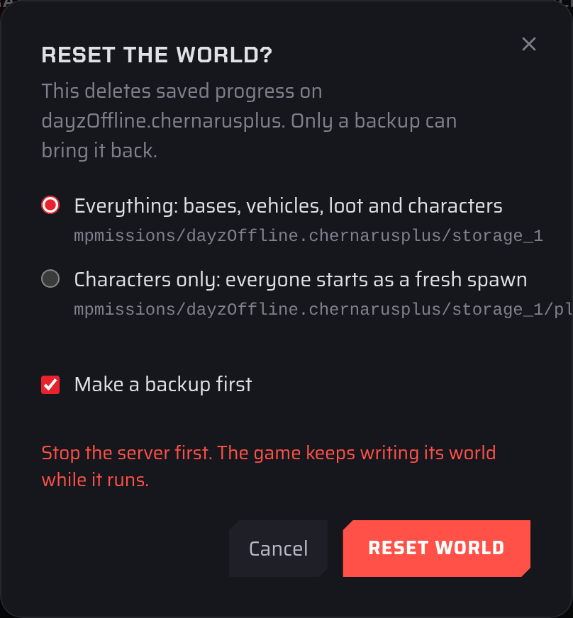

# Wiping your DayZ server

There are two ways to wipe a DayZ server in the [Fragnet dashboard](VAR::PANEL_URL). Both are in the **Danger zone** on the **Configuration** tab.

| | **Reset the world** | **Wipe server** |
| --- | --- | --- |
| What it deletes | The current map's saved world (bases, vehicles, loot and characters), or only the characters | Every file on the server: worlds, configs, mods and player lists |
| What stays | Your settings, mods, player lists and the worlds of your other maps | Nothing. The game is installed fresh. |
| Use it for | A fresh start for your players | Starting over completely |

:::danger
Deleted files can only be brought back from a backup. Make a [backup](./make-backup.md) first, or keep **Make a backup first** ticked when you reset the world.
:::

## Reset the world

1. Open the [Fragnet dashboard](VAR::PANEL_URL), go to **My servers** and select your server.
2. Stop the server with **Shut down** at the top of the page. The game keeps writing its world while it runs. See [Power controls](../../control-panel/basics.md#power-controls).
3. Open the **Configuration** tab and select **General**.
4. Scroll down to the **Danger zone** and select **Reset world** next to **Reset the world**.
5. In **Reset the world?**, choose what to delete:
   - **Everything: bases, vehicles, loot and characters** deletes the map's whole persistence folder (usually `storage_1`), for example `mpmissions/dayzOffline.chernarusplus/storage_1`.
   - **Characters only: everyone starts as a fresh spawn** deletes only `players.db` in that folder. Bases, vehicles and loot stay.
6. Leave **Make a backup first** ticked to back up the server before anything is deleted. The backup is called "Before world reset" followed by the mission name.
7. Select **Reset world**.
8. Start the server. The map starts fresh.

Only the map your server runs now is reset. Each map keeps its own world, so the worlds of other maps stay as they are.

If the backup can't be made or doesn't finish, nothing is deleted. This happens, for example, when you've used all the backups in your plan. Delete an old backup on the **Backups** tab and try again, or untick **Make a backup first** if you already have a recent backup.

## Wipe the whole server

**Wipe server** in the **Danger zone** deletes every file on the server, including worlds, configs and mods, then installs the game fresh. You confirm it by typing the server's name. If your server doesn't show **Wipe server**, [open a support ticket](VAR::SUPPORT_URL). See [Danger zone: wipe the server](../../control-panel/configuration.md#danger-zone-wipe-the-server).

After a full wipe, check your [settings](./adjust-basic-settings.md) and the **Workshop** tab, and [install your mods](./add-mods.md) again where needed.
