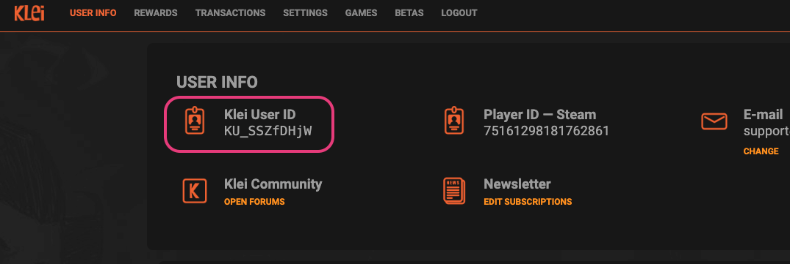
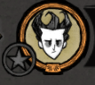

# Adding admins to your Don't Starve Together server

Admins are listed by their Klei ID in a file called `adminlist.txt` on your server. You create it on the **Files** tab of the dashboard.

## Get your Klei ID

There are two ways to find a Klei ID.

### Method 1: on the server

1. Connect to your server and type `c_listallplayers()` in the console. You can also type it in the console on the **Overview** tab of the dashboard (see [Send a command](../../control-panel/basics.md#send-a-command)).
2. You see a list of the players connected to the server. Find your name and copy your Klei ID. It starts with `KU_`.

### Method 2: on the Klei website

1. Go to [Klei Entertainment](https://accounts.klei.com/account/game) and log in with your Steam account.
2. Once logged in, you see your Klei ID.

## Create the adminlist.txt file

1. Open the [Fragnet dashboard](VAR::PANEL_URL), go to **My servers** and select your Don't Starve Together server.
2. Select the **Files** tab and open the folder `DoNotStarveTogether/config/server`.
3. If `adminlist.txt` is already there, select it to open it. Otherwise select **New file**, enter `adminlist.txt` as the name and select **Create** (see [Create a file or folder](../../control-panel/file-manager.md#create-a-file-or-folder)). The name must be exactly `adminlist.txt`. The new file opens in the editor.
4. Paste your Klei ID on the first line. To add more admins, put each Klei ID on its own line.
5. Select **Save file**.
6. Restart the server (see [Power controls](../../control-panel/basics.md#power-controls)) and connect to it.

If it worked, you see a star icon next to your character portrait:

To remove an admin, delete their line from `adminlist.txt`, save the file and restart the server.
