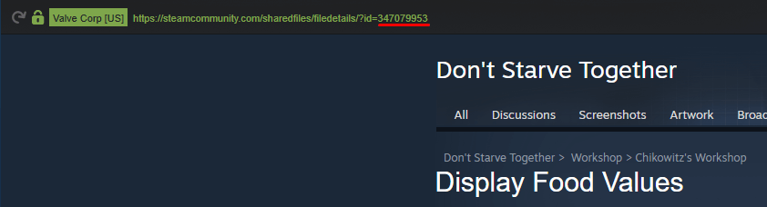
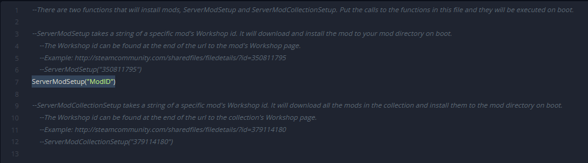
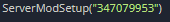
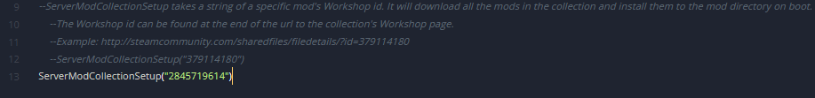
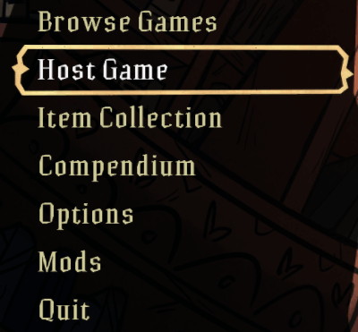
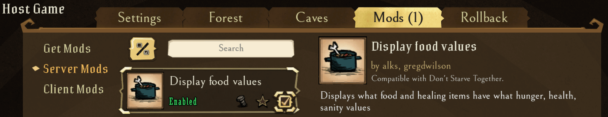
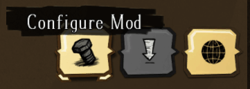
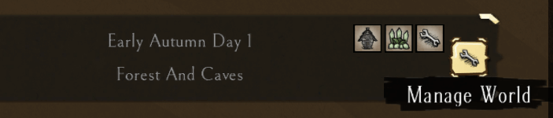
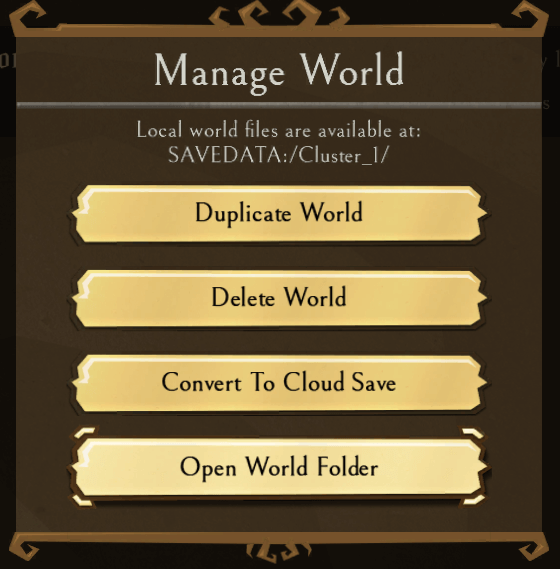

# Adding mods to your Don't Starve Together server

Installing mods on a Don't Starve Together server takes two files, which you edit on the **Files** tab of the dashboard:

- `dedicated_server_mods_setup.lua` in the `mods` folder tells the server which Steam Workshop mods to download.
- `modoverrides.lua` in `DoNotStarveTogether/config/server/Master` (and `Caves`) turns the mods on and holds their settings.

Stop the server before you start (see [Power controls](../../control-panel/basics.md#power-controls)).

## Find a mod's ID

Open the mod's Steam Workshop page. The last part of the page's link is the mod ID:



## Add individual mods

1. Open the [Fragnet dashboard](VAR::PANEL_URL), go to **My servers** and select your Don't Starve Together server.
2. Select the **Files** tab, open the `mods` folder and select `dedicated_server_mods_setup.lua` to open it in the editor.
3. Add this line to the file:

   ```lua
   ServerModSetup("ModID")
   ```

   It should look like this:

   

4. Replace `ModID` with the mod's ID. Keep the quotes and the parentheses.

   

5. To add more mods, add another `ServerModSetup("ModID")` line for each mod.
6. Select **Save file**.

Next, turn the mods on with `modoverrides.lua`, as described in [Enable the mods](#enable-the-mods).

## Add a Workshop collection

Adding a Steam Workshop collection works the same way. The only difference is the line you add to `dedicated_server_mods_setup.lua`. Instead of `ServerModSetup("ModID")`, use:

```lua
ServerModCollectionSetup("Workshop_Collection_ID")
```

Replace `Workshop_Collection_ID` with the ID from the collection's Workshop page. For example:



## Enable the mods

1. On the **Files** tab, open the folder `DoNotStarveTogether/config/server/Master`.
2. If `modoverrides.lua` is already there, select it to open it. Otherwise select **New file**, enter `modoverrides.lua` as the name and select **Create** (see [Create a file or folder](../../control-panel/file-manager.md#create-a-file-or-folder)). The new file opens in the editor.
3. Paste this text. It enables two mods. Replace `modid` with each mod's ID, for example `workshop-347079953`:

   ```lua
   return {
     ["workshop-modid"]={
       configuration_options={  },
       enabled=true
     },
     ["workshop-modid"]={
       configuration_options={  },
       enabled=true
     }
   }
   ```

4. To add more mods, add another block like this one inside the outer brackets, separated from the previous block by a comma:

   ```lua
   ["workshop-modid"]={
     configuration_options={  },
     enabled=true
   },
   ```

5. Select **Save file**.
6. If your server has caves, create the same `modoverrides.lua` in `DoNotStarveTogether/config/server/Caves` too, so the mods are enabled there as well. Copy the text from the `Master` file and paste it into a new file in `Caves`.
7. Start the server. The mods download and are enabled on the server.

## Configure your mods

Some mods need to be configured. The easiest way is to let the game create the config for you on your own computer, then copy it to the server.

1. **Subscribe** to the mod on the Steam Workshop and start the game.
2. Select **Host Game**.

   

3. Go to the **Mods** tab and tick the mods you want.

   

4. Select the mod you want to configure, then select **Configure Mod**.

   

5. When you're done, select **Generate World**. The game creates the config file `modoverrides.lua` in `Users\%useraccount%\Documents\Klei\DoNotStarveTogether\%randomnumber%\Cluster_1\Master` on your computer. To find the folder, you can also select **Manage World**:

   

   And then **Open World Folder**:

   

6. Copy the file to the server, into `DoNotStarveTogether/config/server/Master`. Either:
   - Open the file on your computer in a text editor and copy everything. On the **Files** tab, open the server's `modoverrides.lua`, replace its contents with what you copied and select **Save file**. Or:
   - Delete or rename the server's existing `modoverrides.lua`, then open the `Master` folder on the **Files** tab and select **Upload** to upload your file (see [Upload files](../../control-panel/file-manager.md#upload-files)).
7. If a mod changes the caves, do the same with the `modoverrides.lua` from the `Caves` folder on your computer and the server's `DoNotStarveTogether/config/server/Caves` folder.
8. Start or restart the server. Your mods are now installed, enabled and configured.
