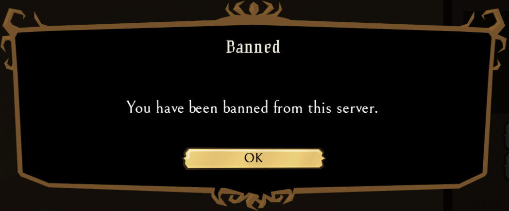

# Banning players on your Don't Starve Together server

There are two ways to ban players:

- With a console command, while the player is still on the server.
- By adding their Klei ID to `blocklist.txt`, for example when the player is offline.

## Ban a player with a console command

You can run these commands in the console on the **Overview** tab of the dashboard (see [Send a command](../../control-panel/basics.md#send-a-command)) or in the in-game console as an admin.

1. Open the [Fragnet dashboard](VAR::PANEL_URL), go to **My servers** and select your Don't Starve Together server.
2. In the console, type `c_listallplayers()` and press **Enter**. The console lists all players with their Klei IDs.
3. Copy the player's Klei ID into this command and send it: `TheNet:Ban("PlayerKleiID")`

   For example: `TheNet:Ban("KU_ex12312")`. Keep the quotes and the parentheses.

The player is removed from the server and can't join again. To only kick a player without banning them, use `TheNet:Kick("PlayerKleiID")` instead.

## Ban a player with blocklist.txt

1. If the player isn't online any more, find their Klei ID in the server log. On the **Files** tab, open `DoNotStarveTogether/config/server/Master/server_log.txt` and look for the player's name.
2. Open the folder `DoNotStarveTogether/config/server`.
3. If `blocklist.txt` is already there, select it to open it. Otherwise select **New file**, enter `blocklist.txt` as the name and select **Create** (see [Create a file or folder](../../control-panel/file-manager.md#create-a-file-or-folder)). The name must be exactly `blocklist.txt`.
4. Paste the player's Klei ID. Put each Klei ID on its own line.
5. Select **Save file**.
6. Restart the server (see [Power controls](../../control-panel/basics.md#power-controls)).

When the player tries to connect, they see this:

To unban a player, delete their line from `blocklist.txt`, save the file and restart the server.
