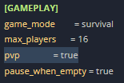

# Configuring PvP on Don't Starve Together server

PvP is set in your server's `cluster.ini` file.

1. Open the [Fragnet dashboard](VAR::PANEL_URL), go to **My servers** and select your Don't Starve Together server.
2. Select the **Files** tab, open the folder `DoNotStarveTogether/config/server` and select `cluster.ini` to open it in the editor (see [Edit a file](../../control-panel/file-manager.md#edit-a-file)).
3. Under the `[GAMEPLAY]` section, set the `pvp` line:

   ```ini
   pvp = true
   ```

   It should look like this:

   

   This enables PvP. To disable it, use `false` instead of `true`.

4. Select **Save file**.
5. Restart the server (see [Power controls](../../control-panel/basics.md#power-controls)). The change is now applied.

:::tip
You can also open `cluster.ini` in the config editor: in the file's ⋯ menu, select **Open in config editor**. If a setting there is marked **Applied at start**, its value comes from a startup setting and is written into the file every time the server starts. Change it on the **Configuration** tab under **General** > **Startup** instead, or your edit is overwritten (see [Easy editor and raw file](../../control-panel/configuration.md#easy-editor-and-raw-file)).
:::
