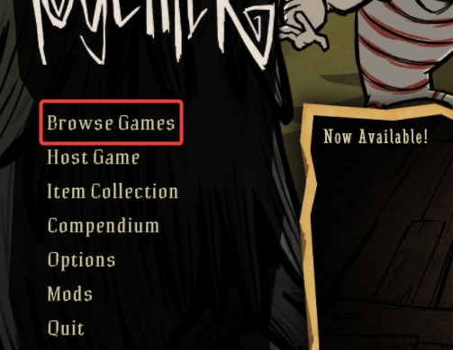
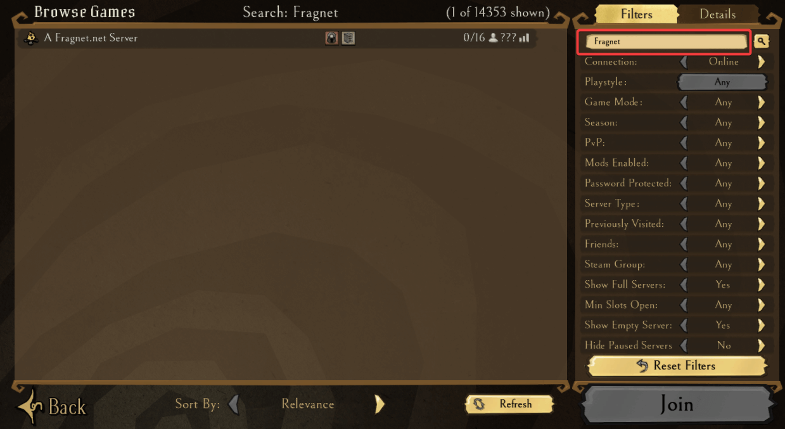

# Finding and connecting to your Don't Starve Together server

This guide shows you two ways to connect to your Don't Starve Together server.

## Via Direct Connect

1. Find your server's address. Open the [Fragnet dashboard](VAR::PANEL_URL), go to **My servers** and select your Don't Starve Together server. On the **Overview** tab, the **Server Details** card shows the **Address** with a copy button (see [Server Details](../../control-panel/basics.md#server-details)). The part before the colon is the IP address, the part after it is the port. If the address shows a domain, you can switch **Address type** to **IP**.
2. If your server has a password, have it ready. See [Setting a password](setting-password.md).
3. Launch the game and press the tilde key (`~`) to open the console.
4. Type this command, with your server's IP address, port and password:

   ```
   c_connect("ip", port, "password")
   ```

   For example: `c_connect("203.0.113.10", 10999, "password123")`. The port goes without quotes.

5. Press **Enter**. If all details are correct, you are connected to your server.

## Via Server Browser in-game

1. Launch the game and select **Browse Games** in the main menu.

   

2. Search for your server's name. This is the `cluster_name` in your server's `cluster.ini`, or the matching startup setting under **Configuration** > **General** > **Startup** if your server has one.

   

3. Your server appears in the list. Select it and select **Join**.

:::tip
If you can't find your server, check that the name you search for and the browser's game mode filter match your server's name and game mode (`game_mode` in `cluster.ini`). The server also needs a valid cluster token to show up. See [Generating a cluster token](generate-cluster-token.md).
:::
