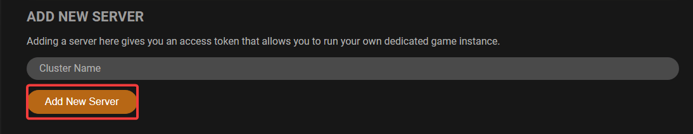
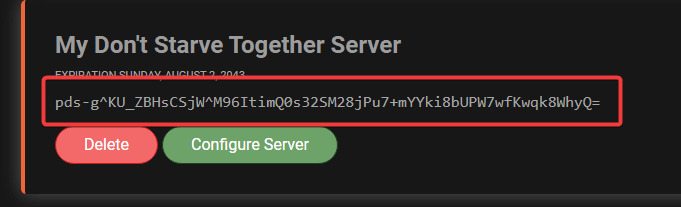

# Generating Cluster Token for your Don't Starve Together server

Your server needs a cluster token from Klei to run and to be visible in the game. This guide shows you how to create one and add it to your server.

## Create the token

1. Log in to your Klei account at https://accounts.klei.com/login and go to **Games** > **Don't Starve Together**. You can also use this link: https://accounts.klei.com/account/game/servers?game=DontStarveTogether
2. Enter a cluster name and select **Add New Server**.

   

3. Klei shows the generated token. Copy it.

   

## Add the token to your server

1. Open the [Fragnet dashboard](VAR::PANEL_URL), go to **My servers** and select your Don't Starve Together server.
2. Select the **Configuration** tab, select **General** in the list on the left, then the **Startup** group (see [Startup](../../control-panel/configuration.md#startup)).
3. Find the startup setting for the server (cluster) token and paste your token into it.
4. Select **Save** in the bar at the bottom.
5. Start or restart the server (see [Power controls](../../control-panel/basics.md#power-controls)). The token applies the next time the server starts.
