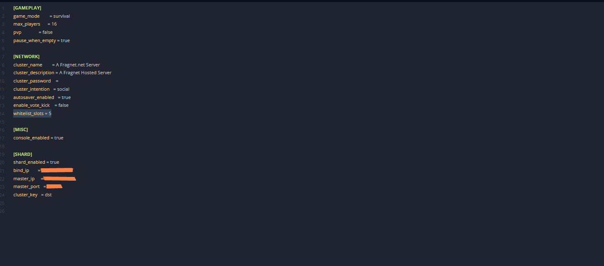

# Assigning reserved slots on Don't Starve Together server

In Don't Starve Together, the whitelist reserves slots: players on the list always have a free slot, and other players who aren't on the list can still join with the remaining slots.

First you set the number of reserved slots in `cluster.ini`, then you add the players' Klei IDs to `whitelist.txt`. To find a Klei ID, see [Get your Klei ID](adding-admins.md#get-your-klei-id).

## Set the number of reserved slots

1. Open the [Fragnet dashboard](VAR::PANEL_URL), go to **My servers** and select your Don't Starve Together server.
2. Select the **Files** tab, open the folder `DoNotStarveTogether/config/server` and select `cluster.ini` to open it in the editor (see [Edit a file](../../control-panel/file-manager.md#edit-a-file)).
3. In the `[NETWORK]` section, add this line and replace `number` with the number of reserved slots you want:

   ```ini
   whitelist_slots = number
   ```

   In this example, there are 5 reserved slots:

   

4. Select **Save file**.

## Create the whitelist

1. On the **Files** tab, open the folder `DoNotStarveTogether/config/server`.
2. If `whitelist.txt` is already there, select it to open it. Otherwise select **New file**, enter `whitelist.txt` as the name and select **Create** (see [Create a file or folder](../../control-panel/file-manager.md#create-a-file-or-folder)). The name must be exactly `whitelist.txt`.
3. Enter the Klei IDs of the players who get a reserved slot, one per line.
4. Select **Save file**.
5. Restart the server (see [Power controls](../../control-panel/basics.md#power-controls)).

The players on the whitelist now have priority over other players connecting.
