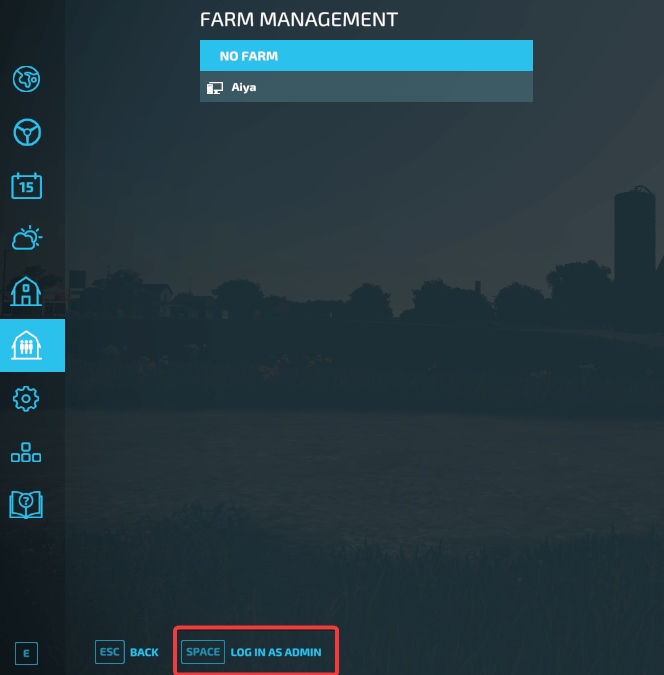
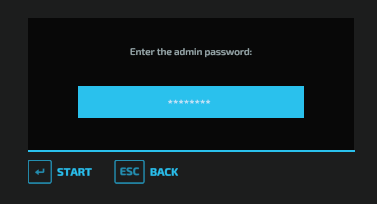

# Become an admin on Farming Simulator 22 server

You become admin in the game by signing in with your server's in-game admin password.

## Find or change the in-game admin password

1. Open the [Fragnet dashboard](VAR::PANEL_URL), go to **My servers** and select your server.
2. On the **Overview** tab, find the **Joining the farm** card. Next to **In-game admin password**, select the eye icon to show the password, or the copy icon to copy it.

<!-- screenshot: fs22-ingame-admin-password-card.png | FS22 server, Overview tab: the "Joining the farm" card with Server name, Join password and the In-game admin password row revealed (eye icon toggled on), with its copy icon visible -->

To set a different password:

1. Open the **Configuration** tab and select the **Server** group.
2. If the game is running, select **Stop game** in the notice and confirm with **Stop game**. The settings can only be changed while the game is stopped.
3. Enter a new **In-game admin password**.
4. Select **Save** in the bar at the bottom of the page.
5. Select **Start game** in the header. The new password applies when the game starts.

:::info
The in-game admin password is not the password of the FS22 control panel. Only members with the Owner, Admin or Service manager role can see and change it.
:::

## Log in as admin in the game

1. Make sure the server shows **Online · ready to join** in the dashboard, then connect to it in the game with **Multiplayer** → **Join Game**. See [Finding your Farming Simulator 22 server](find-server.md).

2. Once connected, go to **Farm Management**. You will see the **Log in as Admin** button.

3. Select the button (or use the shortcut shown in the game). A window opens where you enter the in-game admin password from the dashboard.

4. Select **Start**. If the password is correct, you are now an admin.
