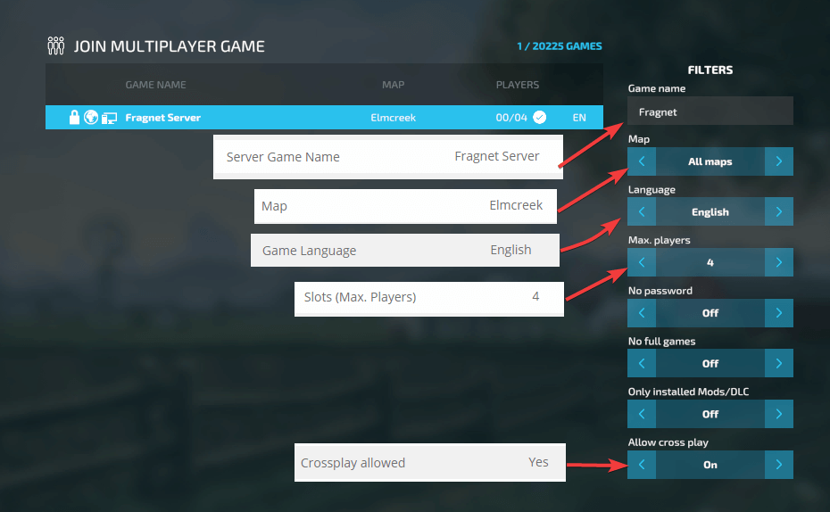

# Finding your Farming Simulator 22 server

Players find a Farming Simulator 22 server by its name in the in-game multiplayer browser.

1. Open the [Fragnet dashboard](VAR::PANEL_URL), go to **My servers** and select your server. Check that the status next to the server name shows **Online · ready to join**. If it shows **Game stopped** or **Server off**, select **Start game** in the header and wait until the map has loaded.

2. On the **Overview** tab, the **Joining the farm** card shows the **Server name** and the **Join password** (select the eye icon to show it, or the copy icon to copy it). Note them down. The language, crossplay and other settings are on the **Configuration** tab, and the number of player slots is shown in the header.

<!-- screenshot: fs22-joining-the-farm.png | FS22 server, Overview tab with the game running: header showing "Online · ready to join", the player slots and map; the "Joining the farm" card with Server name (copy icon), Join password (masked, with show and copy icons) and Savegame "Slot 1" with the map name -->

3. Start the game and go to **Multiplayer** → **Join Game**.

4. Set the filters to match your server: type the server name in the name filter, and make sure the other filters (password protected, language, max. players, crossplay) don't hide it.

5. Select your server, join it and enter the join password.

:::tip
If you have issues finding your server, check out our [overview of common problems](overview-of-common-issues.md).
:::
