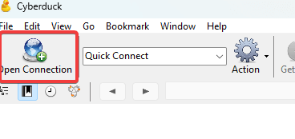
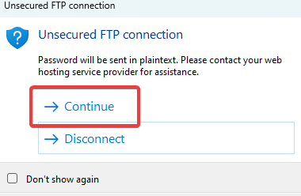
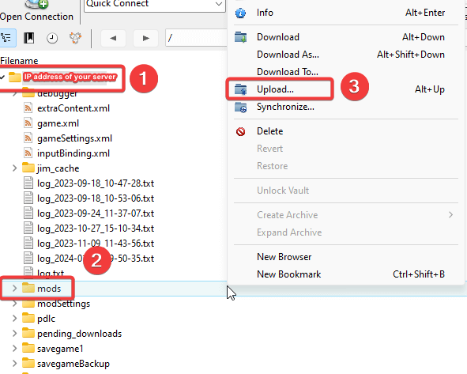

# Manage files via FTP

You can work with your FS22 server's files in two ways:

- the **Files** tab of your server in the [Fragnet dashboard](VAR::PANEL_URL), right in your browser,
- an SFTP or FTP client such as Cyberduck, FileZilla or WinSCP, which is best for large files or many files at once.

Your mods, savegames and logs are in the `serverProfile` folder. Mods go in `serverProfile/mods`.

:::tip
For mods and savegames, the **Mods** and **Savegames** tabs are usually easier: they check your files, show the result and can activate mods for you. Use files and SFTP for mods larger than 512 MB, many mods at once, or anything those tabs don't cover. See [Installing mods](installing-mods.md) and [Upload your savegame](upload-savegame.md).
:::

## Using the Files tab

1. Open the [Fragnet dashboard](VAR::PANEL_URL), go to **My servers** and select your server.
2. Open the **Files** tab. It opens in the `serverProfile` folder.
3. Select a folder to open it, or **Upload** to upload files into the folder you're in.

The **Files** tab also shows how much of your **Mod space** is used. Uploads over 100 MB should go through SFTP or FTP rather than the browser. For everything the **Files** tab can do, see [Files and SFTP](../../control-panel/file-manager.md).

## Connecting with an SFTP or FTP client

### Step 1: Get your login details

1. On the **Overview** tab of your server, find the **File access** card. (The **Files** tab shows the same details in its **FTP access** card.)
2. Select **SFTP** (recommended) or **FTP**. The port changes with your choice.
3. Note the **Host**, **Port** and **Username**. Use the copy icons to copy them.
4. Select **Reveal** to show the **Password**, or **Copy password** to copy it.

<!-- screenshot: fs22-file-access-card.png | FS22 server, Overview tab: the "File access" card with SFTP selected, showing Host, Username and Port with copy icons, the Password row with Reveal and Copy password, the Regenerate button and the "Open in SFTP client" link -->

:::info
The SFTP/FTP password is a separate password for file access. It isn't your Fragnet account password or the FS22 control panel password. Only members with the Owner, Admin or Service manager role can see it. **Regenerate** sets a new one, and connections that use the old password stop working.
:::

### Step 2: Connect

This example uses [Cyberduck](https://cyberduck.io/).

1. Download and install an SFTP client, such as Cyberduck, FileZilla or WinSCP.
2. In Cyberduck, select **Open Connection**.

3. Choose **SFTP (SSH File Transfer Protocol)**, or **FTP (File Transfer Protocol)** if you picked FTP in the dashboard.
4. Enter the **Host** as the server, then the **Port**, **Username** and **Password** from the dashboard. Don't add the port to the host name.
5. Select **Connect**.

You can also select **Open in SFTP client** (or **Open in FTP client**) on the **File access** card to open your default client with the host, port and username filled in.

If you connect with plain FTP, your client may warn that the connection is unsecured. You can select **Continue**, or connect with SFTP instead.

## Uploading and downloading files or folders

Once connected, you can upload files from your computer to the server and download files from the server, for example to keep your own copy of a savegame. To upload mods, open the `serverProfile` folder, right-click the **mods** folder and select **Upload...**. You can also drag and drop files.

Mods you upload this way are installed inactive. Activate them on the **Mods** tab: see [Installing mods](installing-mods.md#activating-deactivating-and-deleting-mods-and-dlcs).

:::warning
Stop the game before you replace or delete mod files or savegame files over SFTP. Changing files the running game is using can corrupt your savegame.
:::
