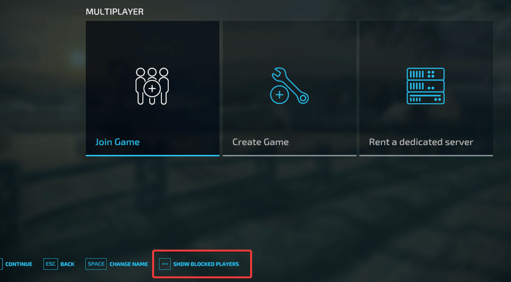
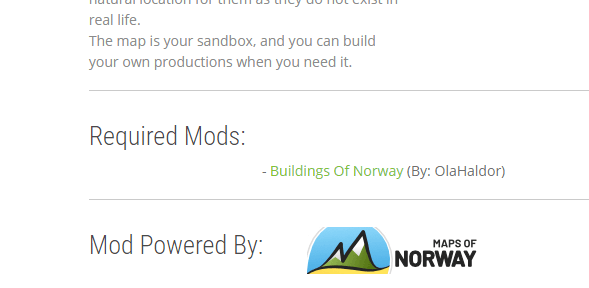

# Overview of common problems

## Unable to find my FS22 server

1. Make sure your game runs the latest available version of Farming Simulator 22.

2. Check that the server is ready. In the [Fragnet dashboard](VAR::PANEL_URL), go to **My servers**, select your server and check that the status shows **Online · ready to join**. While it shows **Loading map**, the server is still loading the savegame. Wait a few minutes after starting before you look for the server.

3. Check that you haven't blocked the server. You can see blocked servers in the **Blocked players** option in **Multiplayer**.


4. Refresh the server list by going back to the **Multiplayer** menu and selecting **Join Game**. See [Finding your Farming Simulator 22 server](find-server.md) for the right filters.

5. Check the server's game log for errors:
   1. Open the **Logs** tab of your server.
   2. Set **Source** to **Game** and **Show** to **Warnings & errors**.

   The **Recent warnings** card on the **Overview** tab also shows the latest warnings and errors, with a link to **Open game log**.

<!-- screenshot: fs22-logs-game-warnings.png | FS22 server, Logs tab: Source set to Game, Show set to "Warnings & errors", with a few warning and error lines listed and the Download filtered button visible -->

If you see this error:

```
Error: Could not start dedicated server with current mod setup because some dependencies are missing!
```

check all the active mods on the server for dependency mods that some mods need to run. All required dependencies have to be uploaded to your server and activated. On the **Mods** tab, a mod with a missing dependency shows **Missing:** followed by the mods it needs. See [Installing mods](installing-mods.md).

For example, if you have the mod map **Rennebu** active, it needs `Buildings Of Norway`. The dependencies of ModHub mods are listed in the **Required Mods** section of their ModHub page, and in the dashboard's **ModHub** view as **Requires:**.


If you have trouble finding the missing dependencies, [open a support ticket](VAR::SUPPORT_URL) and we'll help you.

## My server does not save

1. Check the server's game log for errors: open the **Logs** tab, set **Source** to **Game** and search for `Saving`.

   If you see this warning:

   ```
   Warning: Saving while already saving
   ```

   increase the auto-save interval. The warning means the save interval is too short: a new save starts before the previous one has finished, which can corrupt the savegame.

   1. Open the **Configuration** tab and select the **Saving & statistics** group.
   2. If the game is running, select **Stop game** in the notice and confirm with **Stop game**.
   3. Increase **Auto-save interval** (in minutes).
   4. Select **Save** at the bottom of the page, then **Start game** in the header.

2. Make sure the ***SuperPerson*** mod isn't active, as it tends to corrupt savegames.

3. Update all mods to the latest available versions.
