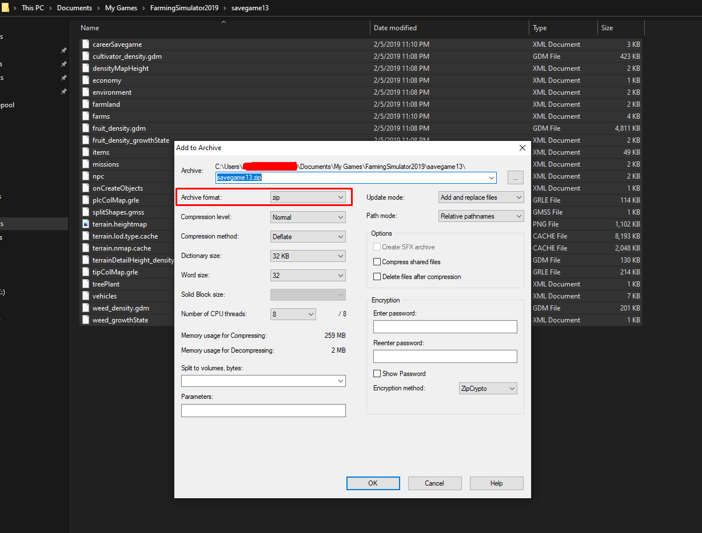

# Upload your savegame

Uploading your own savegame to the server is easy. Follow these steps and you'll have your savegame on the server in no time.

## Preparing the savegame

1. Make sure the server has the same mods as your savegame, installed and active. Otherwise the server may not be able to load it. See [Installing mods](installing-mods.md).
2. Locate your savegame on your PC. It's usually in `C:\Users\<YourUsername>\Documents\My Games\FarmingSimulator2022\savegameX`, where X is your savegame slot.
3. Open the savegame folder. You'll see many files, such as XML, GDM or cache files.
4. Select all files in that folder, right-click them and select **Add to archive**. Make sure the format is `.zip`. Don't zip the folder itself: `careerSavegame.xml` must be at the top level of the ZIP.

The name of the ZIP file becomes the savegame's name on the server. The ZIP can be up to 1 GB.

## Uploading the savegame

The server must be running, but the game must be stopped.

1. Open the [Fragnet dashboard](VAR::PANEL_URL), go to **My servers** and select your server.
2. Open the **Savegames** tab.
3. If the game is running, select **Stop game** in the notice at the top and confirm with **Stop game**. If the server is off, select **Start game** in the header first, then stop the game once it's running.
4. In the **Upload a savegame** card, choose an empty slot under **Slot**.
5. Select **Choose a savegame ZIP** and pick the ZIP you created.
6. Select **Upload save**.

<!-- screenshot: fs22-upload-savegame.png | FS22 server, Savegames tab with the game stopped: the Savegames list and the "Upload a savegame" card with an empty slot selected under Slot, a ZIP chosen and the progress showing "Uploaded" -->

The dashboard checks the savegame and sends it to the server. When it shows **Uploaded**, your savegame is listed in the **Savegames** card.

## Loading the savegame

Before you start the game, make sure your new savegame is the one the server loads:

1. Open the **Configuration** tab and select the **Farm & savegame** group.
2. Set **Savegame slot** to the slot you uploaded to.
3. Select **Save** at the bottom of the page.
4. Select **Start game** in the header.

On the **Savegames** tab, the slot that loads on start is marked **Loads on start**.

## Downloading and restoring savegames

- To keep a copy of a savegame, select **Download ZIP** next to it on the **Savegames** tab.
- The game makes automatic backups of your savegames. To go back to one, stop the game, then select **Restore** next to it in the **Automatic backups** card and confirm with **Restore backup**. This overwrites the slot the backup was made from.

If all 20 slots are in use, delete a savegame you don't need before uploading another. The dashboard can't delete savegames: open the FS22 control panel (on the **Overview** tab, select the open-in-new-tab icon next to **Panel address** on the **FS22 control panel** card), go to **Savegames** and select the delete icon under **Manage Savegames**.

If the upload is rejected, see [Frequently Asked Questions](fs22-faq.md#my-savegame-upload-is-rejected).
