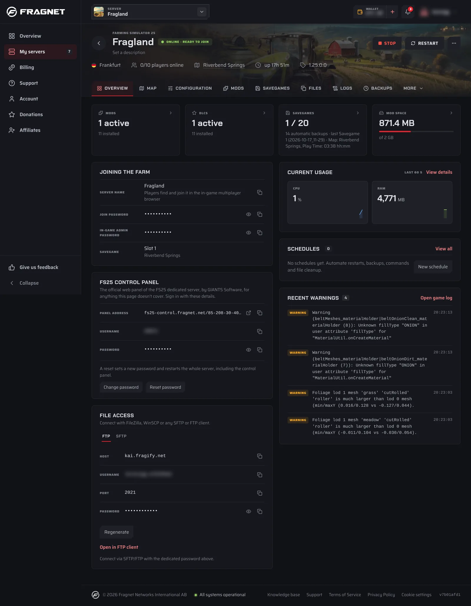
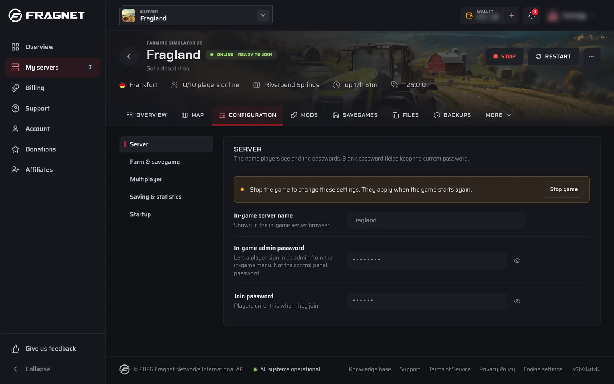
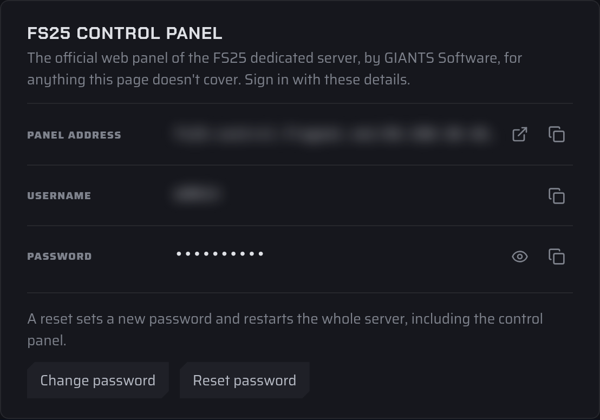

# Managing your FS25 server

You manage your Farming Simulator 25 server in the [Fragnet dashboard](VAR::PANEL_URL). This page shows where everything is: starting and stopping the game, changing the game settings, and opening the official FS25 control panel by GIANTS Software for the few things the dashboard doesn't cover.

## Open your server

1. Open the [Fragnet dashboard](VAR::PANEL_URL), go to **My servers** and select your server.
2. You land on the **Overview** tab. You can also switch servers with the server picker in the top bar.

## What each tab is for

| Tab | What you do there |
| --- | ----------------- |
| **Overview** | See the mods, DLCs, savegames and mod space at a glance. The **Joining the farm** card has the server name and passwords. Also here: the **FS25 control panel** card, **File access** (SFTP/FTP details), **Current usage**, **Schedules** and **Recent warnings** from the game log. |
| **Map** | A live map of the farm, the players online and a message to all players. Needs the free Fragnet Livemap mod. |
| **Mods** | Install mods from ModHub, upload mod ZIPs, and turn mods and DLCs on or off. See [Uploading mods](./uploading-mods.md). |
| **Savegames** | Download savegames, upload a savegame into an empty slot and restore automatic backups. See [Uploading your savegame](./uploading-your-savegame.md). |
| **Configuration** | The game settings: server name, passwords, savegame slot, map for a new farm, auto-save interval and more. |
| **Files** | Browse, upload and edit the server's files. It opens in the `serverProfile` folder, which holds your mods, savegames and logs. |
| **Logs** | The game and server logs, updated live. |
| **Backups** | Full backups of the server's files. See [Backups](../../control-panel/backups/index.md). |
| **Activity** | A record of what happened on the server and who did it. |
| **Billing** | Your plan, renewal, player slots and mod space. |

If your window is narrow, some tabs move into the **More** menu. Which tabs you see also depends on your role on the account: power controls, settings, mods and files need the Owner, Admin or Service manager role.

## Server status

The status pill next to the server name shows what the game is doing.

| Status | What it means |
| ------ | ------------- |
| **Online · ready to join** | The map has loaded and players can join. |
| **Loading map** | The game is running and loading the savegame. Wait until it shows **Online · ready to join**: players who join earlier can get stuck on the loading screen. |
| **Starting** / **Stopping** | The game is starting or stopping. |
| **Game stopped** | The server and the FS25 control panel are on, but the game isn't running. This is the state you need for changing settings, turning mods on or off and uploading savegames. |
| **Server off** | The whole server is off. |
| **Control panel unreachable** | The dashboard can't reach the FS25 control panel. See [Restart the whole server](#restart-the-whole-server). |

## Start, stop and restart the game

Farming Simulator servers have no console. Use the buttons in the header instead.

- **Start game** starts the game. If the whole server is off, it starts the server first. When the map has loaded, the dashboard shows "The map has loaded. Players can join the farm."
- **Stop** opens **Stop the game?**. Select **Stop game**. Everyone on the farm is disconnected.
- **Restart** opens **Restart the game?**. Select **Restart game**. Players are disconnected while the game restarts and the map loads again.

:::tip
Save in-game before you stop or restart the game if you need the latest progress.
:::

To run restarts or messages automatically, use a schedule (**Overview** tab → **Schedules** card → **New schedule**). On Farming Simulator servers a schedule can send a **Message** to the in-game chat instead of a console command; this needs the Fragnet Livemap mod. See [Schedules](../../control-panel/schedules/index.md).

### Restart the whole server

**Restart FS25 control panel** restarts the whole server: the FS25 control panel and the game. You need it:

- after you change the player slots or mod space of your plan, if the new values don't show yet,
- after you change the FS25 control panel password, so the new password applies,
- when the status shows **Control panel unreachable** for more than a few minutes.

1. In the header, open the **More actions** (⋯) menu.
2. Select **Restart FS25 control panel**.
3. Confirm with **Restart FS25 control panel**.

The same menu has **Refresh status**, which reads the server's status again, and **Open FS25 control panel**.

## Change the game settings

The game settings are on the **Configuration** tab, in four groups:

| Group | Settings |
| ----- | -------- |
| **Server** | **In-game server name**, **In-game admin password**, **Join password** |
| **Farm & savegame** | **Savegame slot**, **Map for a new farm**, **Starting money**, **Starting loan**, **Economic difficulty** |
| **Multiplayer** | **Server language**, **Allow crossplay**, **Pause when no players are online** |
| **Saving & statistics** | **Auto-save interval** (in minutes), **Statistics interval** (in seconds) |

The settings can only be changed while the game is stopped. They apply when the game starts again.

1. Open the **Configuration** tab and pick a group.
2. If the game is running, you see "Stop the game to change these settings." Select **Stop game** and confirm with **Stop game**.
3. Change the settings. Leave a password field empty to keep the current password.
4. Select **Save** in the bar at the bottom of the page.
5. Select **Start game** in the header.

:::info
If the server is off, the **Configuration** tab says the FS25 control panel is off. Select **Start FS25 control panel** to start the server without starting the game, then change the settings.
:::

The **Starting money**, **Starting loan**, **Economic difficulty** and **Map for a new farm** settings only apply when a new farm is created, which happens when the selected **Savegame slot** is empty.

The number of players is not a game setting: it's the player slots of your plan. Change it on the **Billing** tab (see [How do I upgrade or downgrade my server](../../FAQ/upgrade-downgrade-server.md)).

## The FS25 control panel

The FS25 control panel is the official web panel of the dedicated server, made by GIANTS Software. You don't need it for day-to-day management, but it is still there for anything the dashboard doesn't cover, for example:

- updating a ModHub mod to a newer version in place (see [Uploading mods](./uploading-mods.md#updating-mods)),
- deleting a savegame you no longer need (see [Uploading your savegame](./uploading-your-savegame.md#freeing-a-savegame-slot)).

The dashboard reads its mods, savegames and settings from the FS25 control panel, so changes you make in either place show up in both.

### Open the FS25 control panel

1. On the **Overview** tab, find the **FS25 control panel** card.
2. Select the open-in-new-tab icon next to **Panel address**. The panel opens in a new browser tab and signs you in.

You can also select **Open FS25 control panel** in the **More actions** (⋯) menu. If you need to sign in by hand, the card shows the **Username** (`admin`) and the **Password** (select the eye icon to show it, or the copy icon to copy it).

:::info
Only members with the Owner, Admin or Service manager role see the **FS25 control panel** card and the menu entry.
:::

### Change the control panel password

1. On the **FS25 control panel** card, select **Change password**.
2. Enter the **New password**: 8 to 64 characters, using letters, digits and `! # % * + , . : = ? @ ^ _ ~ -`.
3. Select **Save password**.
4. If the server is running, the FS25 control panel keeps the old password until it restarts. Select **Restart now** on the card (or **Restart FS25 control panel** in the **More actions** menu) and confirm. Everyone on the farm is disconnected and the panel is unavailable for about a minute. If the server is off, it uses the new password when it next starts.

To get a new random password instead, select **Reset password**. If the server is running, confirm with **Reset and restart**: the dashboard sets the new password and restarts the whole server. If the server is off, confirm with **Reset password**.

:::warning
Your server has three different passwords:

- the **FS25 control panel** password signs you in to the GIANTS web panel,
- the **In-game admin password** makes a player admin in the game (see [Becoming an admin](./becoming-an-admin.md)),
- the SFTP/FTP password gives access to the server's files.

Changing one doesn't change the others.
:::

## Files and SFTP

The **File access** card on the **Overview** tab shows the SFTP and FTP details for your server. Use them in FileZilla, WinSCP or any SFTP or FTP client, for example to upload large mods. The **Files** tab lets you work with the files in your browser and shows how much of your **Mod space** is used. See [Files and SFTP](../../control-panel/file-manager.md).

## Logs

The **Logs** tab shows the server's logs while the server is running.

- **Source**: **Game** (the game log, where mod errors show up) or **Server**.
- **Session**: **Latest session** or an earlier one.
- **Show**: **All messages**, **Warnings & errors** or **Errors only**.
- **Search**: find a mod, player or message.

Select **Download filtered** to save the lines that match your filters, or **Pause live** to stop the view from updating. The **Recent warnings** card on the **Overview** tab shows the latest warnings and errors, with a link to **Open game log**.

## Live map

The **Map** tab shows a live map of the farm, the time and weather, and the players online. It needs the Fragnet Livemap mod:

1. Stop the game.
2. On the **Map** tab, select **Install Fragnet Livemap**.
3. Start the game. The map appears about a minute after the savegame loads.

:::warning
While the Fragnet Livemap mod is on, console players can't join the server: the console versions of the game don't allow mods that run scripts.
:::

With the mod installed you can also send a chat message to everyone with **Message all players** → **Send**, and share the map with your community: turn on **Publish map** in the **Public map** card, then use **Copy link** or **Copy embed code**.
