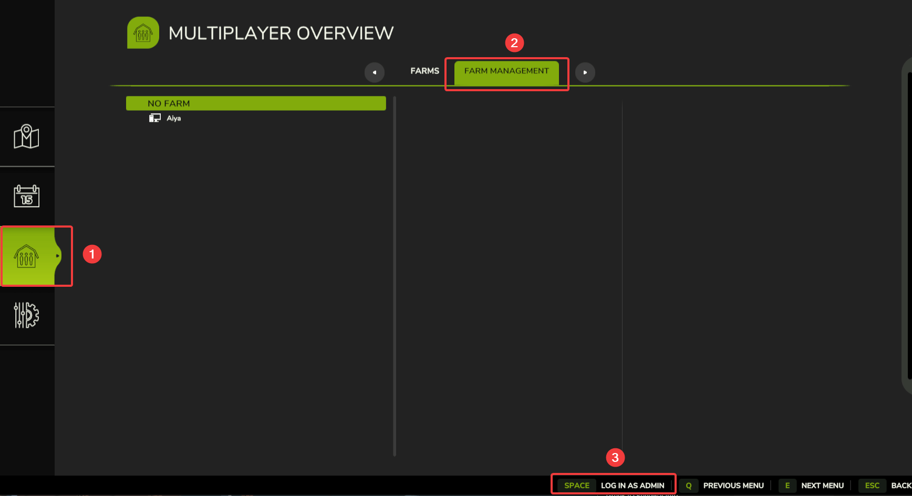
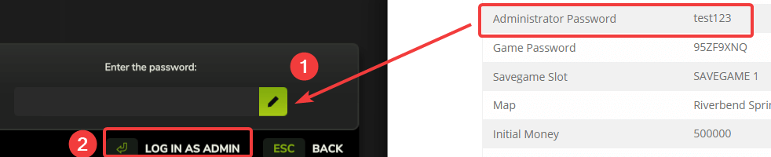

# Becoming an admin

This guide explains how to become an **admin** on your **Farming Simulator 2025 server**. You sign in as admin in the game with the server's in-game admin password.

## Step 1: Find the in-game admin password

1. Open the [Fragnet dashboard](VAR::PANEL_URL), go to **My servers** and select your server.
2. On the **Overview** tab, find the **Joining the farm** card.
3. Next to **In-game admin password**, select the eye icon to show the password, or the copy icon to copy it.

<!-- screenshot: fs25-ingame-admin-password-card.png | FS25 server, Overview tab: the "Joining the farm" card with the In-game admin password row revealed (eye icon toggled on) and its copy icon visible -->

:::info
The **In-game admin password** is shown only to members with the Owner, Admin or Service manager role. It is not the password of the FS25 control panel.
:::

### Change the in-game admin password

1. Open the **Configuration** tab and select the **Server** group.
2. If the game is running, select **Stop game** in the notice and confirm with **Stop game**. The settings can only be changed while the game is stopped.
3. Enter a new **In-game admin password**.
4. Select **Save** in the bar at the bottom of the page.
5. Select **Start game** in the header. The new password applies when the game starts.

## Step 2: Join your server

Find your server in the in-game multiplayer browser and join it with the **Join password**. See [Finding your server](./finding-your-server.md). You only need the admin password after you've joined.

## Step 3: Log in as admin

1. In the game, open the **Multiplayer Overview** menu.
2. Go to **Farm Management**.
3. Select **Log in as admin**.
4. Enter the in-game admin password from the dashboard.
5. Select **Log in as admin** again to confirm.

If the password is correct, you are now an admin on your FS25 server.
