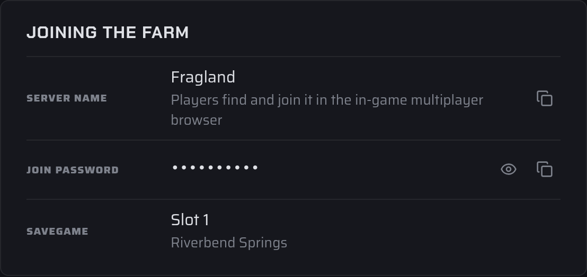
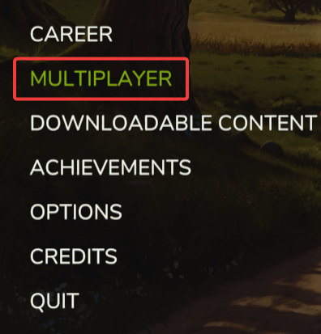
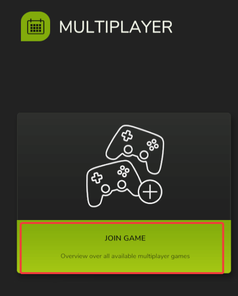
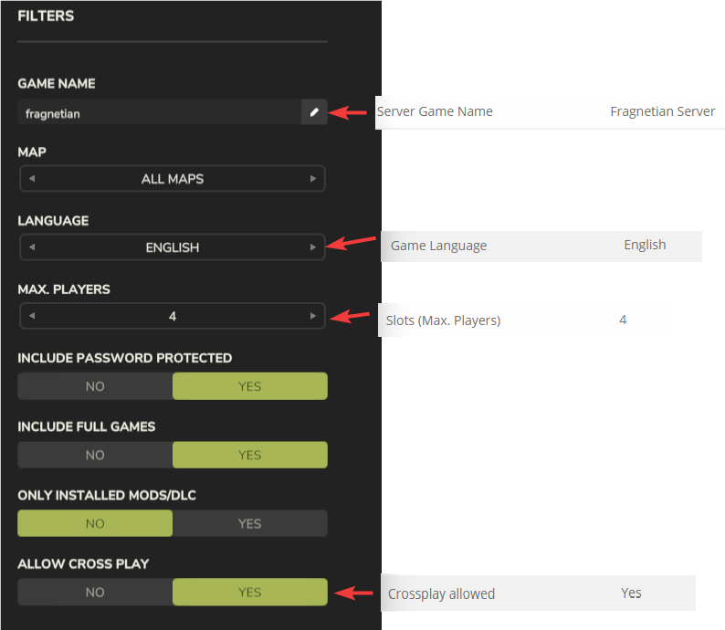

# Finding your server

Farming Simulator 25 servers have no IP address to connect to. Players find the server by its name in the in-game multiplayer browser. This guide shows where to find the name and password, and how to join.

## Step 1: Check the server is ready

1. Open the [Fragnet dashboard](VAR::PANEL_URL), go to **My servers** and select your server.
2. Check the status next to the server name. Players can join when it shows **Online · ready to join**.
   - If it shows **Game stopped** or **Server off**, select **Start game** in the header.
   - If it shows **Loading map**, wait. Joining before the map has loaded can leave players stuck on the loading screen.

## Step 2: Note the server name and password

On the **Overview** tab, the **Joining the farm** card shows:

- **Server name**: the name players see in the in-game browser. Use the copy icon to copy it.
- **Join password**: the password players enter when they join. Select the eye icon to show it. **None** means the server has no join password.
- **Savegame**: the slot and map the server loads.

To change the name or the password, see [Managing your FS25 server](./accessing-your-control-panel.md#change-the-game-settings) (**Configuration** tab → **Server** group → **In-game server name** and **Join password**).

## Step 3: Join in the game

1. Launch **Farming Simulator 25**.
2. Go to **Multiplayer** and select **Join Game**.

3. In **Filters**, type part of your server name in **Game Name**. Make sure the other filters don't hide your server: set **Include Password Protected** to **Yes** if your server has a join password, and **Only Installed Mods/DLC** to **No** if you don't have all of the server's mods yet.

4. Select your server, join it and enter the join password.

## Troubleshooting

### The server doesn't appear in the list

- **The game isn't ready.** The server only shows in the list once the status in the dashboard is **Online · ready to join**.
- **Game version mismatch.** Your game must run the same version as the server. You can see your game version in the top-left corner of the main menu. Fragnet updates servers to new game versions automatically: when an update is being rolled out, a notice on your server page tells you that the server restarts on the new version as soon as no players are online.
- **Filters.** Clear the **Game Name** filter and type the name again, exactly as the **Joining the farm** card shows it. Check the **Language**, **Max. Players** and **Allow Cross Play** filters too.
- **Crossplay.** Console players can only see the server if **Allow crossplay** is on (**Configuration** tab → **Multiplayer** group) and no mod that runs scripts, such as Fragnet Livemap, is active.

### I can't join because of mods

You need the same mods as the server. See [Cannot join the server because of mods](./uploading-mods.md#cannot-join-the-server-because-of-mods).

### Still can't find the server?

1. Check the filters again.
2. Restart the game and search again.
3. [Open a support ticket](VAR::SUPPORT_URL) and tell us your server name.
