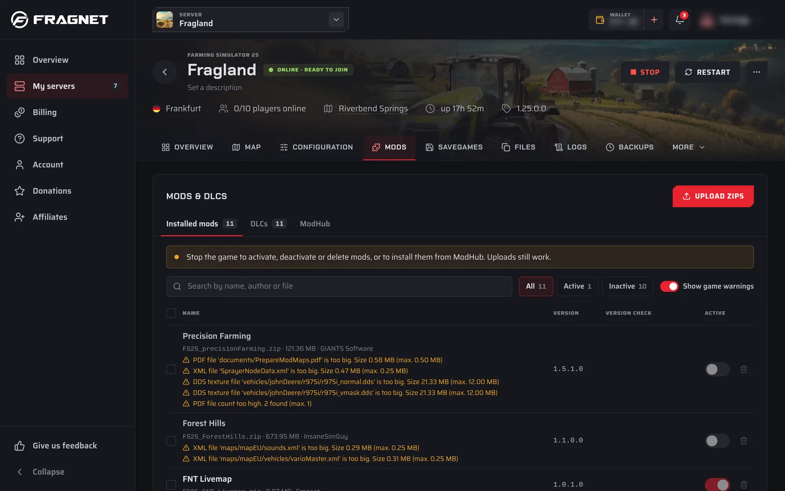
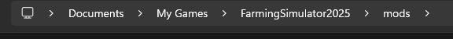
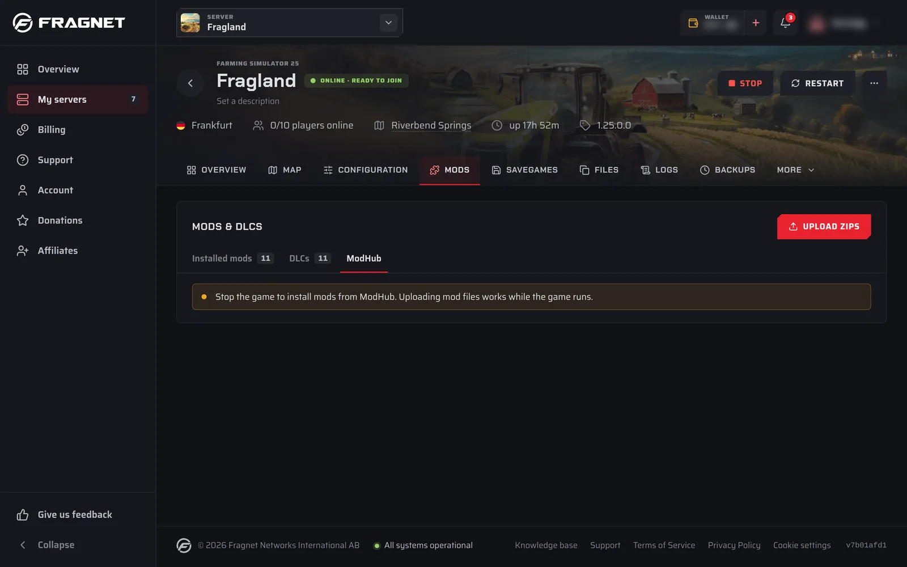
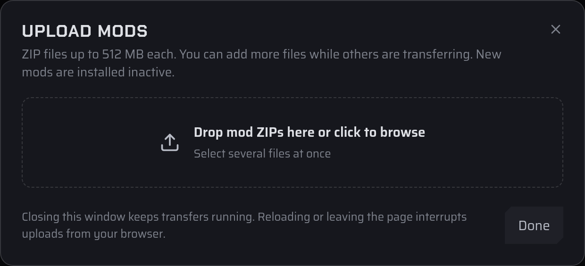
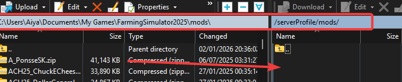
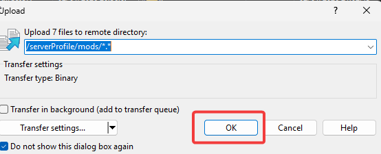
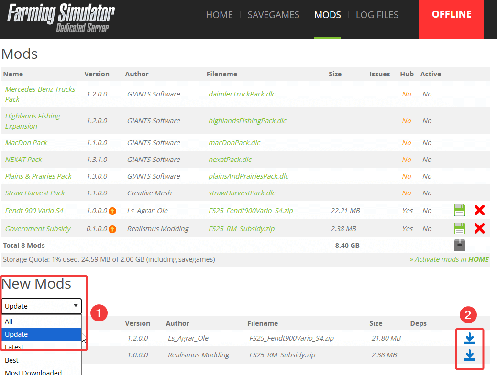
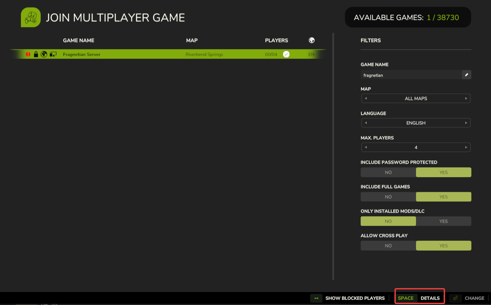
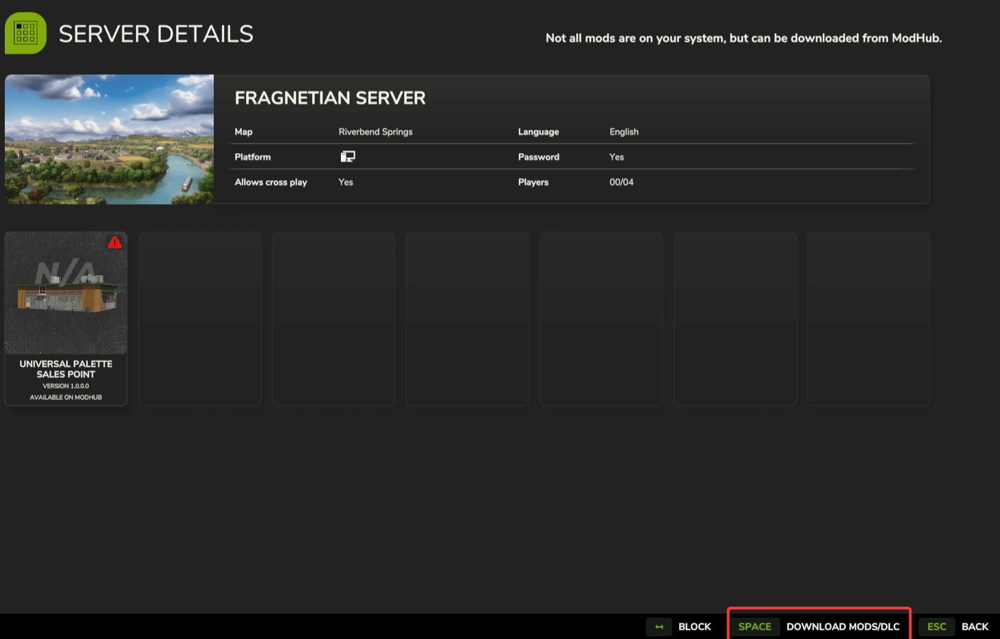

# Uploading Mods

This guide explains how to install, activate, update and remove **mods** on your **Farming Simulator 2025 server**. You manage mods on the **Mods** tab of your server in the [Fragnet dashboard](VAR::PANEL_URL).

## The Mods tab

1. Open the [Fragnet dashboard](VAR::PANEL_URL), go to **My servers** and select your server.
2. Open the **Mods** tab.

The **Mods & DLCs** card has three views:

- **Installed mods**: every mod on the server, with its version and whether it's active. Search by name, author or file, and filter by **All**, **Active** or **Inactive**.
- **DLCs**: the official DLCs. They are all included on the server and can be turned on or off, but not deleted.
- **ModHub**: the official ModHub catalogue, ready to install on the server.

The server has to be running for the dashboard to list mods. If it's off, select **Start FS25 control panel** in the notice.



:::info
Turning mods on or off, deleting them and installing from ModHub only work while the game is stopped. Uploading mod ZIPs works at any time. To stop the game, select **Stop** in the header and confirm with **Stop game**.
:::

## Where can I find FS25 mods?

FS25 mods are on the official ModHub: [farming-simulator.com/mods](https://www.farming-simulator.com/mods.php). You can install ModHub mods straight from the dashboard. Mods from other websites must be uploaded as `.zip` files.

On Windows, the mods you use in your own game are in your Documents folder:

```
C:\Users\<YourUsername>\Documents\My Games\FarmingSimulator2025\mods
```

To open this folder quickly:

1. Press **Win + R** to open the Run dialog.
2. Type `%USERPROFILE%\Documents\My Games\FarmingSimulator2025\mods` and press **Enter**.



## Installing mods

### Install from ModHub

1. Stop the game.
2. On the **Mods** tab, select **ModHub**.
3. Find the mod. The **Search this catalogue page** box searches the page you're on, so change pages with **Previous** and **Next** to search further. If you have the mod's ModHub link, paste it (or the mod ID) into the box that says "Paste a farming-simulator.com mod link or a mod ID" instead.
4. Select **Install** next to the mod.

The dashboard waits until the server lists the mod, then shows which file it was installed as. Large mods can take a few minutes. Mods that need other mods show **Requires:** with their names: install those too.



### Upload mod ZIPs

Use this for mods that aren't on ModHub, or ModHub mods you've downloaded yourself.

1. On the **Mods** tab, select **Upload ZIPs**.
2. Drop your mod ZIPs on the **Upload mods** window, or click it to browse. You can select several files at once.
3. Wait until each file shows **Installed**, then select **Done**.

Each ZIP can be up to 512 MB. A mod with the same file name as an installed mod can't be uploaded again: delete the old one first (see [Updating mods](#updating-mods)). Closing the window keeps transfers running, but reloading or leaving the page stops them.



### Upload via SFTP

Use SFTP for mods larger than 512 MB, or to upload many mods at once. You can use any SFTP client, such as WinSCP, FileZilla or Cyberduck. This example uses WinSCP.

1. On the **Overview** tab, find the **File access** card. Select **SFTP** and note the **Host**, **Port** and **Username**. Select **Reveal** to show the **Password**, or **Copy password** to copy it.
2. In WinSCP, start a new session. Set **File protocol** to **SFTP** and enter the host, port, username and password from the dashboard. Select **Login**. If you're asked whether to continue connecting to an unknown server, select **Accept**.
3. On the server side, open the `serverProfile/mods` folder.
4. Drag your mod ZIPs from your PC into that folder, and select **OK** to confirm the upload.





For more about SFTP, see [Files and SFTP](../../control-panel/file-manager.md).

## Activating mods

New mods are always installed inactive.

1. Stop the game.
2. On the **Mods** tab, in **Installed mods**, turn on the switch in the **Active** column next to the mod.
   To activate several mods at once, tick them, then select **Activate** in the bar that appears.
3. Wait for the message that the mod was activated. The dashboard checks the result against the server's mod list.
4. Select **Start game** in the header.

To turn a mod off, stop the game and turn off its switch, or tick several mods and select **Deactivate**. DLCs work the same way in the **DLCs** view.

:::warning
Everyone who joins needs the same active mods and DLCs as the server. If you activate a DLC, players need that DLC too.
:::

## Deleting mods

Only inactive mods can be deleted.

1. Stop the game.
2. Deactivate the mod.
3. Select the bin icon next to it (or tick several mods and select **Delete**).
4. Confirm with **Delete**.

Savegames that use a deleted mod may lose the items it added.

## Updating mods

When a ModHub page you've opened in the **ModHub** view lists a newer version of an installed mod, that mod shows an **Update to** badge with the new version in **Installed mods**. The dashboard can't update a mod in place yet. You have two options:

**Update in the FS25 control panel (ModHub mods)**

1. Stop the game.
2. Open the FS25 control panel: on the **Overview** tab, select the open-in-new-tab icon next to **Panel address** on the **FS25 control panel** card. See [Managing your FS25 server](./accessing-your-control-panel.md#the-fs25-control-panel).
3. In the FS25 control panel, go to **Mods**.
4. Under **New Mods**, select **Update** in the dropdown.
5. Select the download button next to the mod.
6. Wait a few minutes, then go back to the dashboard and select **Restart FS25 control panel** in the **More actions** (⋯) menu.



**Replace the mod**

1. Stop the game.
2. Deactivate and delete the old mod in the dashboard.
3. Install the new version from **ModHub**, or upload the new ZIP with **Upload ZIPs**.
4. Activate it and start the game.

## Mod space

Your plan includes a fixed amount of mod space. The **Mod space** tile on the **Overview** tab and the bar at the bottom of the **Mods** tab show how much you use. When it's full, uploads and installs fail with "Mod space full. Delete mods or add mod space." Delete mods you don't use, or select **Add storage** to add mod space on the **Billing** tab. See [How do I upgrade or downgrade my server](../../FAQ/upgrade-downgrade-server.md).

## Troubleshooting

### Cannot activate a mod

The most common cause is a missing dependency: the mod needs another mod that isn't installed or active. In **Installed mods**, such a mod shows **Missing:** followed by the mods it needs. Install and activate those first, then activate the mod.

Turn on **Show game warnings** to also see other problems the game reports for each mod.

If the dashboard says GIANTS didn't activate a mod, the usual causes are:

- a broken or wrongly packed ZIP, such as a GitHub "-main" download with an extra folder inside,
- a mod made for another game or version,
- a required mod that isn't installed.

<!-- screenshot: fs25-mods-missing-dependency.png | FS25 server, Mods tab, Installed mods with Show game warnings on: one mod row showing "Missing:" followed by the name of a required mod, and the warning icon for an issue reported by the game -->

### The game won't start because of a map mod

If **Start game** fails with "GIANTS can't start this savegame: its map needs mods that aren't installed or active", open the **Logs** tab to see which mods are missing, then install or activate them on the **Mods** tab.

### Cannot join the server because of mods

**ModHub mods:** in the game's server browser, select your server, select **Details**, then **Download Mods/DLCs**.





**Other mods:** download the mod and put it in your local mods folder:

```
C:\Users\<YourUsername>\Documents\My Games\FarmingSimulator2025\mods
```

To open this folder quickly, press **Win + R**, type `%USERPROFILE%\Documents\My Games\FarmingSimulator2025\mods` and press **Enter**.
