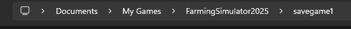
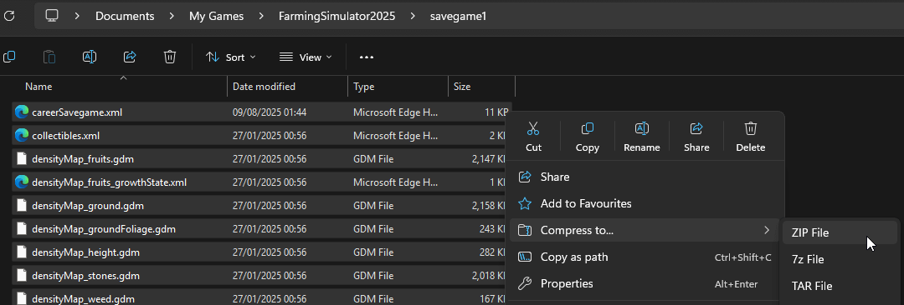
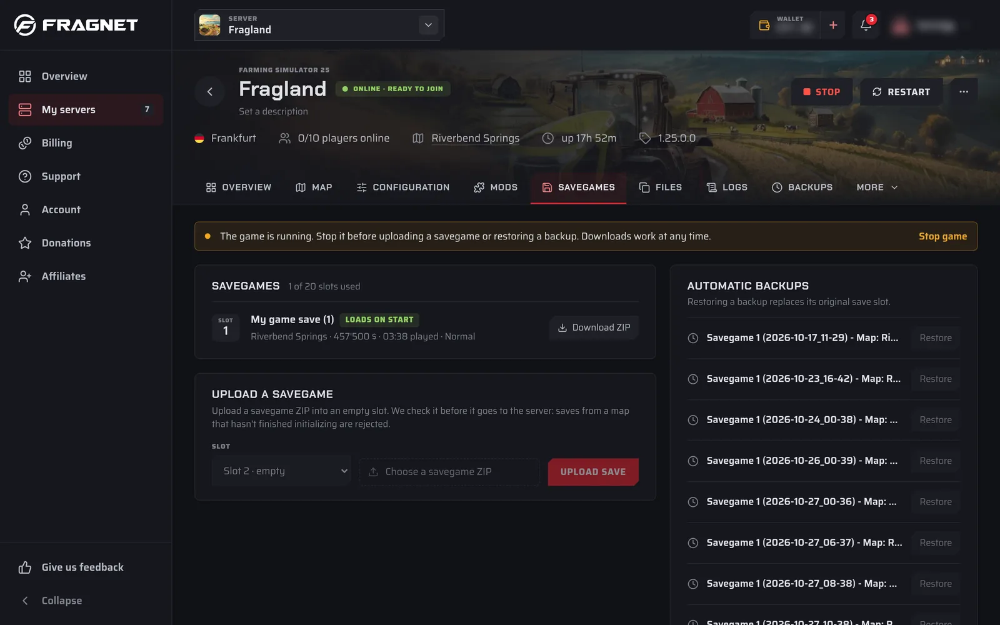

# How to Upload a Savegame to your Farming Simulator 2025 Server

This guide explains how to upload a **single-player or local multiplayer savegame** to your **dedicated Farming Simulator 2025 server**, and how to make the server load it.

A savegame is stored in a folder named `savegameX` (for example `savegame1`, `savegame2` and so on). Each savegame folder contains files such as:

- `careerSavegame.xml`
- `vehicles.xml`
- `placeables.xml`
- `farmland.xml`
- `items.xml`
- `economy.xml`

## Before you start

1. **Make sure the mods match.** The server should have the same mods and versions as your local save, and they must be active. Otherwise the server can hang at 100% while loading, or refuse to start the savegame because the map or other mods are missing. See [Uploading mods](./uploading-mods.md).
2. **Check there's an empty slot.** The server has 20 savegame slots, and you can only upload into an empty one.

## Step 1: Locate your local savegame

On Windows, savegames are stored in your Documents folder:

```
C:\Users\<YourUsername>\Documents\My Games\FarmingSimulator2025
```



To open this folder quickly:

1. Press **Win + R** to open the Run dialog.
2. Type `%USERPROFILE%\Documents\My Games\FarmingSimulator2025` and press **Enter**.

Inside this folder are subfolders named `savegame1`, `savegame2` and so on, one for each save slot.

:::tip
Load the savegame in your own game and save it once before you upload it. Saves from a map that hasn't finished loading are rejected by the server.
:::

## Step 2: Prepare the savegame

Make a ZIP archive of the **contents** of the savegame folder, not of the folder itself. `careerSavegame.xml` must be at the top level of the ZIP.



**Correct:**

```
My Farm.zip
├── careerSavegame.xml
├── vehicles.xml
└── ...
```

**Incorrect:**

```
My Farm.zip
└── savegame1
    ├── careerSavegame.xml
    └── ...
```

The name of the ZIP file becomes the savegame's name on the server, so give it a name you'll recognise. The ZIP can be up to 1 GB.

## Step 3: Upload to the server

The server must be running, but the game must be stopped.

1. Open the [Fragnet dashboard](VAR::PANEL_URL), go to **My servers** and select your server.
2. Open the **Savegames** tab.
3. If the game is running, select **Stop game** in the notice at the top and confirm with **Stop game**. If the server is off, select **Start game** in the header first, then stop the game once it's running.
4. In the **Upload a savegame** card, choose an empty slot under **Slot**.
5. Select **Choose a savegame ZIP** and pick the ZIP you made.
6. Select **Upload save**.

The upload goes through **Uploading**, **Checking savegame** and **Sending to server**. When it shows **Uploaded**, the savegame is in the slot you chose.



## Step 4: Load the savegame

1. Open the **Configuration** tab and select the **Farm & savegame** group.
2. Set **Savegame slot** to the slot you uploaded to.
3. Select **Save** in the bar at the bottom of the page.
4. Select **Start game** in the header.

On the **Savegames** tab, the slot that loads when the game starts is marked **Loads on start**.

## Downloading savegames

On the **Savegames** tab, select **Download ZIP** next to a savegame. Downloads work at any time, even while the game is running.

## Restoring an automatic backup

The game makes automatic backups of your savegames. They are listed in the **Automatic backups** card on the **Savegames** tab.

1. Stop the game.
2. Select **Restore** next to the backup.
3. Confirm with **Restore backup**.

Restoring a backup overwrites the slot it was made from. Download the current savegame first if you want to keep it.

## Freeing a savegame slot

If all 20 slots are in use, you need to delete a savegame before you can upload another one. The dashboard can't delete savegames, so use the FS25 control panel:

1. Download the savegame first if you want to keep it.
2. Stop the game.
3. Open the FS25 control panel: on the **Overview** tab, select the open-in-new-tab icon next to **Panel address** on the **FS25 control panel** card. See [Managing your FS25 server](./accessing-your-control-panel.md#the-fs25-control-panel).
4. In the FS25 control panel, go to **Savegames**.
5. Under **Manage Savegames**, select the delete icon next to the savegame.

## Troubleshooting

### The upload is rejected

- **"This isn't a complete savegame"**: `careerSavegame.xml` is missing from the top level of the ZIP, or the save comes from a map that hadn't finished loading. Re-create the ZIP from the files inside the savegame folder, not the folder itself. If that doesn't help, load and save the game locally once more.
- **"This ZIP can't be used"**: the ZIP is damaged or contains paths the server doesn't accept. Create it again.
- **"This file is larger than 1 GB"**: savegame uploads can be up to 1 GB.
- **"The game is running"**: stop the game, then try again.

### The server can't start with the uploaded savegame

- **Missing map mod**: the savegame uses a mod map that isn't installed or active on the server. Install and activate it on the **Mods** tab.
- **Missing mod dependencies**: other mods the savegame uses aren't installed. Open the **Logs** tab, set **Show** to **Warnings & errors**, and look for missing mods. Then install and activate them on the **Mods** tab.
