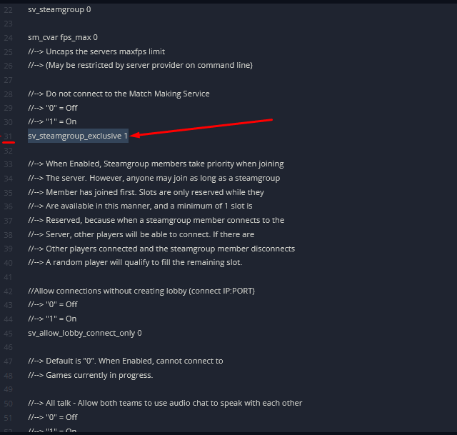

# Enabling matchmaking on Left 4 Dead 2 server
By default, our servers aren't open to matchmaking, meaning no other players can join via the **Quick Match** option in the game.

If you wish to have a server that's available to that option, follow these steps:

1. Open the [Fragnet dashboard](VAR::PANEL_URL), go to **My servers** and select your server. Stop your server. See [Power controls](../../control-panel/basics.md#power-controls).

2. Open the **Files** tab.

3. Go to `left4dead2/cfg/server.cfg` and select it to open it in the editor. See [Edit a file](../../control-panel/file-manager.md#edit-a-file).

4. Find the line `sv_steamgroup_exclusive 0` (line 31 in the default `server.cfg`) and set it to 1, so it looks like this: `sv_steamgroup_exclusive 1`.

5. Once edited, select **Save file**.

6. Start the server again, and now players can join your server via **Quick Match**.
